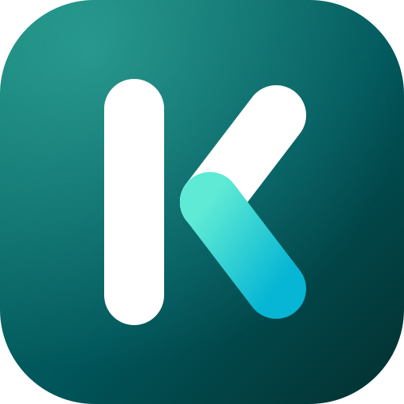

# Kampus

**KAMPUS** — **K**nowledge **A**cademic **M**odular **P**latform for **U**niversal **S**tudy.

A modular learning platform written from scratch in Rust.

## Licence

Proprietary. Copyright (c) 2026 Didactika, all rights reserved. See [LICENSE](LICENSE).
