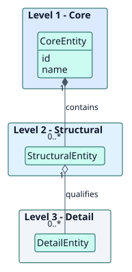
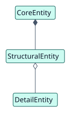

# Domain model

## Purpose

The business concepts of Kampus, module by module. Each module has its own document with entities, rules, flows, lifecycles, customisation points and contracts.

| Module | Document | Status |
| --- | --- | --- |
| `kampus-access`: scopes, roles, permissions | [access.md](./access.md) | accepted |

## Hierarchy of entities

The vertical position of an entity expresses its importance to the project objective. It is not UML inheritance or composition.

| Level | Meaning | Entities | Why they are here |
| --- | --- | --- | --- |
| 1 | Core: the project cannot exist without them | Scope, Permission, Role, Grant | Every operation is a permission check in a scope |
| 2 | Structural: depend directly on the core | Role permission, Permission override, Permission value | Define what roles allow, and where |
| 3 | Detail: qualify or specialise level 2 | Risk, Role template, Role allowance, View-as session | Constrain and template roles |
| 4 | Support: catalogues, audit, configuration | Permission decision | Explanations |

## Diagrams

## Entity dictionary

Per module: [access](./access.md#entities).

## Business rules

Per module: [access](./access.md#business-rules) (RN-001 to RN-021).

## Lifecycles

State diagrams live in [entity-states](./entity-states/entity-states.svg).
