# Domain model

## Purpose

The business concepts of Kampus, module by module. Each module has its own document with entities, rules, flows, lifecycles, customisation points and contracts.

| Module | Document | Status |
| --- | --- | --- |
| `kampus-access`: scopes, roles, permissions | [access.md](./access.md) | accepted |
| `kampus-identity` and `kampus-users`: accounts, sign-in, profiles, system groups | [identity.md](./identity.md) | accepted |
| `kampus-courses`: categories, courses, sections, groups | [courses.md](./courses.md) | accepted |
| `kampus-enrol`: methods, enrolments, requests | [enrolment.md](./enrolment.md) | accepted |
| `kampus-activities`: course modules, access conditions, exceptions | [activities.md](./activities.md) | accepted |
| `kampus-records`: academic records | [records.md](./records.md) | accepted |
| `kampus-progress`: activity and course progress | [progress.md](./progress.md) | accepted |
| `kampus-files`: blobs, files, uploads, quotas | [files.md](./files.md) | accepted |
| `kampus-events`: events, deliveries, audit log | [events.md](./events.md) | accepted |
| `kampus-notify`: notifications and messaging | [notify.md](./notify.md) | accepted |
| `kampus-calendar`: entries, activity dates, subscriptions | [calendar.md](./calendar.md) | accepted |
| `kampus-settings`: declared settings resolved by scope | [settings.md](./settings.md) | accepted |
| `kampus-tasks`: jobs and schedules | [tasks.md](./tasks.md) | accepted |
| `kampus-privacy`: data requests, retention, policies | [privacy.md](./privacy.md) | accepted |
| `kampus-i18n`: messages, language packs, language resolution | [languages.md](./languages.md) | accepted |
| `kampus-api`: API clients, OAuth, webhooks | [integrations.md](./integrations.md) | accepted |
| `kampus-customise`: terms, custom fields, layouts, themes, rules, feature flags | [customise.md](./customise.md) | accepted |
| `kampus-plugin-host`: plugins, capabilities, lifecycle | [plugins.md](./plugins.md) | accepted |

## Hierarchy of entities

The vertical position of an entity expresses its importance to the project objective. It is not UML inheritance or composition.

| Level | Meaning | Entities | Why they are here |
| --- | --- | --- | --- |
| 1 | Core: the project cannot exist without them | Scope, Principal, Permission, Role, Grant; Account, Session, Profile; Course category, Course, Section, Group; Method instance, Enrolment; Course module, Exception; Grade record, Grade entry, Grade; Activity progress, Course progress; Blob, File; Event, Audit entry; Notification, Conversation, Message; Calendar entry, Activity date; Setting value; Job; Data request; API client; Custom field, Custom field value, Rule; Plugin, Plugin version, Installation | Every operation is a permission check in a scope |
| 2 | Structural: depend directly on the core | Role permission, Permission override, Permission value; Credential, External identity, Second factor, API token, Profile field, System group, Course layout, Group set, Group membership, Enrolment method, Enrolment grant, Enrolment request, Linked source, Activity type, Access condition, Grade category, Progress rule, Course criterion, File area, Owner link, Upload session, Event type, Outbox entry, Listener, Delivery, Notification type, Channel, Preference, Member, Recurrence, Subscription, Imported entry, Setting definition, Job type, Schedule, Request item, Privacy handler, Data category, Policy, Language, Message, Language pack, Translation, API scope, Authorisation, Webhook, Term, Term override, Layout, Widget placement, Navigation menu, Theme, Feature flag, Plugin type, Capability, Capability grant | Define what roles allow, and where |
| 3 | Detail: qualify or specialise level 2 | Risk, Role template, Role allowance, View-as session, Quota, Conversion, Template, Message deletion, Block, Fixed value, Schedule tick, Retention rule, Legal hold, Acceptance, Export package, Customised message, Rate limit, Customisation package, Plugin migration | Constrain and template roles |
| 4 | Support: catalogues, audit, configuration | Permission decision, Trash item, Retention policy, Export feed, Setting change, Job attempt, Webhook delivery, Rule run, Plugin failure | Explanations |

## Diagrams

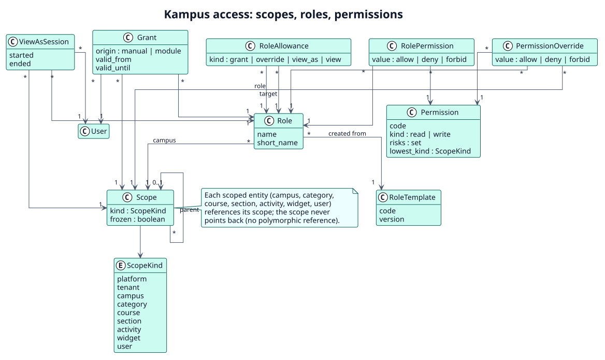

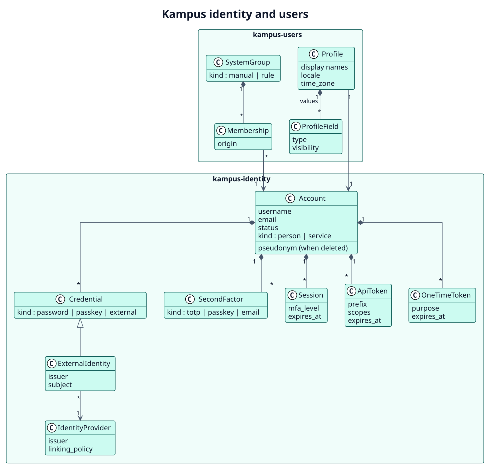

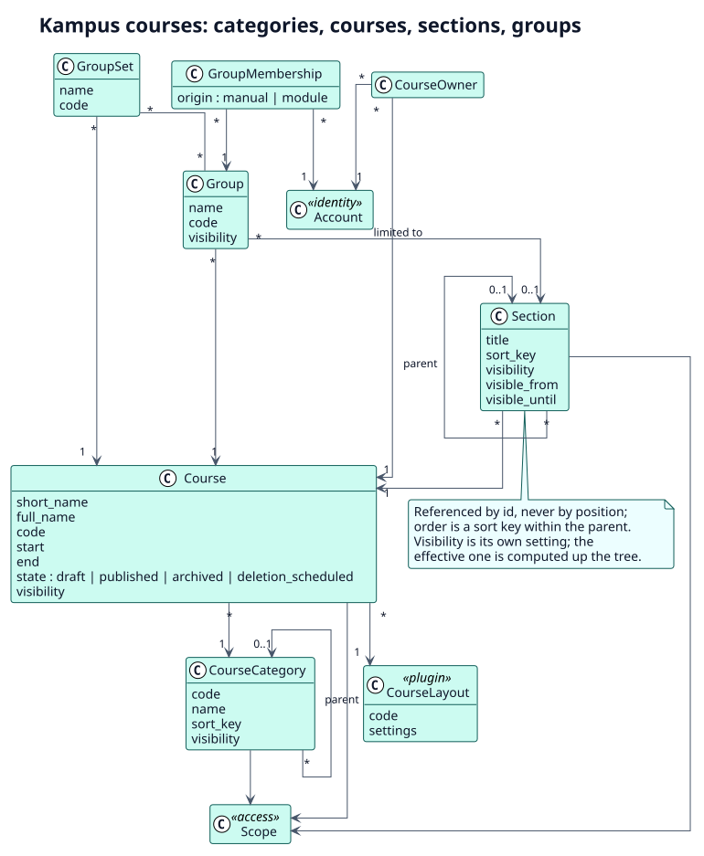

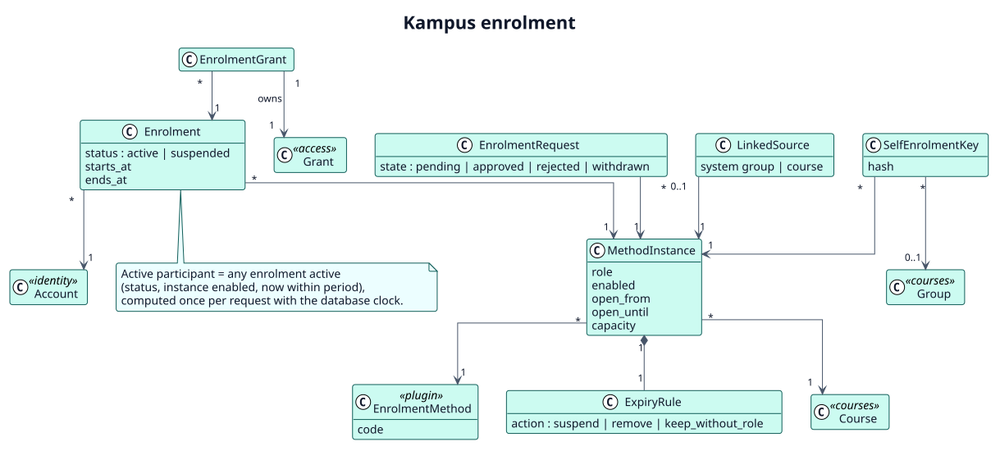

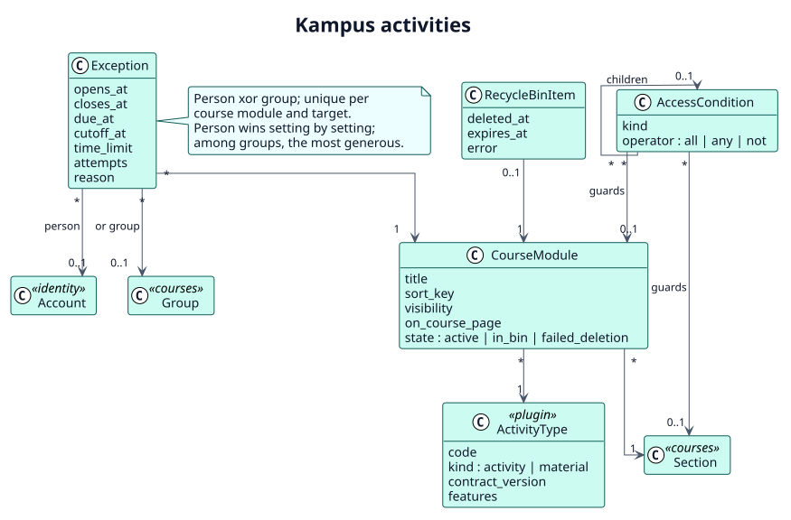

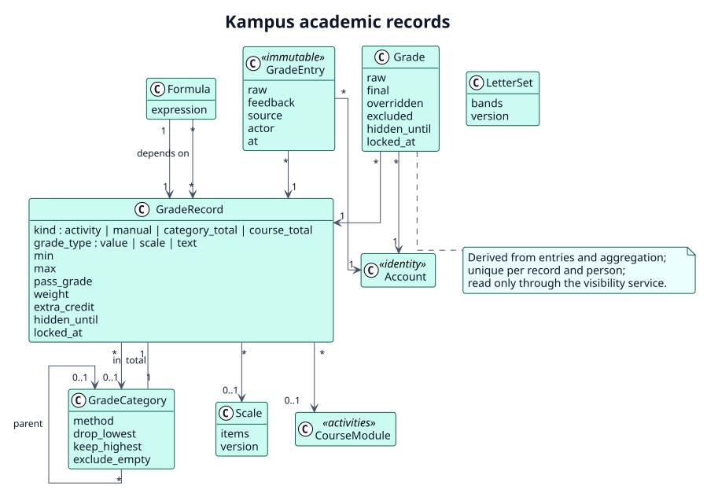

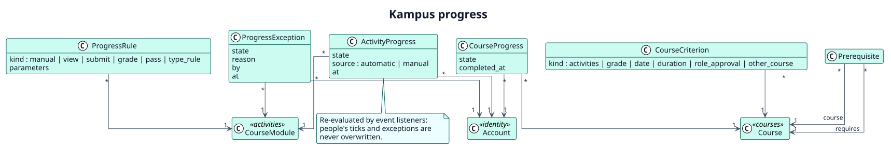

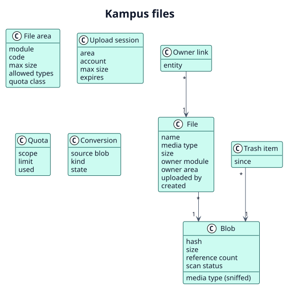

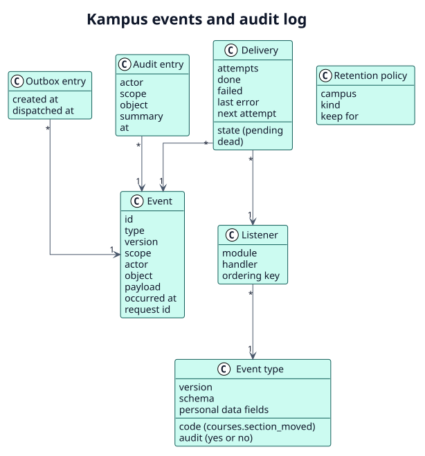

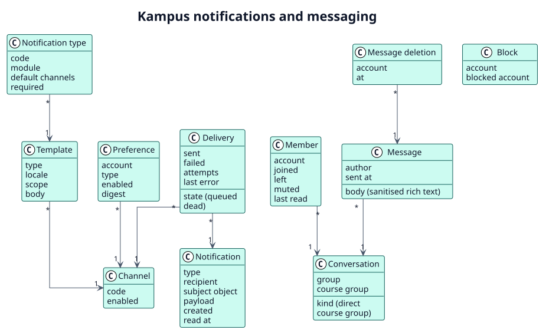

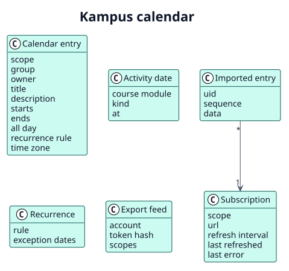

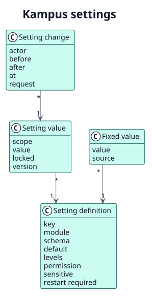

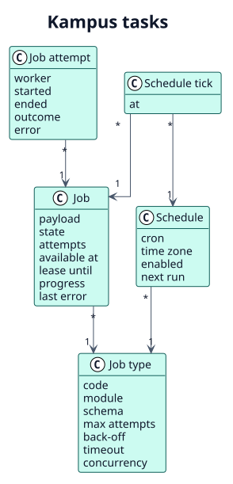

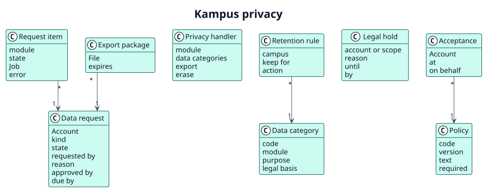

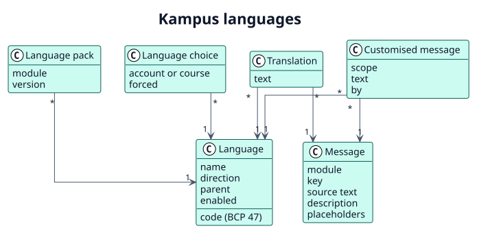

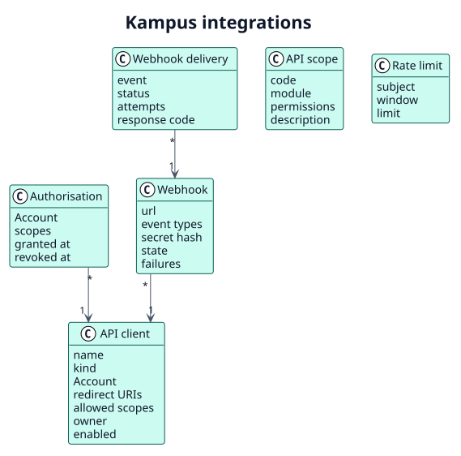

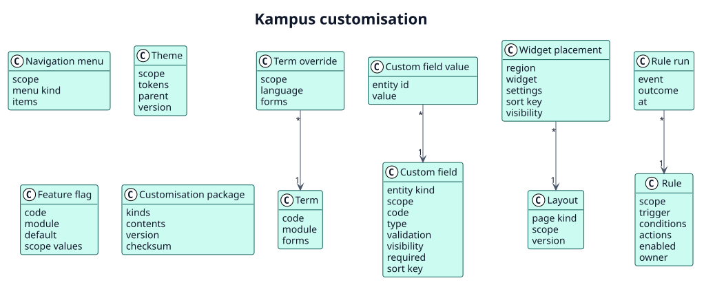

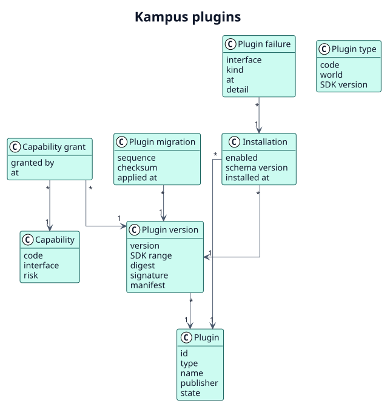

## Entity dictionary

Per module: [access](./access.md#entities), [identity](./identity.md#entities), [courses](./courses.md#entities), [enrolment](./enrolment.md#entities), [activities](./activities.md#entities), [records](./records.md#entities), [progress](./progress.md#entities), [files](./files.md#entities), [events](./events.md#entities), [notify](./notify.md#entities), [calendar](./calendar.md#entities), [settings](./settings.md#entities), [tasks](./tasks.md#entities), [privacy](./privacy.md#entities), [languages](./languages.md#entities), [integrations](./integrations.md#entities), [customisation](./customise.md#entities), [plugins](./plugins.md#entities).

## Business rules

Per module: [access](./access.md#business-rules) (RN-001 to RN-021), [identity](./identity.md#business-rules) (RN-022 to RN-039), [courses](./courses.md#business-rules) (RN-040 to RN-059), [enrolment](./enrolment.md#business-rules) (RN-060 to RN-074), [activities](./activities.md#business-rules) (RN-075 to RN-092), [records](./records.md#business-rules) (RN-095 to RN-110), [progress](./progress.md#business-rules) (RN-115 to RN-125), [files](./files.md#business-rules) (RN-126 to RN-136), [events](./events.md#business-rules) (RN-137 to RN-146), [notify](./notify.md#business-rules) (RN-147 to RN-155), [calendar](./calendar.md#business-rules) (RN-156 to RN-161), [settings](./settings.md#business-rules) (RN-162 to RN-169), [tasks](./tasks.md#business-rules) (RN-170 to RN-177), [privacy](./privacy.md#business-rules) (RN-178 to RN-186), [languages](./languages.md#business-rules) (RN-187 to RN-194), [integrations](./integrations.md#business-rules) (RN-195 to RN-202), [plugins](./plugins.md#business-rules) (RN-203 to RN-211), [customisation](./customise.md#business-rules) (RN-212 to RN-222).

## Lifecycles

State diagrams live in [entity-states](./entity-states/entity-states.svg).
