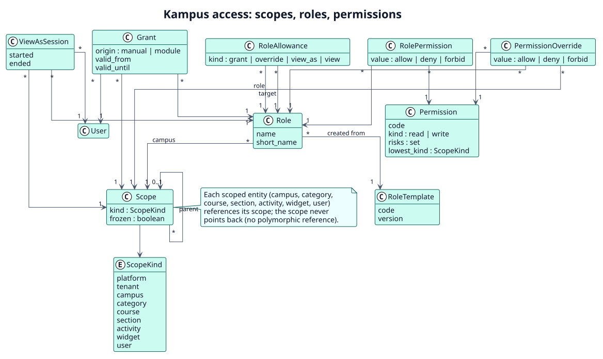

# Access: scopes, roles, permissions

Module `kampus-access` (level 1, [architecture](../03-design/architecture.md#modules)). Every operation in Kampus is allowed or denied by asking whether the actor holds a **permission** in a **scope** (DEC-017). People receive permissions through **roles** granted in scopes; a role's permissions can be adjusted in a scope by **permission overrides**. Sections are scopes of their own (DEC-007). Requirements RF-020 to RF-024; decisions DEC-027 to DEC-029; highlights HL-001, HL-011 to HL-014, HL-020 to HL-022.

## Entities

| Entity | Level | Definition | Key attributes |
| --- | --- | --- | --- |
| Scope | 1 | A node of the scope tree. Every campus, category, course, section, activity, widget and user has exactly one | kind, parent, campus, frozen |
| Scope kind | 1 | platform, tenant, campus, category, course, section, activity, widget, user | code, allowed parent kinds |
| Permission | 1 | One thing an actor may do, declared by a module or plugin (DEC-015) | code (`courses.course.update`), kind (read or write), risks, lowest scope kind, module |
| Role | 1 | A named set of permission values, defined per campus from a role template | campus, name, short name, template and template version, assignable scope kinds |
| Principal | 1 | Anything that can hold grants; every account is a principal with the same id, so access never depends on identity (DEC-079) | kind, campus |
| Grant | 1 | A principal holds a role in a scope, from a start to an optional end | role, scope, Principal, origin (manual or a module), valid from, valid until, granted by |
| Role permission | 2 | The value a role gives a permission: allow, deny or forbid | role, permission, value |
| Permission override | 2 | The value of a role for a permission in one scope and its descendants | scope, role, permission, value |
| Permission value | 2 | `allow`, `deny` (can be allowed again lower down) or `forbid` (cannot be allowed by any role or lower scope); no row means inherit | value |
| Risk | 3 | What a permission can expose: personal data, configuration, script injection, data loss, trust escalation, spam | typed set |
| Role template | 3 | A versioned definition of default permission values that roles are created from and compared with (manager, teacher, learner…) | code, version, values |
| Role allowance | 3 | Which roles a role may grant, override, view as, or see | role, target role, kind |
| View-as session | 3 | A user temporarily sees a scope as another role, read-only and audited | user, scope, role, started, ended |
| Permission decision | 4 | The result of a check with its explanation | allowed, deciding grants, values and scopes |

## Business rules

| ID | Rule |
| --- | --- |
| RN-001 | Scopes form one tree: platform → tenant → campus → category (nested) → course → section (nested) → activity → widget; user scopes hang from their campus. A widget can hang from any scope that shows it. Each scoped entity has exactly one scope, created and deleted with it. |
| RN-002 | A section is a scope (DEC-007): roles can be granted, permissions overridden, settings, visibility and availability set on it, and its activities and subsections inherit them. |
| RN-003 | A check considers every grant of the actor that is **active now** (`valid_from` ≤ now < `valid_until`) on the scope and on its ancestors. |
| RN-004 | For each granted role, the value of a permission is the first one found walking from the checked scope up to the campus: an override on the way, otherwise the role's own value, otherwise none. |
| RN-005 | If any granted role has `forbid` for the permission anywhere on the path, the check fails, whatever other roles allow. |
| RN-006 | Otherwise the check passes if at least one granted role ends with `allow`; with no `allow`, it fails. |
| RN-007 | There is **no bypass**: administration is a role granted in the platform, tenant or campus scope, checked like any other (HL-011). |
| RN-008 | A change that would leave a campus with no active person able to manage access in it is refused. |
| RN-009 | Visitors and the guest role never receive a write permission or one with risks, whatever a role or override says. |
| RN-010 | Suspended or deleted accounts fail every check. |
| RN-011 | A frozen scope allows only read permissions in it and its descendants, for everyone, until it is unfrozen; unfreezing needs `access.scope.freeze`. |
| RN-012 | A permission is meaningful only in scopes of its lowest kind and above; overriding it below that kind is refused. |
| RN-013 | Granting a role needs `access.grant.create` in the scope and an allowance from one of the actor's roles to grant that role; the role must be assignable in that scope kind. |
| RN-014 | Overriding needs `access.override.update` and an allowance to override that role; a permission with risks needs `access.override.risky` as well. |
| RN-015 | Setting a value to inherit deletes the override; every change to grants, overrides and roles is recorded with who, when and the previous value. |
| RN-016 | A grant made by a module (an enrolment, a system group sync) is owned by that module: only the module removes it, through its own link to the grant; manual grants are removed by people with `access.grant.delete`. |
| RN-017 | A role is created from a template version; resetting a role to its template shows the differences first and applies them only when confirmed, and an unknown template is an error, never an empty role. |
| RN-018 | "View as" needs `access.view_as` in the scope and an allowance for the target role. It is read-only, limited to the scope and its descendants, ends with the session or on request, and is recorded in the audit log (HL-014). |
| RN-019 | Every check can return its explanation: the grants considered, the value found for each role and the scope where it was set, and the rule that decided (HL-013). |
| RN-020 | Lists are filtered by permission in the query, per object scope, before paging (DEC-017). |
| RN-021 | Permissions are declared by modules and plugins with a code `<module>.<entity>.<action>`, a kind, risks and a lowest scope kind; an undeclared permission fails every check and is reported. |

## Main flows

- **Check** `can(context, permission, scope)` (UC-003): reject unknown permissions (RN-021) and inactive accounts (RN-010); apply the guest and frozen-scope limits (RN-009, RN-011); load the actor's active grants on the scope path from the cache; compute each role's value bottom-up (RN-004); decide (RN-005, RN-006); optionally return the explanation (RN-019).
- **Grant a role** (UC-001): check RN-013, insert the grant (unique per role, scope, user and origin), publish `access.grant_created`, invalidate the actor cache of that user.
- **Override** (UC-002): check RN-014 and RN-012, upsert or delete the override (RN-015), publish `access.override_changed`, invalidate the cache of the scope subtree.
- **Define a role** (UC-004): create from a template version, adjust values, set allowances and assignable kinds; reset with a preview (RN-017).
- **View as** (UC-005): open a read-only overlay for one role in one scope (RN-018).

## Lifecycles

- **Grant:** created (manual or by a module) → active between `valid_from` and `valid_until` → removed (by a person or its owning module) or expired. Expired grants stay as history.
- **Scope:** created with its entity → moved (re-parented in the closure table, in one transaction) → frozen or unfrozen → deleted with its entity, deleting its overrides and grants by cascade.
- **Role:** created from a template → edited → reset to a template version → deleted only when it has no grants.

## Customisation (DEC-008)

| What | Where it can be changed |
| --- | --- |
| Role names | Per campus, and renamed per category, course or section through the terminology layer |
| Role values | Per campus (role definition) and per scope (overrides) |
| Which roles exist, their allowances and assignable scope kinds | Per campus |
| Default grants for new courses and sections | Course and section templates (courses module) |

## Contracts

| Kind | Items |
| --- | --- |
| Service API | `can`, `explain`, `require`, `filter_query` (list filtering), `grant`, `revoke`, `override`, `define_role`, `reset_role`, `view_as` |
| Events | `access.scope_created`, `access.scope_moved`, `access.scope_frozen`, `access.scope_deleted`, `access.grant_created`, `access.grant_removed`, `access.grant_expired`, `access.override_changed`, `access.role_created`, `access.role_updated`, `access.role_deleted`, `access.view_as_started`, `access.view_as_ended` |
| API | [access.openapi.yaml](../03-design/api/access.openapi.yaml): scopes, roles, templates, grants, overrides, allowances, checks with explanation, view as |
| Permissions | `access.grant.create`, `access.grant.delete`, `access.override.update`, `access.override.risky`, `access.role.manage`, `access.review`, `access.view_as`, `access.scope.freeze` |
| Data | [access data model](../03-design/data-model/access.md) |

## Default role templates

| Template | Typical scope | Purpose |
| --- | --- | --- |
| Platform administrator | Platform | Operates the installation and its tenants |
| Campus administrator | Campus | Configures one campus: settings, plugins, authentication, roles |
| Manager | Campus or category | Manages categories, courses, people and enrolments |
| Course creator | Category | Creates courses |
| Teacher | Course or section | Runs a course or a section: content, activities, grading, communication |
| Non-editing teacher | Course or section | Teaches and grades without changing the content |
| Section leader | Section | Manages one section: content, members, grading and visibility (DEC-007) |
| Learner | Course or section | Takes part |
| Mentor | User | Follows the progress of assigned learners |
| Authenticated user | Campus (implicit) | Every signed-in person |
| Guest | Course (implicit) | Reads what is open to guests; never writes (RN-009) |

## Open questions

| ID | Question | Blocks |
| --- | --- | --- |
| | None | |
