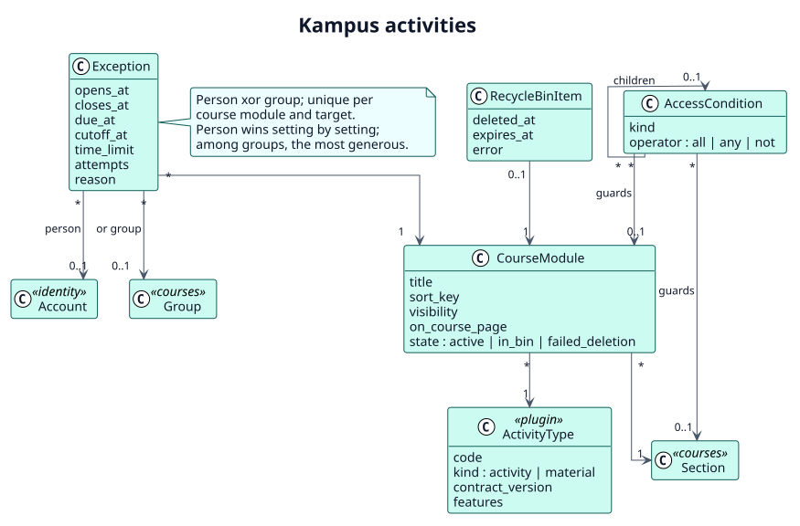

# Activities: course modules, access conditions, exceptions

Module `kampus-activities` (level 4, [architecture](../03-design/architecture.md#modules)). Every activity and material is a **course module** placed in a section; its behaviour comes from an **activity type** plugin that fulfils one typed contract. Access is restricted by **access conditions**, and dates, attempts and time limits can be changed per person or group by **exceptions** (RF-054). Requirements RF-050 to RF-054; decisions DEC-044 to DEC-047.

## Entities

| Entity | Level | Definition | Key attributes |
| --- | --- | --- | --- |
| Activity type | 2 | A plugin that implements the activity contract: material or activity, declared features, settings schema, UI module | code, kind, contract version, features |
| Course module | 1 | One activity or material placed in a section; a scope of its own | scope, section, type, sort key, title, visibility, show on course page, deleted state |
| Activity feature | 3 | What a type supports: grading, progress rules, groups, exceptions, copying, reset, export | code |
| Access condition | 2 | A rule that must hold for a person to open a course module or a section: date window, grade, progress, group, profile field, other activity, combined with all / any / not | kind, typed target, parameters, parent |
| Exception | 1 | A change of dates, attempts or time limit for one person or one group, on one course module | course module, person or group, opens, closes, due, cut-off, time limit, attempts, reason |
| Exception precedence | 3 | How exceptions combine: a person's exception wins over group ones setting by setting; among groups, the most generous value | rule |
| Recycle bin item | 3 | A deleted course module or section kept until the bin expires, with its state | entity, deleted by, deleted at, state, error |

## Business rules

| ID | Rule |
| --- | --- |
| RN-075 | An activity type is a plugin implementing the versioned activity contract (DEC-044): create, update, copy, reset, delete its instance data; declare its features, settings schema, permissions, events, grade items and progress rules. |
| RN-076 | A course module belongs to one section and has its own scope under it; its order is a sort key in the section (DEC-035). |
| RN-077 | Creating a course module and its type's instance data is **one transaction**; so are update, copy and move. A failure leaves nothing half created. |
| RN-078 | Every creation path (interface, API, import, copy) calls the same service with the same defaults: settings inherited down the scopes (DEC-008) and progress defaults (RN-117). |
| RN-079 | A course module's visibility is its own setting (shown, hidden, scheduled) and its effective visibility includes its section and course (DEC-034). "Shown on the course page" is separate from "available". |
| RN-080 | Access conditions are typed rows: each condition points to what it depends on by a foreign key (another course module, a grade record, a group, a profile field); a tree of all / any / not combines them (DEC-045). |
| RN-081 | Deleting what a condition depends on is refused while the condition exists, unless the person chooses to remove or rewrite the condition in the same operation. |
| RN-082 | A condition of an unknown or disabled type makes the course module **unavailable** and is reported to the teacher; it never makes it silently available. |
| RN-083 | Conditions on a section apply to every course module of the section and its subsections. |
| RN-084 | Any activity type that declares dates, attempts, time limits or submissions supports **exceptions**, through one model, one screen and one API endpoint (RF-054, DEC-046). A course module takes them only when it limits something an exception changes (a date, a time limit, a number of attempts): one that is not graded and has no dates or limits needs none and is not offered them, and an exception moves only what its course module limits, never adding a date or a limit the others do not have. |
| RN-085 | An exception targets a person **or** a group, never both; there is at most one exception per course module and person, and one per course module and group (constraints). |
| RN-086 | Effective values for a person: their own exception wins, setting by setting; otherwise, among the groups they belong to, the most generous value of each setting; otherwise the course module's value. The same resolver is used by the activity, the calendar, the course page and notifications. |
| RN-087 | Deleting a group deletes its exceptions by cascade, with an event. |
| RN-088 | Deleting a course module moves it to the course recycle bin in one transaction; its owned data is deleted by cascade when the bin item expires (default 30 days); restoring puts it back in its original section and position when they still exist. |
| RN-089 | A deletion that fails is a visible state of the bin item, with its reason; teachers can retry or restore it, and it stays in the dead-letter list until resolved. |
| RN-090 | Copying a course module (within a course or to another) is an operation of the contract; permission overrides are copied through the access service and recorded. |
| RN-091 | A change to a course module invalidates only the caches of that course module and its scope, not the whole course. |
| RN-092 | Course modules are shown to a person when visible and available; unavailable ones may be shown with the reason when the teacher allows it. |

## Main flows

- **Add an activity** (UC-021): pick a type, fill its settings, place it in a section.
- **Restrict access** (UC-022): build the condition tree with typed conditions.
- **Grant an exception** (UC-023): for a person or a group, with the effective values previewed.
- **Copy or move an activity** (UC-024).
- **Delete and restore an activity** (UC-025): through the recycle bin.

## Lifecycles

- **Course module:** created → shown / hidden / scheduled → moved or copied → deleted to the bin → restored, or purged when the bin item expires (or failed, then retried).
- **Exception:** created → changed → removed (or removed with its group).

## Customisation (DEC-008)

| What | Where |
| --- | --- |
| Default settings of each activity type | Campus, category, course, section |
| Which activity types are enabled | Campus, category |
| Bin retention | Campus |
| Names of activity types | Terminology layer |

## Contracts

| Kind | Items |
| --- | --- |
| Activity contract (plugins) | WIT interface of DEC-003: lifecycle (create, update, copy, reset, delete, export), features, settings schema, grade items, progress rules, events, UI module |
| Service API | `add`, `update`, `move`, `copy`, `delete`, `restore`, `available_to`, `conditions`, `set_conditions`, `effective_values`, `set_exception`, `remove_exception` |
| Events | `activities.module_created`, `activities.module_updated`, `activities.module_moved`, `activities.module_deleted`, `activities.module_restored`, `activities.module_purged`, `activities.conditions_changed`, `activities.exception_changed` |
| API | [activities.openapi.yaml](../03-design/api/activities.openapi.yaml) |
| Permissions | `activities.module.add`, `activities.module.update`, `activities.module.delete`, `activities.module.view_hidden`, `activities.conditions.manage`, `activities.conditions.ignore`, `activities.exception.manage` |
| Data | [activities data model](../03-design/data-model/activities.md) |

## Open questions

| ID | Question | Blocks |
| --- | --- | --- |
| | None | |
