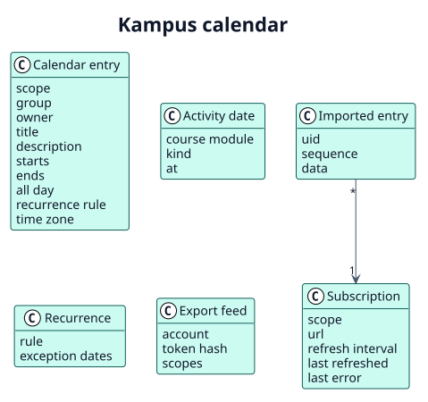

# Calendar

Module `kampus-calendar` (level 6, [architecture](../03-design/architecture.md#modules)). The calendar shows **calendar entries** created by people (campus, category, course, group, personal) and the **dates of activities**, which it never copies: they are a projection kept up to date by events and personalised at read time with each person's exceptions (RN-086). Requirement RF-072; decision DEC-058.

## Entities

| Entity | Level | Definition | Key attributes |
| --- | --- | --- | --- |
| Calendar entry | 1 | An entry created by a person in a scope: campus, category, course, group or personal | scope, group, owner, title, description, starts, ends, all day, recurrence rule, time zone |
| Activity date | 1 | A projection of a course module's dates (opens, due, closes) for the calendar, refreshed by events | course module, kind, at |
| Recurrence | 2 | An RFC 5545 rule with exceptions, expanded when read | rule, exception dates |
| Subscription | 2 | An external calendar (iCal URL) imported into a scope | scope, url, refresh interval, last refreshed, last error |
| Imported entry | 2 | An entry from a subscription, identified by its external UID | subscription, uid, sequence, data |
| Export feed | 3 | A personal iCal feed, authenticated by a scoped, hashed token | account, token hash, scopes |

## Business rules

| ID | Rule |
| --- | --- |
| RN-156 | The scope of an entry decides who sees it: campus and category entries everyone there, course entries the course's participants, group entries the group's members, personal entries only their owner; checks follow DEC-017. |
| RN-157 | **Activity dates are never copied by modules**: the calendar keeps a projection refreshed by `activities.*` events, and applies each person's exceptions at read time through the activity resolver (RN-086). |
| RN-158 | Recurring entries are stored once with an RFC 5545 rule and expanded when read for the requested window; editing one occurrence adds an exception, not a copy. |
| RN-159 | Subscriptions are refreshed by a job: entries are matched by UID and sequence; added, changed and removed entries are applied as a diff, each change recorded and published. |
| RN-160 | Times are instants with the entry's time zone; all-day entries are dates (DEC-022); everything is shown in the viewer's time zone. |
| RN-161 | Personal export feeds use a token that is scoped, revocable and stored hashed; the feed contains only what the person may see. |

## Contracts

| Kind | Items |
| --- | --- |
| Service API | `entries_for` (window, scopes), `create_entry`, `update_entry`, `delete_entry`, `subscribe`, `refresh`, `export_feed` |
| Events consumed | `activities.module_*`, `activities.exception_changed`, `courses.*`, `enrol.*` |
| Events published | `calendar.entry_created`, `calendar.entry_updated`, `calendar.entry_deleted`, `calendar.subscription_refreshed` |
| API | [calendar.openapi.yaml](../03-design/api/calendar.openapi.yaml) |
| Data | [calendar data model](../03-design/data-model/calendar.md) |
