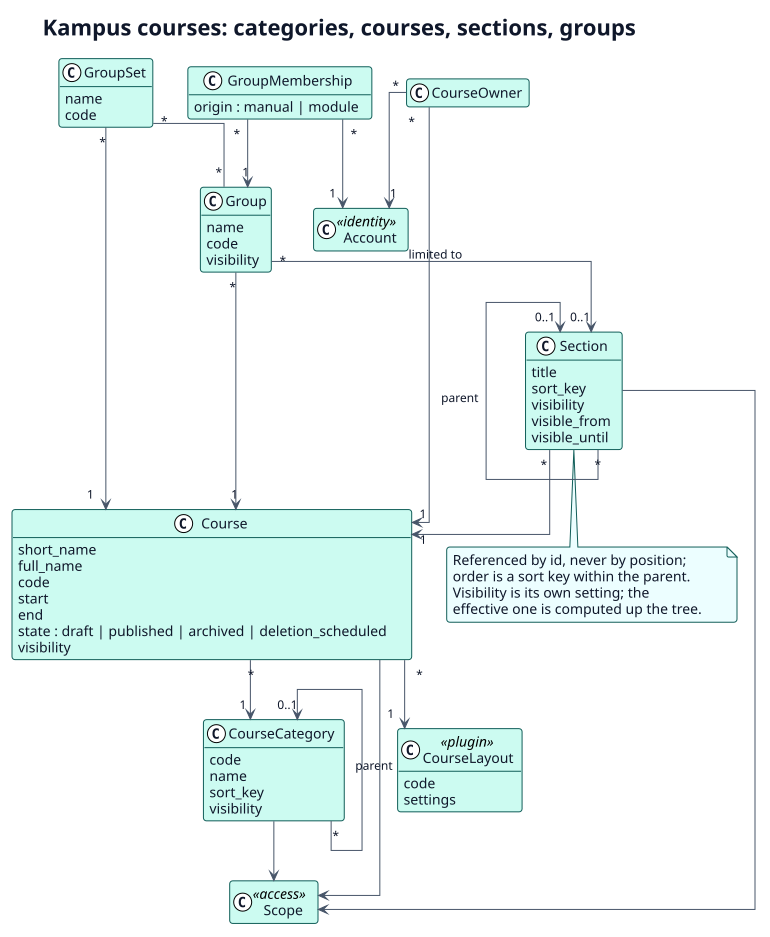

# Courses: categories, courses, sections, groups

Module `kampus-courses` (level 3, [architecture](../03-design/architecture.md#modules)). Courses live in a tree of **course categories**, are organised in **sections** that nest and hold course modules (placed by `kampus-activities`), are presented by a **course layout** plugin, and split their participants into **groups** and **group sets**. Every category, course and section is a scope (DEC-007). Requirements RF-030 to RF-034; decisions DEC-034 to DEC-038.

## Entities

| Entity | Level | Definition | Key attributes |
| --- | --- | --- | --- |
| Course category | 1 | A node of the catalogue tree that holds courses and subcategories | scope, parent, code, name, description, sort key, visibility |
| Course | 1 | The unit of teaching, in one category | scope, category, short name, full name, code, layout, start, end, lifecycle state, visibility, owners |
| Section | 1 | A part of a course with a stable identity, nested to any depth, ordered explicitly within its parent | scope, course, parent section, title, summary, sort key, visibility, availability |
| Visibility | 2 | The setting of one node: `shown`, `hidden`, or shown in a window (from, until); the **effective** visibility is computed from the node and its ancestors | mode, from, until |
| Course layout | 2 | A plugin that presents a course and declares its typed settings (topics, weekly, single activity, social, and others) | code, settings |
| Course owner | 2 | A person who owns a course (its creator by default), recorded as data | course, account, since |
| Group | 1 | A set of enrolled people inside a course, or inside one section of it | course, section (optional), name, code, description, visibility, joining key (hashed) |
| Group membership | 2 | A person in a group, added by hand or owned by a module (enrolment, a rule) | group, account, origin |
| Group set | 2 | A named set of groups of the course | course, name, code |
| Group mode | 2 | `none`, `separate` or `visible`: a setting resolved through the scopes course → section → activity, so a section or activity can use its own mode | value |
| Group visibility | 3 | Who sees a group and its members: everyone, its members, each member only themselves, nobody | value |
| Course lifecycle state | 2 | `draft`, `published`, `archived`, `deletion_scheduled` | value, changed by, changed at |

## Business rules

| ID | Rule |
| --- | --- |
| RN-040 | Categories form a tree under the campus; courses live in exactly one category; sections live in exactly one course and nest under other sections of the same course. Each of them is a scope created and deleted with it (RN-001). |
| RN-041 | A course's short name is unique in its campus and its code is unique when set (constraints, case-insensitive). A category's code is unique in its campus when set. A group's name and code are unique in its course. |
| RN-042 | A course's end is after its start when both are set; `NULL` means open (DEC-022). |
| RN-043 | **Visibility is never copied down.** Each category, course, section and course module stores only its own setting; it is visible to a learner only if it and every ancestor are visible now. Hiding a category and showing it again restores exactly what was there before (DEC-034). |
| RN-044 | People with `courses.hidden.view` in a scope see hidden content there, marked as hidden. |
| RN-045 | **Sections and course modules are referenced by their identifier, never by their position.** Order is an explicit sort key within the parent; moving a node changes only its own key, never its siblings' (DEC-035). |
| RN-046 | Order of categories and courses is local to each category, with the same sort keys; there is no global ordering and no limit per category. |
| RN-047 | A section can be moved to another parent section of the same course; its subtree, permissions and content move with it (one transaction updating the scope closure). |
| RN-048 | Deleting a section with content asks what to do with it: move the content to another section or delete it; deletion runs as a job (DEC-016) and is recoverable from the course recycle bin until it expires. |
| RN-049 | A course moves through `draft` → `published` → `archived`; archiving freezes its scope (read-only, RN-011); unarchiving needs `courses.course.archive`. |
| RN-050 | Deleting a course is a scheduled job with a grace period; owned data of every module is deleted by foreign keys with cascade and by their privacy handlers (DEC-014). Deletion needs `courses.course.delete`; owners hold it through the owner role, never through the event log. |
| RN-051 | Creating a course needs `courses.course.create` in the category; the creator becomes an owner unless the campus says otherwise; the course gets its default sections and grants from a course template. |
| RN-052 | The course layout is a plugin; switching layouts keeps every section and course module, and only changes presentation and the layout's own settings. |
| RN-053 | Only people enrolled in the course can be members of its groups; a group may be limited to one section, and then only people with access to that section can join it. |
| RN-054 | A group membership owned by a module (enrolment, a rule) is removed only by that module (DEC-038). |
| RN-055 | A group with visibility "each member only" or "nobody" cannot be used for group mode; that is checked when it is chosen, not when it is used. |
| RN-056 | With `separate` group mode, people see and work only with the groups they belong to, unless they hold `courses.groups.access_all` in the scope. |
| RN-057 | Group mode is a setting resolved course → section → activity (DEC-008), so a section can work in groups while the rest of the course does not. |
| RN-058 | A group set holds each group at most once; groups can belong to several sets. |
| RN-059 | Joining keys of groups are stored hashed, like any secret (DEC-030). |

## Main flows

- **Manage categories** (UC-011): create, rename, move, reorder, hide and delete categories; delete only empty categories or move their content first.
- **Create and configure a course** (UC-012): from a course template, in a category, with layout, dates, visibility and owners.
- **Organise sections** (UC-013): add, nest, move, reorder, hide, schedule and delete sections, with RN-043, RN-045, RN-047 and RN-048.
- **Manage groups** (UC-014): groups, group sets, members, group mode per course, section or activity.
- **Choose a course layout** (UC-015): select the layout plugin and its settings.

## Lifecycles

- **Course:** draft → published → archived (frozen) → deletion scheduled → deleted. A published course can go back to draft only when nobody is enrolled.
- **Section:** created → moved, nested, hidden, scheduled → deleted to the recycle bin → purged.
- **Group membership:** added by hand or by its owning module → removed by its origin.

## Customisation (DEC-008)

| What | Where |
| --- | --- |
| Course templates (default sections, layout, grants, settings) | Campus, category |
| Layout and its settings | Course |
| Group mode | Course, section, activity |
| Terminology (course, section, group…) | Campus, category, course, section |
| Custom fields of courses and sections | Campus, category |

## Contracts

| Kind | Items |
| --- | --- |
| Service API | `create_category`, `move_category`, `create_course`, `update_course`, `transition_course`, `add_section`, `move_section`, `delete_section`, `effective_visibility`, `create_group`, `add_member`, `remove_member`, `group_mode` |
| Events | `courses.category_created`, `courses.category_updated`, `courses.category_moved`, `courses.category_deleted`, `courses.course_created`, `courses.course_updated`, `courses.course_state_changed`, `courses.course_deleted`, `courses.section_created`, `courses.section_updated`, `courses.section_moved`, `courses.section_deleted`, `courses.group_created`, `courses.group_updated`, `courses.group_deleted`, `courses.group_member_added`, `courses.group_member_removed` |
| API | [courses.openapi.yaml](../03-design/api/courses.openapi.yaml) |
| Permissions | `courses.category.manage`, `courses.course.create`, `courses.course.update`, `courses.course.archive`, `courses.course.delete`, `courses.hidden.view`, `courses.section.manage`, `courses.groups.manage`, `courses.groups.access_all` |
| Extension points | Course layout plugins (DEC-003, DEC-037) |
| Data | [courses data model](../03-design/data-model/courses.md) |

## Open questions

| ID | Question | Blocks |
| --- | --- | --- |
| | None | |
