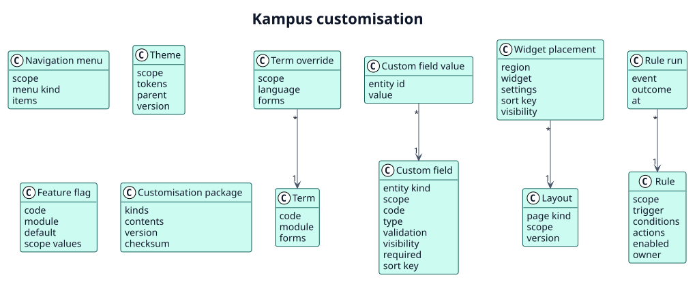

# Customisation

Module `kampus-customise` (level 1, [architecture](../03-design/architecture.md#modules)). Everything a campus may change without code is **data resolved through the scope hierarchy** (platform → tenant → category → course → section → activity → user, DEC-008): terminology, custom fields, layouts and navigation, themes, rules and workflows, and feature flags. Settings live in `kampus-settings` (DEC-059), message texts in `kampus-i18n` (DEC-062) and notification templates in `kampus-notify` (RN-150); all of them use the same resolution, history and packaging. Requirements RF-004, RF-006, RF-115, RF-118; decisions DEC-070 to DEC-073.

## Entities

| Entity | Level | Definition | Key attributes |
| --- | --- | --- | --- |
| Term | 2 | A declared domain word (course, section, teacher, grade…) with its grammatical forms per language | code, module, forms |
| Term override | 2 | The campus or scope's word for a term in a language | Term, scope, language, forms |
| Custom field | 1 | A typed field added to an entity kind in a scope | entity kind, scope, code, type, validation, visibility, required, sort key |
| Custom field value | 1 | The value of a custom field for one entity | Custom field, entity id, value |
| Layout | 2 | The widgets of a page kind placed on its grid in a scope | page kind, scope, version |
| Widget placement | 2 | One widget on a rectangle of cells of a layout, with its settings | Layout, widget, column, row, width, height, settings, visibility |
| Navigation menu | 2 | A menu as data: items, links to pages or URLs, visibility by permission | scope, menu kind, items |
| Theme | 2 | A set of design tokens (colour, typography, spacing, radius, motion) for a scope | scope, tokens, parent, version |
| Rule | 1 | When an event happens and conditions hold, run actions | scope, trigger, conditions, actions, enabled, owner |
| Rule run | 4 | One evaluation of a rule: event, result, actions done, error | Rule, event, outcome, at |
| Feature flag | 2 | A declared feature switch with its value per scope | code, module, default, scope values |
| Customisation package | 3 | An exported set of customisations to import into another campus or scope | kinds, contents, version, checksum |

## Business rules

| ID | Rule |
| --- | --- |
| RN-212 | Terms are declared by modules with grammatical forms (singular, plural, gender, article where the language needs it); messages refer to terms by code, so a renamed term is right in every sentence. |
| RN-213 | Every customisation is resolved from the most specific scope up and returns its origin; a level may lock a kind for the levels below (as RN-165). |
| RN-214 | Custom fields are typed (text, number, date, choice, multiple choice, boolean, file, reference to an account), validated on write, and stored as typed values with a foreign key to the field and owned through each module's link table, like files (RN-127), so there is no polymorphic owner. |
| RN-215 | Custom field visibility and editing follow permissions (`customise.field.view`, `.edit`) per field; private fields never reach the API or exports of people without them. |
| RN-216 | Layouts and menus are data validated against the grid of the page kind, the widgets installed and the sizes each declares for the page kind (DEC-090); an unknown or disabled widget is skipped, never breaks the page; teachers change course layouts within what the campus allows. |
| RN-217 | Themes are design tokens validated against the token schema: seed colours from which the colour roles of a light and a dark scheme are grown, each keeping the contrast of WCAG 2.2 AA (RNF-003); a theme whose roles would still fail it is refused; the client applies them as CSS custom properties without code. |
| RN-218 | Rules have a typed trigger (a declared event type), typed conditions and typed actions declared by modules (enrol, notify, set progress, add to group, set a grade category, call a webhook); free code is not allowed. |
| RN-219 | Rule actions run as jobs after commit with the permissions of the rule's owner; a rule chain is limited in depth (RN-141) and a rule cannot trigger itself; every run is recorded. |
| RN-220 | Feature flags are declared by modules with a default; a disabled feature hides its routes, UI modules and contributions in that scope, and its data is kept. |
| RN-221 | Customisations are exported and imported as packages validated against the target's declarations; an import shows the differences first and applies them in one transaction, recorded as one change. |
| RN-222 | Every customisation change records who, when, before and after, and publishes `customise.changed`, which invalidates the caches of the resolved values on every node. |

## Contracts

| Kind | Items |
| --- | --- |
| Service API | `term` (code, scope, language), `fields_for` (entity kind, scope), `set_field_value`, `layout` (page kind, scope), `menu`, `theme`, `rules`, `flag` (code, scope), `export`, `import` |
| Contributed by every module | Terms, entity kinds that accept custom fields, page kinds and widgets, rule triggers, conditions and actions, feature flags |
| Events consumed | every declared event type, for rules |
| Events published | `customise.changed`, `customise.rule_failed` |
| API | [customise.openapi.yaml](../03-design/api/customise.openapi.yaml) |
| Data | [customisation data model](../03-design/data-model/customise.md) |
