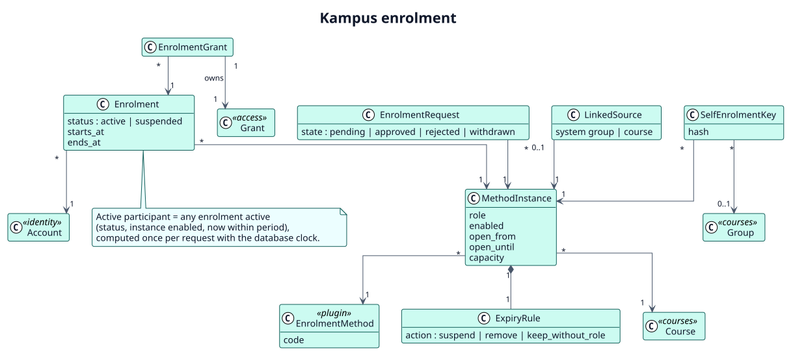

# Enrolment: methods, enrolments, requests

Module `kampus-enrol` (level 4, [architecture](../03-design/architecture.md#modules)). People take part in a course through **enrolments** created by **enrolment methods** configured in the course. An enrolment is participation; what the person may do comes from the **grants** the enrolment owns in the access module (DEC-028). Requirements RF-040 to RF-042; decisions DEC-040 to DEC-043.

## Entities

| Entity | Level | Definition | Key attributes |
| --- | --- | --- | --- |
| Enrolment method | 2 | A plugin that brings people into courses: manual, self, system group, course link, and others such as payment-gated self | code, settings schema, capabilities |
| Method instance | 1 | A method configured in a course (or a section): who it brings, with which role, when, under which limits | course, method, role, enabled, open from, open until, default duration, capacity, settings |
| Enrolment | 1 | A person's participation in a course through one method instance | instance, account, status, starts at, ends at, created by, reason |
| Enrolment status | 2 | `active` or `suspended`; participation is **active** when the status is active, the instance is enabled and now is within the period | value |
| Enrolment grant | 2 | The link between an enrolment and the grant it owns in the access module | enrolment, grant |
| Enrolment group membership | 3 | A group membership owned by an enrolment instance (DEC-038) | instance, membership |
| Enrolment request | 2 | A request to join that waits for approval | instance, account, message, state (pending, approved, rejected, withdrawn), decided by |
| Self-enrolment key | 3 | A joining key of a self instance, stored hashed; a group key puts the person in that group | instance, group, hash |
| Linked source | 2 | A system group or another course whose members a method brings in, by derivation | instance, system group or course |
| Expiry rule | 3 | What happens when an enrolment ends: suspend, remove, or keep the participation without the role | instance, action |
| Expiry outcome | 4 | The recorded result of applying an expiry rule to one enrolment | enrolment, action, at |

## Business rules

| ID | Rule |
| --- | --- |
| RN-060 | A person is **an active participant** of a course when at least one of their enrolments in it is active: status `active`, instance enabled, and the database clock within `starts_at` and `ends_at` (`NULL` = open). This is computed once per request and every module uses the same answer (DEC-040). |
| RN-061 | An enrolment gives roles only through the grants it owns; ending, suspending or removing an enrolment affects only its own grants, never grants made by hand or by another enrolment (DEC-028). |
| RN-062 | A person has at most one enrolment per method instance (constraint); different instances in the same course can coexist. |
| RN-063 | A method instance's capacity, opening period and cohort or group restriction are checked **in the same transaction** that creates the enrolment, with a lock on the instance, so concurrent requests cannot exceed the capacity (DEC-026, DEC-041). |
| RN-064 | Self-enrolment keys are stored hashed, compared in constant time, never hinted, and attempts are limited per person and per address (DEC-041). |
| RN-065 | An instance that requires approval creates an enrolment request; only people with `enrol.request.decide` in the course decide; approving creates the enrolment; every decision is recorded and the person is notified. |
| RN-066 | Payment-gated methods create the enrolment only after the payment port confirms the payment; the enrolment records the payment reference. |
| RN-067 | System group and course-link methods **derive** their enrolments from their source: a sync job adds and removes exactly the enrolments of that instance when the source changes; linked enrolments are never a source for another link (no chains), and a link that would create a cycle is refused (DEC-042). |
| RN-068 | When an enrolment reaches its end, an expiry job applies the instance's expiry rule and records the outcome; nothing is guessed (DEC-042). |
| RN-069 | **Ending a participation never deletes academic records or progress.** They stay with the person in the course, hidden while the person is not an active participant, and come back when the person returns. They are deleted only by course deletion, retention rules or a privacy request (DEC-043). |
| RN-070 | Suspending an enrolment keeps it and its data; the person loses access to the course at the next request (RN-060, DEC-031). |
| RN-071 | Disabling a method instance suspends the participation it gives without deleting anything; deleting an instance removes its enrolments, and with them its grants and group memberships, by cascade. |
| RN-072 | Guest access is not an enrolment: a course can allow guests, optionally with a key; guests get the guest role for their session only and never write (RN-009). |
| RN-073 | Bulk enrolments (a file, a list, a system group) validate every row first, apply the same rules as single ones and report per row; they run as jobs (DEC-016). |
| RN-074 | Every enrolment change (create, status, dates, removal) publishes an event; other modules (records, progress, groups, notifications) react to events, never by reading the enrolment tables. |

## Main flows

- **Enrol people** (UC-016): manual enrolment of one or many people with a role and a period.
- **Enrol oneself** (UC-017): self-enrolment with a key, an approval or a payment.
- **Manage an enrolment** (UC-018): change status, period and role; remove.
- **Link a system group or a course** (UC-019): derived enrolments kept in sync.
- **Expire enrolments** (UC-020): the scheduled job that applies expiry rules.

## Lifecycles

- **Enrolment:** created (by a person, a request approval, a payment or a sync) → active ⇄ suspended → ended (by its period, then the expiry rule) → removed.
- **Enrolment request:** pending → approved (creates the enrolment) or rejected or withdrawn.
- **Method instance:** created → enabled ⇄ disabled → deleted.

## Customisation (DEC-008)

| What | Where |
| --- | --- |
| Which methods are enabled, and their defaults | Campus, category |
| Method instances, their role, period, capacity, keys, approval and expiry rule | Course or section |
| Notification templates (welcome, request decided, ending soon) | Campus, course |

## Contracts

| Kind | Items |
| --- | --- |
| Service API | `is_active_participant`, `participants` (filtered, paged), `enrol`, `enrol_many`, `update_enrolment`, `remove_enrolment`, `request`, `decide_request`, `self_enrol`, `link_source`, `sync_instance` |
| Events | `enrol.instance_created`, `enrol.instance_updated`, `enrol.instance_deleted`, `enrol.enrolment_created`, `enrol.enrolment_updated`, `enrol.enrolment_suspended`, `enrol.enrolment_ended`, `enrol.enrolment_removed`, `enrol.request_created`, `enrol.request_decided` |
| API | [enrolment.openapi.yaml](../03-design/api/enrolment.openapi.yaml) |
| Permissions | `enrol.instance.manage`, `enrol.enrolment.manage`, `enrol.enrolment.read`, `enrol.request.decide`, `enrol.self` |
| Extension points | Enrolment method plugins (DEC-003); the payment port |
| Data | [enrolment data model](../03-design/data-model/enrolment.md) |

## Open questions

| ID | Question | Blocks |
| --- | --- | --- |
| | None | |
