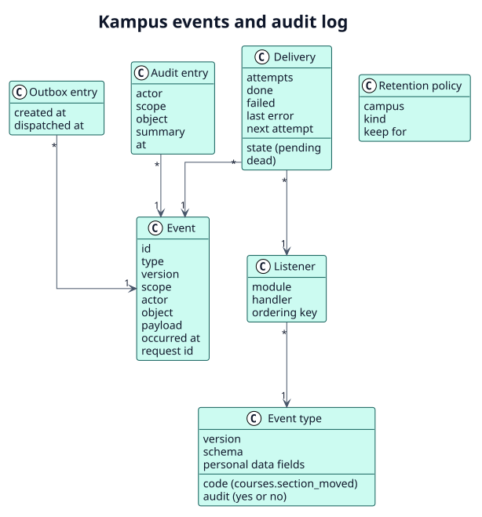

# Events and the audit log

Module `kampus-events` (level 0, [architecture](../03-design/architecture.md#modules)). Every significant change publishes a **domain event**, declared and typed by its module, written to the **outbox** in the change's transaction and delivered after commit to **listeners** (DEC-016). The **audit log** records who did what, apart from operational logs (DEC-019). Requirements RF-081 and RF-082; decision DEC-055.

## Entities

| Entity | Level | Definition | Key attributes |
| --- | --- | --- | --- |
| Event type | 2 | A declared kind of event with a versioned payload schema (DEC-015) | code (`courses.section_moved`), version, schema, audit (yes or no), personal data fields |
| Event | 1 | One occurrence: what happened, to what, by whom, in which scope | id, type, version, scope, actor, object, payload, occurred at, request id |
| Outbox entry | 2 | An event waiting for dispatch, written in the change's transaction | event, created at, dispatched at |
| Listener | 2 | A declared reaction of a module or plugin to an event type | module, event type, handler, ordering key |
| Delivery | 2 | One attempt to run one listener for one event | listener, event, attempts, state (pending, done, failed, dead), last error, next attempt |
| Audit entry | 1 | An append-only record of an audited event, kept by the campus retention policy | event, actor, scope, object, summary, at |
| Retention policy | 3 | How long audit entries and event payloads are kept, per campus | campus, kind, keep for |

## Business rules

| ID | Rule |
| --- | --- |
| RN-137 | Every event type is declared with a versioned payload schema; publishing an undeclared type or an invalid payload fails the operation in development and is reported in production. |
| RN-138 | Events are written to the outbox in the transaction of the change and dispatched only after commit; a rolled-back change publishes nothing (DEC-016). |
| RN-139 | Each listener receives each event at least once, is idempotent by event id, and runs with retries and back-off; after the last attempt the delivery is **dead** and visible to administrators, who can replay it. A failing listener never affects the operation or other listeners. |
| RN-140 | Events about the same object are delivered to a listener in the order they happened (ordering key = object id). |
| RN-141 | A chain of events triggered by listeners is limited in depth (10 by default); exceeding it stops the chain and is reported. |
| RN-142 | Listeners of disabled plugins and modules are not called; their deliveries are paused, not lost. |
| RN-143 | Audited event types write an **append-only audit entry** in the same transaction; audit entries are never updated or deleted except by the retention job. |
| RN-144 | The audit log is queried through the API with the same permission rules as the objects it is about: an entry is visible when its object is visible to the requester in its scope (DEC-017). |
| RN-145 | Personal data in payloads is declared per event type and erased or pseudonymised by the privacy handlers (RN-034). |
| RN-146 | Operational logs (traces, errors) never replace the audit log, and the audit log never holds operational noise (DEC-019). |

## Contracts

| Kind | Items |
| --- | --- |
| Service API | `publish` (inside a transaction), `subscribe` (declared), `replay`, `audit_query` |
| Declared by modules | Event types with schemas, audit flags and personal data fields; listeners (DEC-015) |
| Events of its own | `events.delivery_dead`, `events.chain_limit_reached` |
| API | [events.openapi.yaml](../03-design/api/events.openapi.yaml) |
| Data | [events data model](../03-design/data-model/events.md) |
