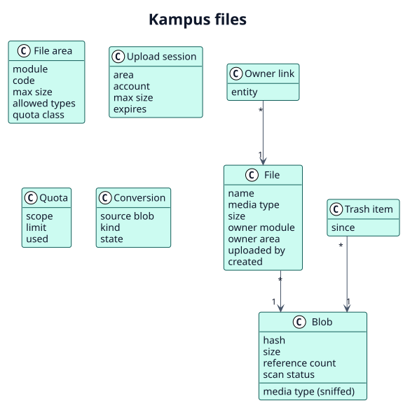

# Files: blobs, files, uploads, serving

Module `kampus-files` (level 2, [architecture](../03-design/architecture.md#modules)), on the storage port (DEC-009). Content is stored once as a **blob**; a **file** is a named use of a blob that belongs to exactly one owning entity of another module (a material, a submission, a profile picture), and is readable when its owner is readable. Requirement RF-080; decisions DEC-053 and DEC-054.

## Entities

| Entity | Level | Definition | Key attributes |
| --- | --- | --- | --- |
| Blob | 1 | Content stored once in the storage port, addressed by its SHA-256 hash | hash, size, media type (sniffed), reference count, scan status |
| File | 1 | A named use of a blob, owned by one entity of a module | blob, name, media type, size, owner module, owner area, uploaded by, created |
| File area | 2 | A declared place where a module keeps files (for example `activities.material.content`), with its permission resolver, limits and allowed types (DEC-015) | module, code, max size, allowed types, quota class |
| Owner link | 2 | A module's own table linking its entity to its files (`<module>.<entity>_file`), with foreign keys on both sides | entity, file |
| Upload session | 2 | A server-issued, typed, expiring permission to upload into one area | area, account, max size, expires |
| Quota | 3 | Storage allowed per person, course and campus, counting every owned file | scope, limit, used |
| Conversion | 3 | A job that produces a derived blob (thumbnail, PDF, transcoded media) | source blob, kind, state |
| Trash item | 3 | A blob whose reference count reached zero, kept until the retention period ends | blob, since |

## Business rules

| ID | Rule |
| --- | --- |
| RN-126 | A blob is stored once per content hash; its reference count is maintained in the database **in the same transaction** as every file that uses or stops using it. |
| RN-127 | A file belongs to exactly one owner, through the owner's own link table with foreign keys; there is no polymorphic owner column (DEC-053). |
| RN-128 | **A file is readable exactly when its owner is readable**: the owning module declares the area's permission resolver, and serving asks it; there is no other path to a file. |
| RN-129 | Every upload, from the web client, the API or a plugin, goes through **one pipeline**: upload session, size and type limits of the area, quota, rate limit, malware scan through the scanning port, then attachment to its owner (DEC-054). A file that fails any step is never attached. |
| RN-130 | The media type is sniffed from the content; the declared type is only a hint; types the area does not allow are refused. |
| RN-131 | Files are served through **signed, expiring URLs** (5 minutes by default) issued after the permission check, for one file and one requester; storage that supports it serves them directly (pre-signed URLs). |
| RN-132 | Active content (HTML, SVG, scripts) is served from a separate files origin with a restrictive content security policy, or as an attachment; it never runs in the platform's origin. |
| RN-133 | When a blob's reference count reaches zero it goes to the trash; a job deletes it from storage after the retention period (7 days by default). |
| RN-134 | Quotas count every file a person, course or campus owns; exceeding a quota refuses the upload with an explicit error. |
| RN-135 | Conversions run as jobs (DEC-016) and publish an event when done; the original is always kept. |
| RN-136 | Moving files between storage backends is a job that copies, verifies the hash, switches and then deletes, without downtime (DEC-009). |

## Contracts

| Kind | Items |
| --- | --- |
| Service API | `open_upload`, `complete_upload`, `attach`, `detach`, `signed_url`, `copy`, `convert`, `usage` |
| Events | `files.uploaded`, `files.attached`, `files.detached`, `files.scan_failed`, `files.converted`, `files.quota_exceeded` |
| Declared by modules | File areas with their permission resolver, limits, allowed types and quota class (DEC-015) |
| Ports | Storage (DEC-009), malware scanning |
| API | [files.openapi.yaml](../03-design/api/files.openapi.yaml) |
| Data | [files data model](../03-design/data-model/files.md) |
