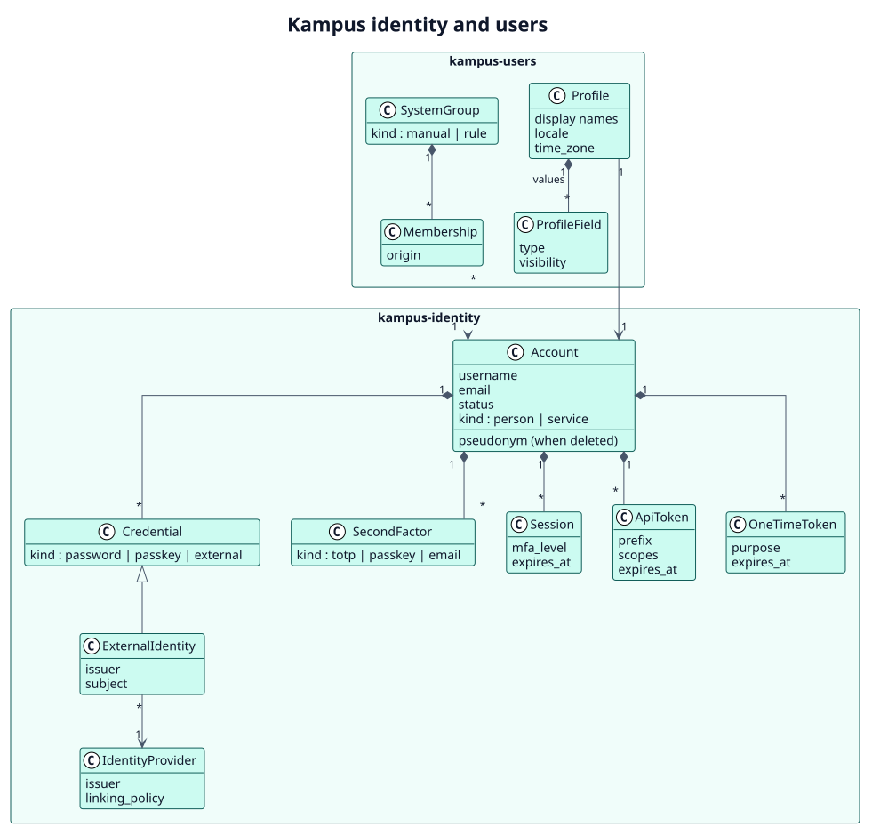

# Identity and users: accounts, sign-in, profiles, system groups

Modules `kampus-identity` (level 1: accounts, credentials, external identities, second factors, sessions, API tokens) and `kampus-users` (level 2: profiles, preferences, system groups), [architecture](../03-design/architecture.md#modules). Requirements RF-010 to RF-015 and RF-093; RNF-001, RNF-002; decisions DEC-030 to DEC-033.

## Entities

| Entity | Module | Level | Definition | Key attributes |
| --- | --- | --- | --- | --- |
| Account | identity | 1 | A person's (or a service's) way into one campus | campus, username, email, status, kind (person or service), created, last sign-in |
| Account status | identity | 1 | `invited`, `pending_confirmation`, `active`, `suspended`, `deleted` | value, reason, changed by, changed at |
| Credential | identity | 1 | Something an account proves itself with: password, passkey, external identity | kind, created, last used |
| Password | identity | 2 | A password hash (Argon2id) with its parameters | hash, set at, must change |
| External identity | identity | 2 | A link to an identity provider account, by issuer and subject | provider, issuer, subject, verified email |
| Identity provider | identity | 2 | An OIDC provider configured for a campus (SAML and LDAP later, through the same port) | issuer, client, secret (encrypted), claim mapping, linking policy |
| Second factor | identity | 2 | TOTP app, passkey (WebAuthn) or email code, plus recovery codes | kind, label, created, last used |
| Session | identity | 1 | A signed-in browser or app | account, created, last seen, expires, MFA level, client, address |
| API token | identity | 2 | A credential for an integration, scoped and expiring | account, scopes, prefix, hash, expires, last used |
| One-time token | identity | 3 | A hashed, expiring token for confirmation, invitation, set-password and recovery | purpose, hash, expires, used at |
| Sign-in attempt | identity | 4 | A record used for throttling and for the account's security log | account or name tried, address, outcome, at |
| Tombstone | identity | 4 | A deleted account: the same row, with every personal datum erased and a pseudonym, so academic records keep a valid reference | id, pseudonym, deleted at |
| Profile | users | 1 | The person behind an account: names, picture, language, time zone, contact | display names, picture, locale, time zone |
| Profile field | customise | 2 | A custom field of the entity kind `account` (DEC-070), linked to the account through `users.account_field` | type, required, visibility, permissions |
| Preference | users | 3 | A typed per-user setting declared by a module | key, value |
| System group | users | 2 | A campus or category-wide set of people (for enrolment and reporting) | scope, name, kind (manual or rule), rule |
| System group membership | users | 3 | A person in a system group, manual or owned by a rule or a sync | group, account, origin |

## Business rules

| ID | Rule |
| --- | --- |
| RN-022 | An account belongs to one campus; its username and its email are unique in the campus, compared case-insensitively. |
| RN-023 | The account lifecycle is a state machine: invited → pending confirmation → active ⇄ suspended → deleted. Each transition needs its own permission, takes a reason, is recorded with who and when, and publishes one event. |
| RN-024 | **Every sign-in method runs the same pipeline**: identify the account, check its status, check throttling, verify the credential, require the second factor when the account, its roles or the campus demand it, then create the session. No method may skip a step. |
| RN-025 | Passwords are hashed with Argon2id; the campus policy (length, breached-password check) applies at every change; passwords are never generated, sent or shown. New accounts receive a one-time link to set their own. |
| RN-026 | One-time tokens come from a cryptographically secure generator, are stored only as hashes, expire (confirmation 24 h, recovery 30 min by default) and are used once. |
| RN-027 | Throttling is on by default, per account and per address, also for names that do not exist; it slows down and then locks temporarily, and the answer never reveals whether an account exists. |
| RN-028 | An external identity links to an account by **issuer and subject**. Linking by email needs a verified email claim from the provider **and** the campus linking policy, or an explicit confirmation by the account owner; never the first account that happens to share the email. |
| RN-029 | A second factor is required when the person enabled one, when one of their roles requires it in a scope where it is granted, or when the campus requires it. TOTP, passkeys and email codes are supported; recovery codes are shown once and stored hashed. |
| RN-030 | **Account recovery checks the second factor (or a recovery code) before any credential changes**; recovery is rate-limited, recorded, and notifies the account. Recovery never signs the person in by itself. |
| RN-031 | Sessions are stored server-side and checked on every request against the account status; suspending, deleting or changing the password of an account revokes all its sessions and API tokens at once. |
| RN-032 | A sensitive operation (changing credentials, second factors or email, viewing as another role, deleting) needs a recent strong authentication (step-up), at most 15 minutes old by default. |
| RN-033 | API tokens are scoped to a list of permissions and scopes, expire (at most one year, campus default 90 days), are shown once and stored hashed; their prefix identifies them in lists and logs. |
| RN-034 | Deleting an account erases its personal data (profile, credentials, sessions, tokens, preferences, contact data) and keeps the account row as a **tombstone** (same id, personal columns erased, a pseudonym); academic records and contributions keep pointing to the tombstone. What each module keeps or erases is declared in its privacy handler (DEC-015). |
| RN-035 | A deletion is executed after the campus's grace period (default 14 days), during which the account is suspended and the deletion can be cancelled. |
| RN-036 | Custom profile fields declare who can see and edit them (the person, roles in a scope, nobody); hidden fields never leave the API to someone without the permission. |
| RN-037 | A system group lives in a campus or a category scope; its members are added by hand, by a rule over profile fields, or by a sync, and each membership records its origin; a rule or a sync only removes the memberships it created. |
| RN-038 | Bulk operations (upload, suspend, delete) validate every row first, report per row, and are jobs (DEC-016); they apply the same rules as single operations. |
| RN-039 | Service accounts have no password and no second factor; they authenticate only with API tokens and appear as such in every log. |

## Main flows

- **Sign up and confirm** (UC-006): self sign-up when the campus allows it; the account is pending until the email link (RN-026) is used; invitations by managers skip sign-up and set the password through the link.
- **Sign in** (UC-007): the pipeline of RN-024 for password, passkey or OIDC; recovery (RN-030) as an alternative path.
- **Set up a second factor** (UC-008): with step-up (RN-032); recovery codes shown once.
- **Manage the account lifecycle** (UC-009): invite, suspend, reactivate, delete with grace period and tombstone (RN-023, RN-034, RN-035), one by one or in bulk (RN-038).
- **Edit a profile** (UC-010): standard and custom fields, with their visibility (RN-036).

## Lifecycles

- **Account:** invited → pending confirmation → active ⇄ suspended → (grace period) → deleted, leaving a tombstone.
- **Session:** created by the pipeline → refreshed while used → ends at expiry, sign-out, or revocation (RN-031).
- **API token:** created (shown once) → used → expires or is revoked.

## Customisation (DEC-008)

| What | Where |
| --- | --- |
| Self sign-up on or off, allowed email domains, password policy, second-factor requirement, token lifetimes, deletion grace period | Campus settings |
| Identity providers and their linking policy | Campus |
| Second factor required for a role | Role, in the scopes where it is granted |
| Custom profile fields and their visibility | Campus, category |
| Names of fields and terms | Terminology layer |

## Contracts

| Kind | Items |
| --- | --- |
| Service API | `sign_in`, `step_up`, `sign_out`, `revoke_sessions`, `create_token`, `revoke_token`, `invite`, `transition` (account lifecycle), `link_identity`, `get_profile`, `update_profile`, `group_members` |
| Events | `identity.account_invited`, `identity.account_confirmed`, `identity.account_suspended`, `identity.account_reactivated`, `identity.account_deletion_scheduled`, `identity.account_deleted`, `identity.signed_in`, `identity.sign_in_failed`, `identity.second_factor_added`, `identity.second_factor_removed`, `identity.recovery_used`, `identity.token_created`, `identity.token_revoked`, `users.profile_updated`, `users.system_group_member_added`, `users.system_group_member_removed` |
| API | [identity.openapi.yaml](../03-design/api/identity.openapi.yaml) |
| Permissions | `identity.account.invite`, `identity.account.suspend`, `identity.account.delete`, `identity.account.read`, `identity.provider.manage`, `identity.token.manage_own`, `identity.token.manage_any`, `users.profile.update_own`, `users.profile.update_any`, `customise.fields.manage` (profile fields are custom fields of kind `account`), `users.system_group.manage` |
| Data | [identity data model](../03-design/data-model/identity.md) |
| Privacy | Both modules declare their personal data and their export and erase handlers (RN-034) |

## Open questions

| ID | Question | Blocks |
| --- | --- | --- |
| | None | |
