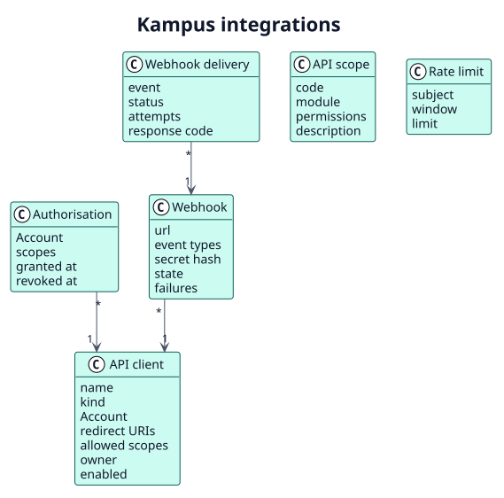

# Integrations

Module `kampus-api` (level 7, [architecture](../03-design/architecture.md#modules)). External systems integrate through the documented HTTP API with **API clients**: a service account with scoped tokens (RN-033), or a third-party application authorised by a person with OAuth 2. The API document is generated from the routes the modules declare; requests are rate-limited; **webhooks** push events to external systems through the event deliveries of DEC-055. Requirements RF-103, RF-104; decisions DEC-063, DEC-064.

## Entities

| Entity | Level | Definition | Key attributes |
| --- | --- | --- | --- |
| API client | 1 | A registered integration: a service account or an OAuth application | name, kind, Account, redirect URIs, allowed scopes, owner, enabled |
| API scope | 2 | A declared group of operations an integration may be granted | code, module, permissions, description |
| Authorisation | 2 | A person's consent that an OAuth application acts for them with some scopes | API client, Account, scopes, granted at, revoked at |
| Rate limit | 3 | A request budget per client, token or address | subject, window, limit |
| Webhook | 2 | A subscription of an API client to event types, delivered to a URL | API client, url, event types, secret hash, state, failures |
| Webhook delivery | 4 | One attempt to deliver one event to one webhook | Webhook, event, status, attempts, response code |

## Business rules

| ID | Rule |
| --- | --- |
| RN-195 | Every route is declared by its module with its permission, API scope and schemas; the OpenAPI 3.1 document is generated from the declarations and a route that is not declared does not exist. |
| RN-196 | A token reaches an operation only when its scopes include the route's scope **and** its account holds the permission in the target scope (DEC-017); a scope never grants a permission the account lacks. |
| RN-197 | Third-party applications use OAuth 2 authorisation code with PKCE; access tokens are short-lived, refresh tokens rotate, and people see and revoke the applications they authorised. |
| RN-198 | Requests are rate-limited per token and per address on the cache port; over the limit the answer is `429` with `Retry-After`, and limits are campus settings. |
| RN-199 | A webhook receives only event types its client may see, with the payload filtered by the client's permissions; payloads are signed with an HMAC of the body, a timestamp and the event id. |
| RN-200 | Webhook deliveries are listener deliveries (RN-139): at least once, ordered per object, retried with back-off; after repeated failures the webhook is disabled and its owner notified. |
| RN-201 | Webhook URLs must use HTTPS and may not point to private or loopback addresses unless the operator allows them; the check is repeated at delivery time. |
| RN-202 | API versions are paths (`/api/v1`); a deprecated route answers with `Deprecation` and `Sunset` headers and keeps working until its sunset date within the major version (RNF-011). |

## Contracts

| Kind | Items |
| --- | --- |
| Service API | `register_client`, `issue_token`, `authorise`, `revoke`, `subscribe_webhook`, `openapi` |
| Contributed by every module | Routes with permission, scope and schemas; API scopes |
| Events consumed | every declared event type, for webhooks |
| Events published | `api.client_registered`, `api.authorisation_revoked`, `api.webhook_disabled` |
| API | [integrations.openapi.yaml](../03-design/api/integrations.openapi.yaml) |
| Data | [integrations data model](../03-design/data-model/integrations.md) |
