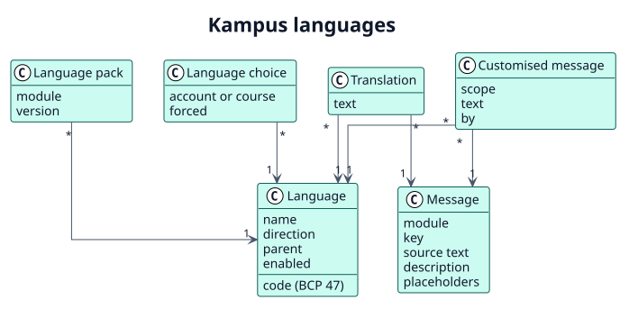

# Languages

Module `kampus-i18n` (level 1, [architecture](../03-design/architecture.md#modules)). Every user-facing string is a **message** declared by its module with a key and an ICU MessageFormat text; **language packs** translate them, the campus can customise them, and terminology (DEC-008, DEC-012) is applied on top. The language of a request is resolved from the person, the course and the campus. Requirement RF-091; RNF-010; decision DEC-062.

## Entities

| Entity | Level | Definition | Key attributes |
| --- | --- | --- | --- |
| Language | 2 | An installed language with its locale data and direction | code (BCP 47), name, direction, parent, enabled |
| Message | 2 | A declared user-facing string of a module | module, key, source text, description, placeholders |
| Language pack | 2 | A versioned set of translations of a module's messages into one language | module, Language, version |
| Translation | 2 | The text of a message in a language, from a pack | Message, Language, text |
| Customised message | 3 | A campus or scope override of a message's text | Message, Language, scope, text, by |

## Business rules

| ID | Rule |
| --- | --- |
| RN-187 | No user-facing text is written in code: the lint fails on literal strings in UI modules and API errors; messages are referenced by key. |
| RN-188 | Messages use ICU MessageFormat with named placeholders, plurals and selects; text is never concatenated from pieces, and a translation with other placeholders than the source is refused. |
| RN-189 | The language of a request is the course's forced language (`courses.course`), else the person's choice (`users.profile`), else the `Accept-Language` of a visitor, else the campus default; only enabled languages qualify. |
| RN-190 | A missing translation falls back along the language's parent chain (for example `es-MX` → `es` → campus default → source) and is counted per pack, so missing strings are visible. |
| RN-191 | Resolution order for one message: customised message for the scope (walking up the scope), then the pack translation, then the fallback chain; terminology is applied to the result. |
| RN-192 | Dates, times, numbers, money and lists are formatted with CLDR data for the resolved locale and the viewer's time zone (DEC-022, DEC-023); right-to-left languages switch the direction of the whole client. |
| RN-193 | Language packs are installed and updated per module and version; an update never overwrites customised messages, and messages removed from a module are reported. |
| RN-194 | Content written by people (course names, posts) is not translated by packs; multilingual content uses the per-language text values of DEC-024. |

## Contracts

| Kind | Items |
| --- | --- |
| Service API | `resolve_language` (the candidates of the request: course, person, browser, campus), `message` (key, args, scope), `bundle` (module, language), `install_pack`, `customise`, `missing` |
| Events published | `i18n.pack_installed`, `i18n.message_customised` |
| API | [i18n.openapi.yaml](../03-design/api/i18n.openapi.yaml) |
| Data | [i18n data model](../03-design/data-model/i18n.md) |
