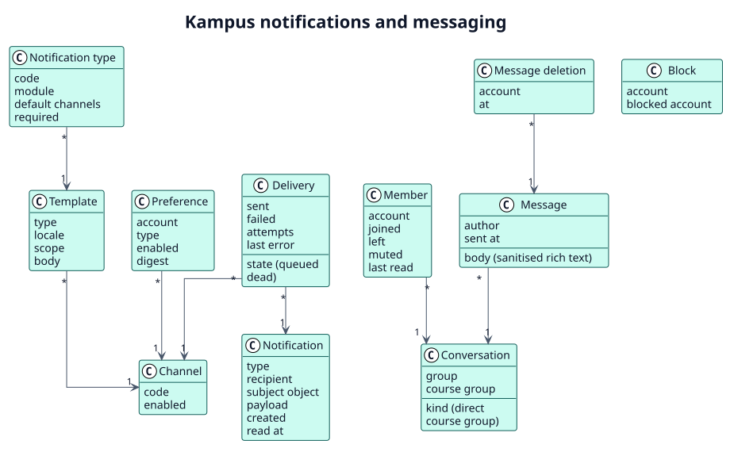

# Notifications and messaging

Module `kampus-notify` (level 6, [architecture](../03-design/architecture.md#modules)). Modules declare **notification types**; each is delivered through **channels** (inbox, email, push, and plugins) according to people's **preferences**, by **delivery jobs** with a visible state. **Conversations** carry direct and group messages. Requirements RF-070 and RF-071; decisions DEC-056 and DEC-057.

## Entities

| Entity | Level | Definition | Key attributes |
| --- | --- | --- | --- |
| Notification type | 2 | A declared kind of notification with its default channels and whether people may turn it off | code, module, default channels, required, template |
| Channel | 2 | A way to deliver: inbox, email, push, or a plugin channel | code, enabled |
| Preference | 2 | A person's choice for one type and one channel | account, type, channel, enabled, digest |
| Notification | 1 | One notification to one person | type, recipient, subject object, payload, created, read at |
| Delivery | 2 | One notification through one channel | notification, channel, state (queued, sent, failed, dead), attempts, last error |
| Template | 3 | The text of a notification type per channel and locale, customisable by scope (DEC-008) | type, channel, locale, scope, body |
| Conversation | 1 | A direct or group exchange of messages | kind (direct, group, course group), course group |
| Member | 2 | A person in a conversation | conversation, account, joined, left, muted, last read |
| Message | 1 | One message in a conversation | conversation, author, body (sanitised rich text), sent at |
| Message deletion | 3 | A member's deletion of a message for themselves | message, account, at |
| Block | 3 | A person blocking another from messaging them | account, blocked account |

## Business rules

| ID | Rule |
| --- | --- |
| RN-147 | Notification types are declared by modules (DEC-015); a type marked required cannot be turned off, only routed to another channel. |
| RN-148 | Preferences are typed rows per person, type and channel; the campus sets defaults and can lock a type; there is one resolution rule for notifications and messages alike. |
| RN-149 | Every notification is created by a listener after commit and delivered by **one job per recipient and channel**, with retries, a visible state and a dead-letter state; nothing is sent inside the request that causes it (DEC-056). |
| RN-150 | Notification texts come from templates customisable per scope and locale; they use the campus terminology (DEC-008, DEC-012). |
| RN-151 | People see in their inbox every notification of every enabled channel, with links checked against their permissions when opened. |
| RN-152 | A direct conversation exists once per pair of people (unique key on the ordered pair); group conversations of a course group follow the group's membership. |
| RN-153 | A person may message another only when a campus rule allows it (shared course, contact, role) and they are not blocked. |
| RN-154 | Deleting a message removes it for the person who deletes it; when every member has deleted it, or by the campus retention policy, a job purges it (DEC-057). |
| RN-155 | Message bodies are sanitised rich text (DEC-024); attachments are files of the conversation's file area (RN-128). |

## Contracts

| Kind | Items |
| --- | --- |
| Service API | `notify` (from listeners), `inbox`, `mark_read`, `preferences`, `set_preference`, `send_message`, `conversations`, `block` |
| Declared by modules | Notification types with default channels and templates (DEC-015) |
| Ports | Mail, push; channel plugins |
| Events | `notify.delivered`, `notify.delivery_dead`, `notify.message_sent`, `notify.conversation_created` |
| API | [notify.openapi.yaml](../03-design/api/notify.openapi.yaml) |
| Data | [notifications data model](../03-design/data-model/notify.md) |
