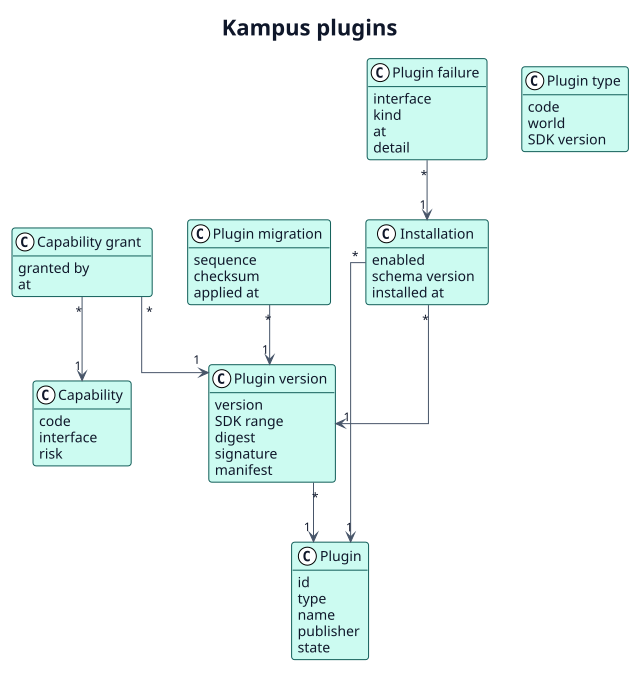

# Plugins

Module `kampus-plugin-host` (level 7, [architecture](../03-design/architecture.md#modules)). Installable plugins are **WebAssembly components** that implement one plugin type's WIT world and call the host only through the capabilities they declare and the campus grants (DEC-003). A plugin declares its contributions in a **manifest**, exactly like a native module (DEC-015). The SDK contract is in the [plugin SDK](../03-design/sdk/README.md). Requirements RF-100, RF-102; RNF-011, RNF-012; decisions DEC-067 to DEC-069.

## Entities

| Entity | Level | Definition | Key attributes |
| --- | --- | --- | --- |
| Plugin | 1 | An installable extension identified by a reverse-domain id, of one plugin type | id, type, name, publisher, state |
| Plugin version | 1 | One released build of a plugin: component, manifest, signature | Plugin, version, SDK range, digest, signature, manifest |
| Plugin type | 2 | A kind of plugin with its WIT world and extension points (activity, widget, authentication, enrolment, report, question type, course format, theme, local) | code, world, SDK version |
| Capability | 2 | A host interface or resource a plugin may use: its tables, permissions, events, files, strings, outbound HTTP to declared hosts | code, interface, risk |
| Capability grant | 2 | The campus's approval of one capability for one installed version | Plugin version, Capability, granted by, at |
| Installation | 1 | The state of a plugin in the campus: installed version, enabled, migrations applied | Plugin, Plugin version, enabled, schema version, installed at |
| Plugin migration | 3 | A forward-only schema step of a plugin's own tables, applied by the host | Plugin version, sequence, checksum, applied at |
| Plugin failure | 4 | A trap, timeout or resource limit hit by a plugin call | Installation, interface, kind, at, detail |

## Business rules

| ID | Rule |
| --- | --- |
| RN-203 | A plugin version installs only when its signature is valid for a trusted publisher (or the operator allows unsigned development builds), its digest matches and its SDK range includes the host's SDK version. |
| RN-204 | The manifest declares the plugin type, the capabilities it needs and every contribution (permissions, settings, events, jobs, privacy handler, routes, UI modules, help topics, messages); undeclared contributions are ignored and undeclared host calls fail. |
| RN-205 | Installing or upgrading shows the requested capabilities with their risk; the plugin runs only after an administrator grants them; an upgrade that asks for more capabilities waits for a new grant while the previous version keeps running. |
| RN-206 | A plugin owns only its own tables, in its own schema with the installation prefix (DEC-039); it reads other data only through host interfaces, which apply the caller's permissions (DEC-017). |
| RN-207 | Plugin migrations are forward-only, applied in one transaction per step, and recorded with a checksum; a failed migration leaves the previous version installed and enabled. |
| RN-208 | Every call into a plugin runs with limits on fuel (CPU), memory and wall time; a trap or limit fails that call only, is recorded as a failure, and repeated failures disable the plugin and alert the administrators (RNF-012). |
| RN-209 | Disabling a plugin stops its listeners, jobs, routes and UI modules at once; its deliveries are paused (RN-142) and its data is kept; enabling it resumes them. |
| RN-210 | Removing a plugin runs its privacy handler for retention, deletes its tables and files after confirmation, and keeps an audit entry; content that referenced it (course modules of an activity plugin) is shown as unavailable, never broken. |
| RN-211 | Host interfaces are versioned with the SDK; within a major SDK version changes are additive only, so a plugin built for 1.x runs on every 1.y host (RNF-011). |

## Contracts

| Kind | Items |
| --- | --- |
| Service API | `install`, `grant`, `enable`, `disable`, `upgrade`, `remove`, `call` (into a plugin with limits) |
| Host interfaces | WIT packages of the [plugin SDK](../03-design/sdk/README.md) |
| Events published | `plugins.installed`, `plugins.enabled`, `plugins.disabled`, `plugins.upgraded`, `plugins.removed`, `plugins.failed` |
| API | [plugins.openapi.yaml](../03-design/api/plugins.openapi.yaml) |
| Data | [plugins data model](../03-design/data-model/plugins.md) |
