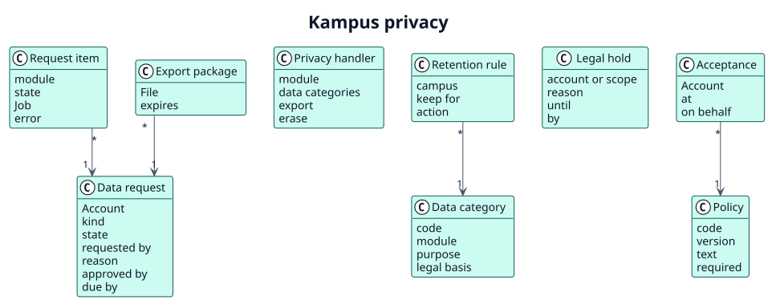

# Privacy

Module `kampus-privacy` (level 6, [architecture](../03-design/architecture.md#modules)). People ask for an export or the deletion of their personal data; every module answers for its own data through the **privacy handler** it declares (DEC-015), so privacy never depends on the modules it serves. Retention is a set of declared **data categories** with periods per campus. Requirement RF-093; RNF-002; decision DEC-061.

## Entities

| Entity | Level | Definition | Key attributes |
| --- | --- | --- | --- |
| Data request | 1 | A request to export or delete the personal data of one account | Account, kind, state, requested by, reason, approved by, due by |
| Request item | 2 | The part of a request handled by one module's privacy handler | Data request, module, state, Job, error |
| Privacy handler | 2 | A module's declared handler: what personal data it keeps, how to export it and how to erase it | module, data categories, export, erase |
| Data category | 2 | A declared kind of personal data with its purpose and legal basis | code, module, purpose, legal basis |
| Retention rule | 3 | How long a data category is kept after its context ends, per campus | Data category, campus, keep for, action |
| Legal hold | 3 | A suspension of deletion for an account or a scope, with a reason | account or scope, reason, until, by |
| Policy | 2 | A versioned text (privacy notice, terms) that people accept | code, version, text, required |
| Acceptance | 3 | A person's acceptance of a policy version | Account, Policy, at, on behalf |
| Export package | 3 | The files produced by an export, available for a limited time | Data request, File, expires |

## Business rules

| ID | Rule |
| --- | --- |
| RN-178 | Every module that stores personal data declares a privacy handler and its data categories; the architecture test fails the build when a module has personal columns and no handler. |
| RN-179 | A request is split into one item per module, each run as a job (DEC-016); the request is complete only when every item is, and failed items are visible and retryable. |
| RN-180 | Deletion requests are **approved** by someone holding `privacy.request.approve` unless the campus allows self-service deletion; the approval and its reason are audited. |
| RN-181 | Deletion follows RN-034: personal data is erased, the account row becomes a tombstone with a pseudonym, and records that must be kept (grades, legal obligations) keep pointing to it. |
| RN-182 | A legal hold stops deletion and retention purges for its account or scope until it ends; the request waits and says why. |
| RN-183 | Exports are machine-readable (JSON per module plus the person's files), packaged as files of the request, available only to the requester through signed URLs (RN-131) and deleted when they expire. |
| RN-184 | Retention jobs apply each rule when the category's context has ended (course finished, account deleted) plus the period, and record what they erased. |
| RN-185 | A required policy whose version changes must be accepted again before continuing; acceptances are kept with the version and the moment, including acceptance on behalf of minors. |
| RN-186 | Requests have a due date set by the campus (30 days by default); overdue requests are flagged to the people who can act on them. |

## Contracts

| Kind | Items |
| --- | --- |
| Service API | `request_export`, `request_deletion`, `approve`, `reject`, `requests`, `policies`, `accept`, `holds` |
| Contributed by every module | Privacy handler: `describe`, `export(account)`, `erase(account)` |
| Events published | `privacy.request_created`, `privacy.request_completed`, `privacy.account_erased`, `privacy.policy_accepted` |
| API | [privacy.openapi.yaml](../03-design/api/privacy.openapi.yaml) |
| Data | [privacy data model](../03-design/data-model/privacy.md) |
