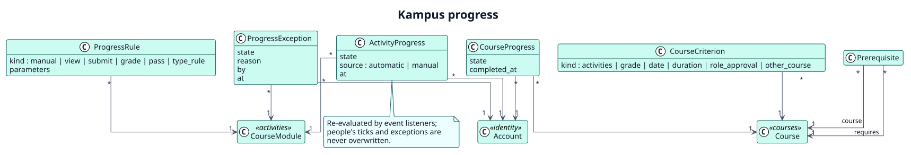

# Progress: activity and course progress

Module `kampus-progress` (level 5, [architecture](../03-design/architecture.md#modules)). **Activity progress** says whether a person has done what a course module asks (viewed it, submitted, reached a grade, passed, or a rule of its type); **course progress** says whether they have met the course's criteria. Both are **derived records** re-evaluated when something relevant changes; what people decide (manual ticks, exceptions) is never overwritten by a recalculation. Requirement RF-063; decisions DEC-051 and DEC-052.

## Entities

| Entity | Level | Definition | Key attributes |
| --- | --- | --- | --- |
| Progress rule | 2 | What a course module requires: view, submit, receive a grade, pass, or a rule declared by its type; or manual marking by the learner | course module, kind, parameters |
| Activity progress | 1 | A person's state on one course module | course module, person, state, source, at |
| Progress state | 2 | `not_started`, `in_progress`, `done`, `done_passed`, `done_failed` | value |
| Progress exception | 2 | A teacher's decision that sets a state regardless of the rules, with a reason | course module, person, state, reason, by, at |
| Course progress criterion | 2 | What the course requires, as typed criteria: activities done, a grade, a date, a duration of enrolment, a role's approval, another course done | course, kind, typed target |
| Course progress | 1 | A person's progress in the course and the moment they completed it | course, person, completed at, state |
| Prerequisite | 3 | A course that must be completed before another; the graph is acyclic | course, prerequisite course |
| Tracked population | 3 | The people progress is tracked for: active participants with `progress.tracked` | course |

## Business rules

| ID | Rule |
| --- | --- |
| RN-115 | Progress states are an enumeration enforced by the database; how a state is **shown** (for example a failed state hidden while the grade is hidden) is decided at read time through the records visibility service, never stored (RN-103). |
| RN-116 | Activity progress is **re-evaluated by listeners** of the events that can change it (views, submissions, grades, exceptions, rule changes); every change of state publishes an event. |
| RN-117 | Progress rule defaults are settings inherited down the scopes (DEC-008) and applied by the creation service for every path (RN-078). |
| RN-118 | Changing a course module's progress rules starts a recalculation job for that course module; records made by people (manual ticks, progress exceptions) are kept, never deleted. |
| RN-119 | A progress exception has an author, a reason and a date, is visible in the person's records, and wins over the rules until removed. |
| RN-120 | Course progress criteria are typed rows with foreign keys to what they depend on (course modules, grade records, courses, roles); one evaluation function per kind. |
| RN-121 | Course progress is evaluated by listeners of the criteria's events and by a job for date-based criteria; it is **revoked** when a criterion stops being met, unless the course says completion is final; both changes are recorded and published. |
| RN-122 | The prerequisite graph is validated when it is saved: a cycle is refused, and teachers see the graph. |
| RN-123 | The tracked population is the same for every rule: active participants (RN-060) with `progress.tracked`. |
| RN-124 | Progress survives the end of a participation (DEC-043). |
| RN-125 | Notifications about progress are listeners configured per course; only criteria that can be met are offered. |

## Main flows

- **Track activity progress** (UC-030): listeners re-evaluate the state of a person on a course module.
- **Configure course progress** (UC-031): criteria and prerequisites.
- **Set a progress exception** (UC-032): a teacher decides a state with a reason.

## Customisation (DEC-008)

| What | Where |
| --- | --- |
| Default progress rules per activity type | Campus, category, course, section |
| Whether course completion is final or can be revoked | Course |
| Progress notifications | Course |

## Contracts

| Kind | Items |
| --- | --- |
| Service API | `state_of`, `states_for` (visibility-aware), `mark`, `set_exception`, `define_rules`, `define_criteria`, `course_progress`, `recalculate` |
| Events | `progress.activity_changed`, `progress.course_completed`, `progress.course_revoked`, `progress.rules_changed`, `progress.exception_changed` |
| API | [progress.openapi.yaml](../03-design/api/progress.openapi.yaml) |
| Permissions | `progress.tracked`, `progress.view_own`, `progress.view_all`, `progress.mark_own`, `progress.exception`, `progress.manage` |
| Data | [progress data model](../03-design/data-model/progress.md) |

## Open questions

| ID | Question | Blocks |
| --- | --- | --- |
| | None | |
