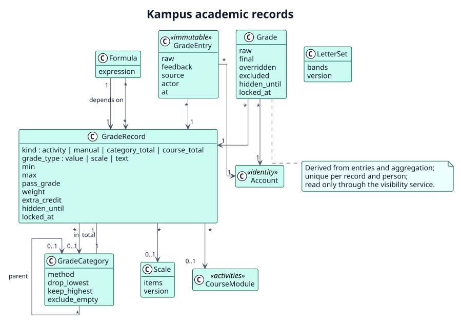

# Academic records: grade records, categories, aggregation, grades

Module `kampus-records` (level 5, [architecture](../03-design/architecture.md#modules)). The **academic records** of a course hold **grade records** (one per graded activity, category, course total or manual item), organised in **categories** that **aggregate** their children. Every change to a person's grade is an immutable **grade entry**; current grades and totals are derived from them. Requirements RF-060 to RF-062; decisions DEC-048 to DEC-050.

## Entities

| Entity | Level | Definition | Key attributes |
| --- | --- | --- | --- |
| Grade record | 1 | One graded thing of a course: an activity's grade, a manual item, a category total or the course total | course, kind, course module, category, grade type, min, max, scale, pass grade, weight, extra credit, multiplier, offset, hidden until, locked |
| Grade category | 2 | A node of the records tree that aggregates its children | course, parent, aggregation method, drop lowest, keep highest, exclude empty |
| Aggregation method | 2 | mean, weighted mean, simple weighted mean, natural (sum), median, lowest, highest, mode | code |
| Grade entry | 1 | An immutable change to one person's grade on one record | record, person, raw, feedback, source (activity, teacher, import, formula), actor, at |
| Grade | 1 | The current grade of a person on a record, derived from the entries and the aggregation | record, person, raw, final, overridden, excluded, hidden until, locked, version |
| Scale | 3 | An ordered list of items used instead of numbers, versioned and attached to a scope | scope, items, version |
| Letter set | 3 | Bands that turn a percentage into a letter, versioned and attached to a scope | scope, bands, version |
| Formula | 3 | A calculated grade record, with its dependencies stored as relations | record, expression, depends on |
| Recalculation job | 4 | The work of recomputing derived grades along the dependency graph after a change | course, records affected, state |

## Business rules

| ID | Rule |
| --- | --- |
| RN-095 | Every graded activity has exactly one grade record per grade item it declares (constraint); each category has exactly one total record; each course has exactly one course total. |
| RN-096 | Grades are written by **idempotent upserts** on (record, person): sending the same grade twice changes nothing and publishes one event; concurrent first grades never fail (DEC-048). |
| RN-097 | Every change creates an immutable grade entry with its source, actor and time; the history of a grade is its entries. |
| RN-098 | Overriding a grade is an entry with source `teacher`; it wins over later activity grades until removed; locking a record or a grade stops all changes until unlocked. |
| RN-099 | Category totals, the course total and formulas are **derived**: a recalculation job recomputes them along the dependency graph, only for the records and people affected by a change; reading never triggers recalculation (DEC-048). |
| RN-100 | Each aggregation method has a typed definition of how weights, extra credit and empty grades count, with worked examples as tests; the meaning of a child's weight never depends on a code that changes with the parent's method (DEC-050). |
| RN-101 | Drop lowest and keep highest apply only to methods that define them; ties drop the child with the larger maximum first; natural aggregation ignores them. |
| RN-102 | Exact numerics (DEC-023): grades `numeric(12,5)`, weights `numeric(9,5)`; rounding only for display, by the course's rule. |
| RN-103 | **Grade visibility is applied in one read service** (DEC-049): every consumer (learner views, reports, progress rules, achievements, integrations, the API) receives the grades and totals the requester may see; a teacher view is explicit and needs a permission. Hidden grades never leak through a total. |
| RN-104 | A grade record or a grade can be hidden until a date; hidden is a state with its own date, not a sentinel value. |
| RN-105 | Grades survive the end of a participation (DEC-043): hidden while the person is not an active participant, shown again on return. |
| RN-106 | Scales and letter sets are versioned and inherited down the scopes; a record keeps the version it was graded with. |
| RN-107 | Formula dependencies are relations; deleting or renaming a record used by a formula is refused or rewrites the formula explicitly. |
| RN-108 | Changing a record's settings (maximum, type, weight, multiplier) checks the permission of each changed attribute; hiding needs its own permission. |
| RN-109 | The grader report and exports read through the same visibility service and paginate on the server. |
| RN-110 | Calculation behaviour that changes between releases is versioned per course; upgrading a course's behaviour is an explicit, recorded action. |

## Main flows

- **Receive a grade from an activity** (UC-026): upsert, entry, event, recalculation job.
- **Configure the records of a course** (UC-027): categories, methods, weights, scales, formulas.
- **Override or lock a grade** (UC-028).
- **See grades** (UC-029): learner view and grader report through the visibility service.

## Customisation (DEC-008)

| What | Where |
| --- | --- |
| Default aggregation, rounding, display (points, percentage, letter) | Campus, category, course |
| Scales and letter sets | Campus, category, course |
| What learners see (totals, ranges, ranks) | Course |

## Contracts

| Kind | Items |
| --- | --- |
| Service API | `upsert_grade`, `grades_for` (visibility-aware), `grader_report`, `override`, `lock`, `define_record`, `define_category`, `recalculate` |
| Events | `records.grade_changed`, `records.total_changed`, `records.record_created`, `records.record_updated`, `records.record_deleted`, `records.overridden`, `records.locked` |
| API | [records.openapi.yaml](../03-design/api/records.openapi.yaml) |
| Permissions | `records.view_own`, `records.view_all`, `records.view_hidden`, `records.grade`, `records.override`, `records.lock`, `records.hide`, `records.manage`, `records.export` |
| Data | [records data model](../03-design/data-model/records.md) |

## Open questions

| ID | Question | Blocks |
| --- | --- | --- |
| | None | |
