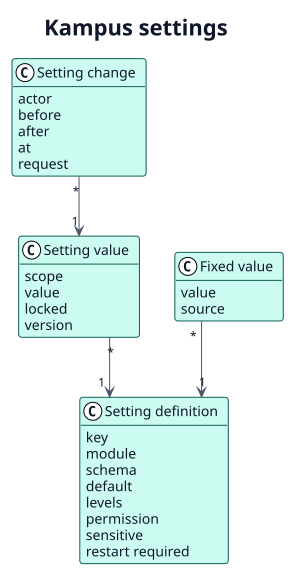

# Settings

Module `kampus-settings` (level 1, [architecture](../03-design/architecture.md#modules)). Every module **declares** its settings with a type, a default, the scope levels where each may be overridden and the permission to change it (DEC-015); values are stored per scope and **resolved** through the scope hierarchy of DEC-008. Deployment configuration (DEC-020) is a different thing: it can fix a setting, which is then shown as fixed. Requirement RF-090; decision DEC-059.

## Entities

| Entity | Level | Definition | Key attributes |
| --- | --- | --- | --- |
| Setting definition | 2 | A declared, typed setting of a module | key, module, schema, default, levels, permission, sensitive, restart required |
| Setting value | 1 | The value of a setting in one scope | Setting definition, scope, value, locked, version |
| Setting change | 4 | A recorded change of a value: who, when, before and after | Setting value, actor, before, after, at, request |
| Fixed value | 3 | A value fixed by the deployment configuration, read-only in the campus | Setting definition, value, source |

## Business rules

| ID | Rule |
| --- | --- |
| RN-162 | A setting exists only when its module declares it; values of undeclared or retired keys are refused, and retired keys are removed by the module's migration. |
| RN-163 | Every value is validated against the declared JSON schema when written; an invalid value is refused with the field errors (DEC-018), never stored and fixed later. |
| RN-164 | Resolution walks the scope from the most specific level to the platform (platform → tenant → category → course → section → activity → user) and returns the first value, or the default; the result says **where the value came from**. |
| RN-165 | A value may be set only at the levels its definition allows, by someone holding its permission in that scope; a value **locked** at a level cannot be overridden below it. |
| RN-166 | A value fixed by the deployment wins over every stored value; it is shown as fixed with its source and cannot be changed through the API. |
| RN-167 | Sensitive settings (secrets, keys) are stored encrypted with the installation key, never returned by the API, and shown only as set or not set. |
| RN-168 | Every change records who, when, the value before and after (sensitive values masked) and publishes `settings.changed`; caches of the resolved value are invalidated by that event on every node. |
| RN-169 | Settings marked as requiring a restart are applied only by the next start of the role that reads them; the screen says so. |

## Customisation points

| Point | Where |
| --- | --- |
| New settings | Declared by modules and plugins |
| Levels and locks | Per definition, then per campus |

## Contracts

| Kind | Items |
| --- | --- |
| Service API | `get` (key, scope) with origin, `set`, `unset`, `lock`, `history`, `definitions` |
| Events published | `settings.changed` |
| API | [settings.openapi.yaml](../03-design/api/settings.openapi.yaml) |
| Data | [settings data model](../03-design/data-model/settings.md) |
