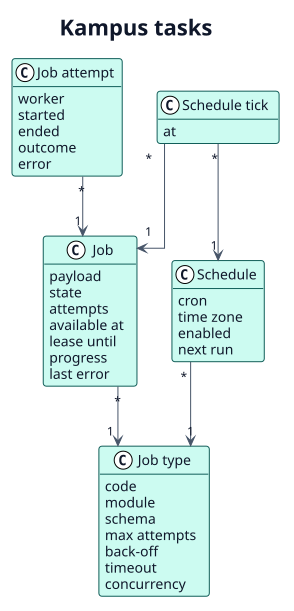

# Tasks

Module `kampus-tasks` (level 0, [architecture](../03-design/architecture.md#modules)). Background work is a **job** in a durable queue on the database, and scheduled work is a **schedule** that enqueues jobs (DEC-016). Job types are declared by modules (DEC-015); every job has a state that administrators can see, retry or cancel. Requirement RF-092; decision DEC-060.

## Entities

| Entity | Level | Definition | Key attributes |
| --- | --- | --- | --- |
| Job type | 2 | A declared kind of job with its payload schema, retry policy, timeout and concurrency key | code, module, schema, max attempts, back-off, timeout, concurrency |
| Job | 1 | One unit of background work | Job type, payload, state, attempts, available at, lease until, progress, last error |
| Schedule | 2 | A recurring rule that enqueues jobs of a type | Job type, cron, time zone, enabled, next run |
| Schedule tick | 3 | One firing of a schedule, unique per schedule and instant | Schedule, at, Job |
| Job attempt | 4 | One execution of a job: worker, start, end, outcome, error | Job, worker, started, ended, outcome, error |

## Business rules

| ID | Rule |
| --- | --- |
| RN-170 | A job is enqueued in the transaction that needs it (DEC-016); a job of an undeclared type or with an invalid payload fails that transaction. |
| RN-171 | Workers claim jobs with `FOR UPDATE SKIP LOCKED` and hold a **lease** they renew while working; a job whose lease expires (the worker died) becomes available again. |
| RN-172 | Jobs are idempotent by id; a failed attempt is retried with exponential back-off up to the type's maximum, then the job becomes **failed** with its error and an alert; nothing fails silently. |
| RN-173 | Jobs sharing a concurrency key run one at a time (for example one recalculation per course); others wait without being claimed. |
| RN-174 | A schedule fires once per instant across the whole cluster: the tick is unique per schedule and instant, so several schedulers never enqueue the same run twice. |
| RN-175 | Schedules are declared by modules with defaults; administrators may change the rule, the time zone or disable them, and run one now; the change is recorded. |
| RN-176 | Long jobs report progress and check for cancellation between steps; a cancelled job stops at the next step and keeps what it finished. |
| RN-177 | Job payloads hold identifiers, never copies of personal data; finished jobs and attempts are kept by a retention policy and purged by a job. |

## Contracts

| Kind | Items |
| --- | --- |
| Service API | `enqueue` (in a transaction), `cancel`, `retry`, `run_schedule_now`, `jobs` (filters), `schedules` |
| Events published | `tasks.job_failed`, `tasks.schedule_changed` |
| API | [tasks.openapi.yaml](../03-design/api/tasks.openapi.yaml) |
| Data | [tasks data model](../03-design/data-model/tasks.md) |
