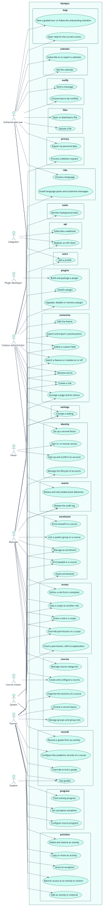
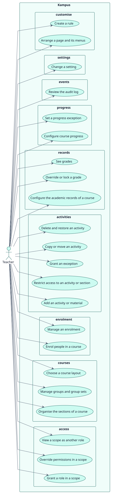

# Requirements

## Index

- [Actors](./actors.md)
- [Requirements catalogue](./requirements.md)

## Use cases

| ID | Use case | Actor | Package | Requirement | Analysis | Design | Implementation | Status |
| --- | --- | --- | --- | --- | --- | --- | --- | --- |
| UC-001 | [Grant a role in a scope](./use-cases/grantRole/README.md) | Manager, Teacher | access | RF-020 | [card](../02-analysis/use-cases/grantRole/README.md) | [card](../03-design/use-cases/grantRole/README.md) | [card](../04-implementation/use-cases/grantRole/README.md) | proposed |
| UC-002 | [Override permissions in a scope](./use-cases/overridePermission/README.md) | Manager, Teacher | access | RF-024 | [card](../02-analysis/use-cases/overridePermission/README.md) | [card](../03-design/use-cases/overridePermission/README.md) | [card](../04-implementation/use-cases/overridePermission/README.md) | proposed |
| UC-003 | [Check a permission, with its explanation](./use-cases/checkPermission/README.md) | System | access | RF-022 | [card](../02-analysis/use-cases/checkPermission/README.md) | [card](../03-design/use-cases/checkPermission/README.md) | [card](../04-implementation/use-cases/checkPermission/README.md) | proposed |
| UC-004 | [Define a role from a template](./use-cases/defineRole/README.md) | Campus administrator | access | RF-021 | [card](../02-analysis/use-cases/defineRole/README.md) | [card](../03-design/use-cases/defineRole/README.md) | [card](../04-implementation/use-cases/defineRole/README.md) | proposed |
| UC-005 | [View a scope as another role](./use-cases/viewAsRole/README.md) | Teacher, Manager | access | RF-023 | [card](../02-analysis/use-cases/viewAsRole/README.md) | [card](../03-design/use-cases/viewAsRole/README.md) | [card](../04-implementation/use-cases/viewAsRole/README.md) | proposed |

### Use-case diagram

### By actor

#### Campus administrator

#### Manager

#### System

#### Teacher

The index and its diagrams are generated from the use-case cards (front matter: `actor`, `package`, `includes`, `extends`). Edit the cards, not this table.

## Conventions

- `specification.puml` is the behavioural source of truth of a use case: a statechart with the Actor/System conversation.
- `wireframes.puml` is the interface prototype, even when it holds a single screen.
- Each use-case folder holds `README.md`, `specification.puml` and `wireframes.puml`.
