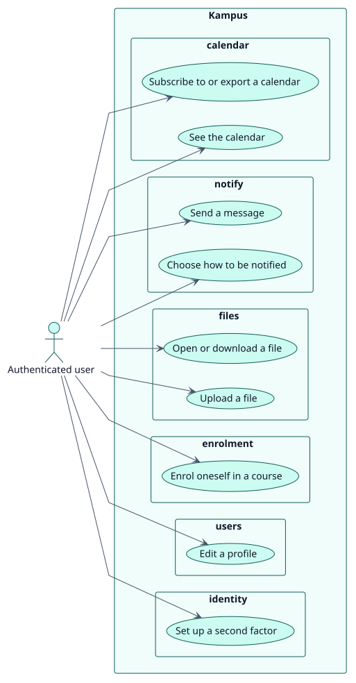
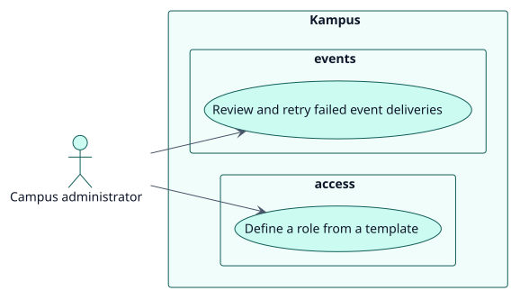
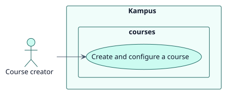
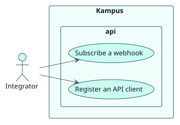
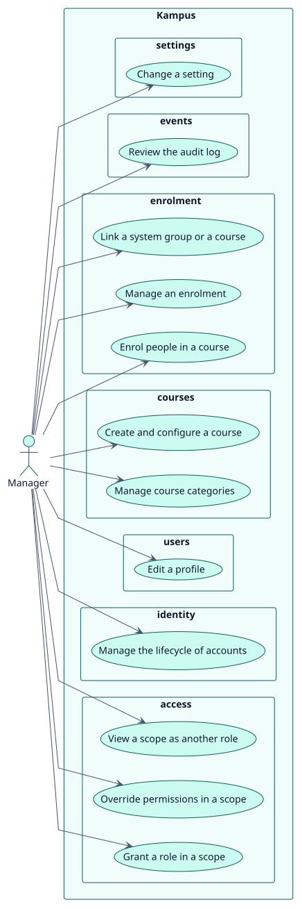
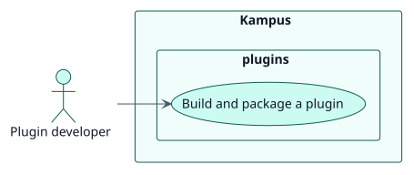
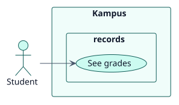
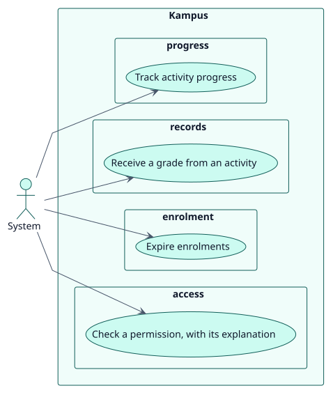
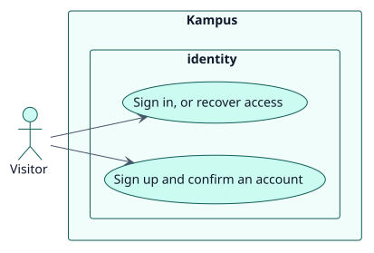

# Requirements

## Index

- [Actors](./actors.md)
- [Requirements catalogue](./requirements.md)

## Use cases

| ID | Use case | Actor | Package | Requirement | Analysis | Design | Implementation | Status |
| --- | --- | --- | --- | --- | --- | --- | --- | --- |
| UC-001 | [Grant a role in a scope](./use-cases/grantRole/README.md) | Manager, Teacher | access | RF-020 | [card](../02-analysis/use-cases/grantRole/README.md) | [card](../03-design/use-cases/grantRole/README.md) | [card](../04-implementation/use-cases/grantRole/README.md) | accepted |
| UC-002 | [Override permissions in a scope](./use-cases/overridePermission/README.md) | Manager, Teacher | access | RF-024 | [card](../02-analysis/use-cases/overridePermission/README.md) | [card](../03-design/use-cases/overridePermission/README.md) | [card](../04-implementation/use-cases/overridePermission/README.md) | accepted |
| UC-003 | [Check a permission, with its explanation](./use-cases/checkPermission/README.md) | System | access | RF-022 | [card](../02-analysis/use-cases/checkPermission/README.md) | [card](../03-design/use-cases/checkPermission/README.md) | [card](../04-implementation/use-cases/checkPermission/README.md) | accepted |
| UC-004 | [Define a role from a template](./use-cases/defineRole/README.md) | Campus administrator | access | RF-021 | [card](../02-analysis/use-cases/defineRole/README.md) | [card](../03-design/use-cases/defineRole/README.md) | [card](../04-implementation/use-cases/defineRole/README.md) | accepted |
| UC-005 | [View a scope as another role](./use-cases/viewAsRole/README.md) | Teacher, Manager | access | RF-023 | [card](../02-analysis/use-cases/viewAsRole/README.md) | [card](../03-design/use-cases/viewAsRole/README.md) | [card](../04-implementation/use-cases/viewAsRole/README.md) | accepted |
| UC-006 | [Sign up and confirm an account](./use-cases/signUp/README.md) | Visitor | identity | RF-010 | [card](../02-analysis/use-cases/signUp/README.md) | [card](../03-design/use-cases/signUp/README.md) | [card](../04-implementation/use-cases/signUp/README.md) | accepted |
| UC-007 | [Sign in, or recover access](./use-cases/signIn/README.md) | Visitor | identity | RF-011 | [card](../02-analysis/use-cases/signIn/README.md) | [card](../03-design/use-cases/signIn/README.md) | [card](../04-implementation/use-cases/signIn/README.md) | accepted |
| UC-008 | [Set up a second factor](./use-cases/setUpSecondFactor/README.md) | Authenticated user | identity | RF-012 | [card](../02-analysis/use-cases/setUpSecondFactor/README.md) | [card](../03-design/use-cases/setUpSecondFactor/README.md) | [card](../04-implementation/use-cases/setUpSecondFactor/README.md) | accepted |
| UC-009 | [Manage the lifecycle of accounts](./use-cases/manageAccountLifecycle/README.md) | Manager | identity | RF-013 | [card](../02-analysis/use-cases/manageAccountLifecycle/README.md) | [card](../03-design/use-cases/manageAccountLifecycle/README.md) | [card](../04-implementation/use-cases/manageAccountLifecycle/README.md) | accepted |
| UC-010 | [Edit a profile](./use-cases/editProfile/README.md) | Authenticated user, Manager | users | RF-014 | [card](../02-analysis/use-cases/editProfile/README.md) | [card](../03-design/use-cases/editProfile/README.md) | [card](../04-implementation/use-cases/editProfile/README.md) | accepted |
| UC-011 | [Manage course categories](./use-cases/manageCategories/README.md) | Manager | courses | RF-030 | [card](../02-analysis/use-cases/manageCategories/README.md) | [card](../03-design/use-cases/manageCategories/README.md) | [card](../04-implementation/use-cases/manageCategories/README.md) | accepted |
| UC-012 | [Create and configure a course](./use-cases/createCourse/README.md) | Course creator, Manager | courses | RF-031 | [card](../02-analysis/use-cases/createCourse/README.md) | [card](../03-design/use-cases/createCourse/README.md) | [card](../04-implementation/use-cases/createCourse/README.md) | accepted |
| UC-013 | [Organise the sections of a course](./use-cases/organiseSections/README.md) | Teacher | courses | RF-032 | [card](../02-analysis/use-cases/organiseSections/README.md) | [card](../03-design/use-cases/organiseSections/README.md) | [card](../04-implementation/use-cases/organiseSections/README.md) | accepted |
| UC-014 | [Manage groups and group sets](./use-cases/manageGroups/README.md) | Teacher | courses | RF-033 | [card](../02-analysis/use-cases/manageGroups/README.md) | [card](../03-design/use-cases/manageGroups/README.md) | [card](../04-implementation/use-cases/manageGroups/README.md) | accepted |
| UC-015 | [Choose a course layout](./use-cases/chooseCourseLayout/README.md) | Teacher | courses | RF-034 | [card](../02-analysis/use-cases/chooseCourseLayout/README.md) | [card](../03-design/use-cases/chooseCourseLayout/README.md) | [card](../04-implementation/use-cases/chooseCourseLayout/README.md) | accepted |
| UC-016 | [Enrol people in a course](./use-cases/enrolPeople/README.md) | Teacher, Manager | enrolment | RF-040 | [card](../02-analysis/use-cases/enrolPeople/README.md) | [card](../03-design/use-cases/enrolPeople/README.md) | [card](../04-implementation/use-cases/enrolPeople/README.md) | accepted |
| UC-017 | [Enrol oneself in a course](./use-cases/selfEnrol/README.md) | Authenticated user | enrolment | RF-042 | [card](../02-analysis/use-cases/selfEnrol/README.md) | [card](../03-design/use-cases/selfEnrol/README.md) | [card](../04-implementation/use-cases/selfEnrol/README.md) | accepted |
| UC-018 | [Manage an enrolment](./use-cases/manageEnrolment/README.md) | Teacher, Manager | enrolment | RF-041 | [card](../02-analysis/use-cases/manageEnrolment/README.md) | [card](../03-design/use-cases/manageEnrolment/README.md) | [card](../04-implementation/use-cases/manageEnrolment/README.md) | accepted |
| UC-019 | [Link a system group or a course](./use-cases/linkEnrolmentSource/README.md) | Manager | enrolment | RF-040 | [card](../02-analysis/use-cases/linkEnrolmentSource/README.md) | [card](../03-design/use-cases/linkEnrolmentSource/README.md) | [card](../04-implementation/use-cases/linkEnrolmentSource/README.md) | accepted |
| UC-020 | [Expire enrolments](./use-cases/expireEnrolments/README.md) | System | enrolment | RF-041 | [card](../02-analysis/use-cases/expireEnrolments/README.md) | [card](../03-design/use-cases/expireEnrolments/README.md) | [card](../04-implementation/use-cases/expireEnrolments/README.md) | accepted |
| UC-021 | [Add an activity or material](./use-cases/addActivity/README.md) | Teacher | activities | RF-050 | [card](../02-analysis/use-cases/addActivity/README.md) | [card](../03-design/use-cases/addActivity/README.md) | [card](../04-implementation/use-cases/addActivity/README.md) | accepted |
| UC-022 | [Restrict access to an activity or section](./use-cases/restrictAccess/README.md) | Teacher | activities | RF-051 | [card](../02-analysis/use-cases/restrictAccess/README.md) | [card](../03-design/use-cases/restrictAccess/README.md) | [card](../04-implementation/use-cases/restrictAccess/README.md) | accepted |
| UC-023 | [Grant an exception](./use-cases/grantException/README.md) | Teacher | activities | RF-054 | [card](../02-analysis/use-cases/grantException/README.md) | [card](../03-design/use-cases/grantException/README.md) | [card](../04-implementation/use-cases/grantException/README.md) | accepted |
| UC-024 | [Copy or move an activity](./use-cases/copyActivity/README.md) | Teacher | activities | RF-053 | [card](../02-analysis/use-cases/copyActivity/README.md) | [card](../03-design/use-cases/copyActivity/README.md) | [card](../04-implementation/use-cases/copyActivity/README.md) | accepted |
| UC-025 | [Delete and restore an activity](./use-cases/deleteActivity/README.md) | Teacher | activities | RF-050 | [card](../02-analysis/use-cases/deleteActivity/README.md) | [card](../03-design/use-cases/deleteActivity/README.md) | [card](../04-implementation/use-cases/deleteActivity/README.md) | accepted |
| UC-026 | [Receive a grade from an activity](./use-cases/receiveGrade/README.md) | System | records | RF-061 | [card](../02-analysis/use-cases/receiveGrade/README.md) | [card](../03-design/use-cases/receiveGrade/README.md) | [card](../04-implementation/use-cases/receiveGrade/README.md) | accepted |
| UC-027 | [Configure the academic records of a course](./use-cases/configureRecords/README.md) | Teacher | records | RF-060 | [card](../02-analysis/use-cases/configureRecords/README.md) | [card](../03-design/use-cases/configureRecords/README.md) | [card](../04-implementation/use-cases/configureRecords/README.md) | accepted |
| UC-028 | [Override or lock a grade](./use-cases/overrideGrade/README.md) | Teacher | records | RF-061 | [card](../02-analysis/use-cases/overrideGrade/README.md) | [card](../03-design/use-cases/overrideGrade/README.md) | [card](../04-implementation/use-cases/overrideGrade/README.md) | accepted |
| UC-029 | [See grades](./use-cases/viewGrades/README.md) | Student, Teacher | records | RF-062 | [card](../02-analysis/use-cases/viewGrades/README.md) | [card](../03-design/use-cases/viewGrades/README.md) | [card](../04-implementation/use-cases/viewGrades/README.md) | accepted |
| UC-030 | [Track activity progress](./use-cases/trackActivityProgress/README.md) | System | progress | RF-063 | [card](../02-analysis/use-cases/trackActivityProgress/README.md) | [card](../03-design/use-cases/trackActivityProgress/README.md) | [card](../04-implementation/use-cases/trackActivityProgress/README.md) | accepted |
| UC-031 | [Configure course progress](./use-cases/configureCourseProgress/README.md) | Teacher | progress | RF-063 | [card](../02-analysis/use-cases/configureCourseProgress/README.md) | [card](../03-design/use-cases/configureCourseProgress/README.md) | [card](../04-implementation/use-cases/configureCourseProgress/README.md) | accepted |
| UC-032 | [Set a progress exception](./use-cases/setProgressException/README.md) | Teacher | progress | RF-063 | [card](../02-analysis/use-cases/setProgressException/README.md) | [card](../03-design/use-cases/setProgressException/README.md) | [card](../04-implementation/use-cases/setProgressException/README.md) | accepted |
| UC-033 | [Upload a file](./use-cases/uploadFile/README.md) | Authenticated user | files | RF-080 | [card](../02-analysis/use-cases/uploadFile/README.md) | [card](../03-design/use-cases/uploadFile/README.md) | [card](../04-implementation/use-cases/uploadFile/README.md) | accepted |
| UC-034 | [Open or download a file](./use-cases/downloadFile/README.md) | Authenticated user | files | RF-080 | [card](../02-analysis/use-cases/downloadFile/README.md) | [card](../03-design/use-cases/downloadFile/README.md) | [card](../04-implementation/use-cases/downloadFile/README.md) | accepted |
| UC-035 | [Review and retry failed event deliveries](./use-cases/retryDeliveries/README.md) | Campus administrator | events | RF-081 | [card](../02-analysis/use-cases/retryDeliveries/README.md) | [card](../03-design/use-cases/retryDeliveries/README.md) | [card](../04-implementation/use-cases/retryDeliveries/README.md) | accepted |
| UC-036 | [Review the audit log](./use-cases/reviewAuditLog/README.md) | Teacher, Manager | events | RF-082 | [card](../02-analysis/use-cases/reviewAuditLog/README.md) | [card](../03-design/use-cases/reviewAuditLog/README.md) | [card](../04-implementation/use-cases/reviewAuditLog/README.md) | accepted |
| UC-037 | [Choose how to be notified](./use-cases/setNotificationPreferences/README.md) | Authenticated user | notify | RF-070 | [card](../02-analysis/use-cases/setNotificationPreferences/README.md) | [card](../03-design/use-cases/setNotificationPreferences/README.md) | [card](../04-implementation/use-cases/setNotificationPreferences/README.md) | accepted |
| UC-038 | [Send a message](./use-cases/sendMessage/README.md) | Authenticated user | notify | RF-071 | [card](../02-analysis/use-cases/sendMessage/README.md) | [card](../03-design/use-cases/sendMessage/README.md) | [card](../04-implementation/use-cases/sendMessage/README.md) | accepted |
| UC-039 | [See the calendar](./use-cases/viewCalendar/README.md) | Authenticated user | calendar | RF-072 | [card](../02-analysis/use-cases/viewCalendar/README.md) | [card](../03-design/use-cases/viewCalendar/README.md) | [card](../04-implementation/use-cases/viewCalendar/README.md) | accepted |
| UC-040 | [Subscribe to or export a calendar](./use-cases/subscribeCalendar/README.md) | Authenticated user | calendar | RF-072 | [card](../02-analysis/use-cases/subscribeCalendar/README.md) | [card](../03-design/use-cases/subscribeCalendar/README.md) | [card](../04-implementation/use-cases/subscribeCalendar/README.md) | accepted |
| UC-041 | [Change a setting](./use-cases/changeSetting/README.md) | Campus administrator, Manager, Teacher | settings | RF-090 | [card](../02-analysis/use-cases/changeSetting/README.md) | [card](../03-design/use-cases/changeSetting/README.md) | [card](../04-implementation/use-cases/changeSetting/README.md) | accepted |
| UC-042 | [Monitor background tasks](./use-cases/monitorTasks/README.md) | Campus administrator | tasks | RF-092 | [card](../02-analysis/use-cases/monitorTasks/README.md) | [card](../03-design/use-cases/monitorTasks/README.md) | [card](../04-implementation/use-cases/monitorTasks/README.md) | accepted |
| UC-043 | [Export my personal data](./use-cases/exportMyData/README.md) | Authenticated user | privacy | RF-093 | [card](../02-analysis/use-cases/exportMyData/README.md) | [card](../03-design/use-cases/exportMyData/README.md) | [card](../04-implementation/use-cases/exportMyData/README.md) | accepted |
| UC-044 | [Process a deletion request](./use-cases/processDeletionRequest/README.md) | Campus administrator | privacy | RF-093 | [card](../02-analysis/use-cases/processDeletionRequest/README.md) | [card](../03-design/use-cases/processDeletionRequest/README.md) | [card](../04-implementation/use-cases/processDeletionRequest/README.md) | accepted |
| UC-045 | [Choose a language](./use-cases/chooseLanguage/README.md) | Authenticated user | i18n | RF-091 | [card](../02-analysis/use-cases/chooseLanguage/README.md) | [card](../03-design/use-cases/chooseLanguage/README.md) | [card](../04-implementation/use-cases/chooseLanguage/README.md) | accepted |
| UC-046 | [Install language packs and customise messages](./use-cases/manageLanguagePacks/README.md) | Campus administrator | i18n | RF-091 | [card](../02-analysis/use-cases/manageLanguagePacks/README.md) | [card](../03-design/use-cases/manageLanguagePacks/README.md) | [card](../04-implementation/use-cases/manageLanguagePacks/README.md) | accepted |
| UC-047 | [Register an API client](./use-cases/registerApiClient/README.md) | Integrator, Campus administrator | api | RF-103 | [card](../02-analysis/use-cases/registerApiClient/README.md) | [card](../03-design/use-cases/registerApiClient/README.md) | [card](../04-implementation/use-cases/registerApiClient/README.md) | accepted |
| UC-048 | [Subscribe a webhook](./use-cases/subscribeWebhook/README.md) | Integrator | api | RF-104 | [card](../02-analysis/use-cases/subscribeWebhook/README.md) | [card](../03-design/use-cases/subscribeWebhook/README.md) | [card](../04-implementation/use-cases/subscribeWebhook/README.md) | accepted |
| UC-049 | [Install a plugin](./use-cases/installPlugin/README.md) | Campus administrator | plugins | RF-100 | [card](../02-analysis/use-cases/installPlugin/README.md) | [card](../03-design/use-cases/installPlugin/README.md) | [card](../04-implementation/use-cases/installPlugin/README.md) | accepted |
| UC-050 | [Upgrade, disable or remove a plugin](./use-cases/managePlugin/README.md) | Campus administrator | plugins | RF-100 | [card](../02-analysis/use-cases/managePlugin/README.md) | [card](../03-design/use-cases/managePlugin/README.md) | [card](../04-implementation/use-cases/managePlugin/README.md) | accepted |
| UC-051 | [Build and package a plugin](./use-cases/buildPlugin/README.md) | Plugin developer | plugins | RF-102 | [card](../02-analysis/use-cases/buildPlugin/README.md) | [card](../03-design/use-cases/buildPlugin/README.md) | [card](../04-implementation/use-cases/buildPlugin/README.md) | accepted |
| UC-052 | [Rename terms](./use-cases/renameTerms/README.md) | Campus administrator, Manager | customise | RF-006 | [card](../02-analysis/use-cases/renameTerms/README.md) | [card](../03-design/use-cases/renameTerms/README.md) | [card](../04-implementation/use-cases/renameTerms/README.md) | accepted |
| UC-053 | [Define a custom field](./use-cases/defineCustomField/README.md) | Campus administrator, Manager | customise | RF-006 | [card](../02-analysis/use-cases/defineCustomField/README.md) | [card](../03-design/use-cases/defineCustomField/README.md) | [card](../04-implementation/use-cases/defineCustomField/README.md) | accepted |
| UC-054 | [Arrange a page and its menus](./use-cases/arrangeLayout/README.md) | Campus administrator, Teacher | customise | RF-006 | [card](../02-analysis/use-cases/arrangeLayout/README.md) | [card](../03-design/use-cases/arrangeLayout/README.md) | [card](../04-implementation/use-cases/arrangeLayout/README.md) | accepted |
| UC-055 | [Edit the theme](./use-cases/editTheme/README.md) | Campus administrator | customise | RF-115 | [card](../02-analysis/use-cases/editTheme/README.md) | [card](../03-design/use-cases/editTheme/README.md) | [card](../04-implementation/use-cases/editTheme/README.md) | accepted |
| UC-056 | [Create a rule](./use-cases/createRule/README.md) | Campus administrator, Teacher | customise | RF-006 | [card](../02-analysis/use-cases/createRule/README.md) | [card](../03-design/use-cases/createRule/README.md) | [card](../04-implementation/use-cases/createRule/README.md) | accepted |
| UC-057 | [Switch a feature or module on or off](./use-cases/switchFeature/README.md) | Campus administrator, Manager | customise | RF-118 | [card](../02-analysis/use-cases/switchFeature/README.md) | [card](../03-design/use-cases/switchFeature/README.md) | [card](../04-implementation/use-cases/switchFeature/README.md) | accepted |
| UC-058 | [Export and import customisations](./use-cases/shareCustomisation/README.md) | Campus administrator | customise | RF-004 | [card](../02-analysis/use-cases/shareCustomisation/README.md) | [card](../03-design/use-cases/shareCustomisation/README.md) | [card](../04-implementation/use-cases/shareCustomisation/README.md) | accepted |
| UC-059 | [Open help for the current screen](./use-cases/openHelp/README.md) | Authenticated user | help | RF-009 | [card](../02-analysis/use-cases/openHelp/README.md) | [card](../03-design/use-cases/openHelp/README.md) | [card](../04-implementation/use-cases/openHelp/README.md) | accepted |
| UC-060 | [Take a guided tour or follow the onboarding checklist](./use-cases/takeGuidedTour/README.md) | Authenticated user | help | RF-009 | [card](../02-analysis/use-cases/takeGuidedTour/README.md) | [card](../03-design/use-cases/takeGuidedTour/README.md) | [card](../04-implementation/use-cases/takeGuidedTour/README.md) | accepted |

### Use-case diagram

### By actor

#### Authenticated user

#### Campus administrator

#### Course creator

#### Integrator

#### Manager

#### Plugin developer

#### Student

#### System

#### Teacher

#### Visitor

The index and its diagrams are generated from the use-case cards (front matter: `actor`, `package`, `includes`, `extends`). Edit the cards, not this table.

## Conventions

- `specification.puml` is the behavioural source of truth of a use case: a statechart with the Actor/System conversation.
- `wireframes.puml` is the interface prototype, even when it holds a single screen.
- Each use-case folder holds `README.md`, `specification.puml` and `wireframes.puml`.
