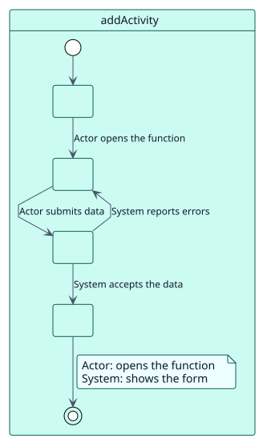

# UC-021 Add an activity or material

| Overview | Requirements | Analysis | Design | Implementation | Tests |
| --- | --- | --- | --- | --- | --- |
| [Use cases](../../../01-requirements/use-case-overview.svg) | **Requirements** | [Analysis](../../../02-analysis/use-cases/addActivity/README.md) | [Design](../../../03-design/use-cases/addActivity/README.md) | [Implementation](../../../04-implementation/use-cases/addActivity/README.md) | [Tests](../../../04-implementation/use-cases/addActivity/README.md#tests) |

## Use-case information

| Field | Value |
| --- | --- |
| Actor | Teacher or section leader (with `activities.module.add`) |
| Package | activities |
| Goal | Place a new activity or material of a type in a section, with its settings |
| Type | Primary, real |
| Level | User goal |
| Requirement | RF-050 |
| Domain entities | Course module, Activity type |

## Context

Every activity type fulfils the same contract; the course module carries the common settings, the type its own data.

## Preconditions

- The type is enabled in the scope; the actor holds `activities.module.add` in the section.

## Postconditions

- Success: the course module and the type's instance data exist; grade records and progress rules declared by the type are created; `activities.module_created` is published.
- Failure: nothing is created.

## Main flow

| Step | Actor | System |
| --- | --- | --- |
| 1 | Chooses a type and a position | Shows the type's settings form with inherited defaults (RN-078) |
| 2 | Fills settings and saves | Creates the course module, its scope and the type data in one transaction (RN-077) |

## Alternative flows

| ID | Starts at step | Condition | Behaviour | Ends |
| --- | --- | --- | --- | --- |
| A1 | 2 | The type rejects the settings | `validation` with the fields; nothing created | Failure |

## Business rules

| ID | Rule |
| --- | --- |
| RN-075 | Activity contract |
| RN-076 | Placement and order |
| RN-077 | One transaction |
| RN-078 | Same defaults for every path |

## Specification

Behaviour source of truth: [specification.puml](./specification.puml)

## Wireframes

## Pending

| Question | Blocks |
| --- | --- |
| None | — |
