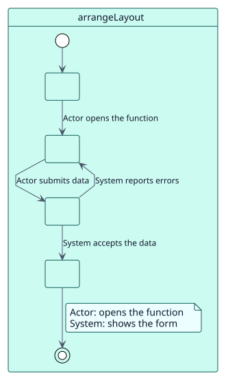

# UC-054 Arrange a page and its menus

| Overview | Requirements | Analysis | Design | Implementation | Tests |
| --- | --- | --- | --- | --- | --- |
| [Use cases](../../../01-requirements/use-case-overview.svg) | **Requirements** | [Analysis](../../../02-analysis/use-cases/arrangeLayout/README.md) | [Design](../../../03-design/use-cases/arrangeLayout/README.md) | [Implementation](../../../04-implementation/use-cases/arrangeLayout/README.md) | [Tests](../../../04-implementation/use-cases/arrangeLayout/README.md#tests) |

## Use-case information

| Field | Value |
| --- | --- |
| Actor | Campus administrator for campus pages; teacher for course pages, within what the campus allows |
| Package | customise |
| Goal | Place widgets in the regions of a page and edit its menus |
| Type | Primary, real |
| Level | User goal |
| Requirement | RF-006 |
| Domain entities | Layout, Widget placement, Navigation menu |

## Context

Layouts and menus are data per page kind and scope, validated against the regions and installed widgets.

## Preconditions

- The actor holds `customise.layout.manage` in the scope and the layout is not locked above.

## Postconditions

- Success: the page shows the new arrangement in the scope and below.
- Failure: no change.

## Main flow

| Step | Actor | System |
| --- | --- | --- |
| 1 | Opens a page in edit mode | Shows regions and the widgets available |
| 2 | Adds, moves or removes widgets and saves | Validates regions, widgets and their settings (RN-216); stores with If-Match |
| 3 | Edits a menu | Stores the tree; items are filtered by permission when shown |

## Alternative flows

| ID | Starts at step | Condition | Behaviour | Ends |
| --- | --- | --- | --- | --- |
| A1 | — | A widget's plugin is disabled | The widget is skipped; the page still renders (RN-216) | Success |

## Business rules

| ID | Rule |
| --- | --- |
| RN-213 | Resolution and locks |
| RN-216 | Validated layouts and menus |
| RN-222 | History |

## Specification

Behaviour source of truth: [specification.puml](./specification.puml)

## Wireframes

## Pending

| Question | Blocks |
| --- | --- |
| None | — |
