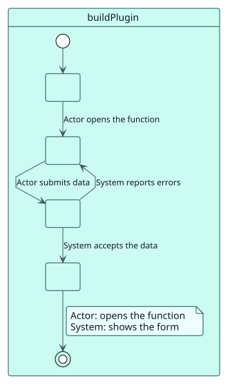

# UC-051 Build and package a plugin

| Overview | Requirements | Analysis | Design | Implementation | Tests |
| --- | --- | --- | --- | --- | --- |
| [Use cases](../../../01-requirements/use-case-overview.svg) | **Requirements** | [Analysis](../../../02-analysis/use-cases/buildPlugin/README.md) | [Design](../../../03-design/use-cases/buildPlugin/README.md) | [Implementation](../../../04-implementation/use-cases/buildPlugin/README.md) | [Tests](../../../04-implementation/use-cases/buildPlugin/README.md#tests) |

## Use-case information

| Field | Value |
| --- | --- |
| Actor | Plugin developer with the SDK |
| Package | plugins |
| Goal | Write a plugin of a type, test it against the host and publish a signed package |
| Type | Primary, real |
| Level | User goal |
| Requirement | RF-102 |
| Domain entities | Plugin type, Capability, Plugin version |

## Context

The SDK wraps the WIT worlds; a host test harness runs the plugin with an in-memory database.

## Preconditions

- The developer has the SDK and a signing key.

## Postconditions

- Success: a signed package with its manifest is ready to install.
- Failure: the harness reports the failing contracts.

## Main flow

| Step | Actor | System |
| --- | --- | --- |
| 1 | Scaffolds a plugin of a type | `kampus plugin new` creates the world, manifest and tests |
| 2 | Implements and tests it | `kampus plugin test` runs it in the harness with limits (RN-208) |
| 3 | Packs it | `kampus plugin pack` builds the component, computes the digest and signs it (RN-203) |

## Alternative flows

| ID | Starts at step | Condition | Behaviour | Ends |
| --- | --- | --- | --- | --- |
| A1 | 2 | The plugin calls an interface it did not declare | The call fails in the harness, as in production (RN-204) | Failure |

## Business rules

| ID | Rule |
| --- | --- |
| RN-203 | Signed packages |
| RN-204 | Declared calls only |
| RN-208 | Limits |
| RN-211 | SDK compatibility |

## Specification

Behaviour source of truth: [specification.puml](./specification.puml)

## Wireframes

## Pending

| Question | Blocks |
| --- | --- |
| None | — |
