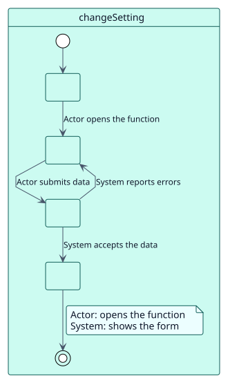

# UC-041 Change a setting

| Overview | Requirements | Analysis | Design | Implementation | Tests |
| --- | --- | --- | --- | --- | --- |
| [Use cases](../../../01-requirements/use-case-overview.svg) | **Requirements** | [Analysis](../../../02-analysis/use-cases/changeSetting/README.md) | [Design](../../../03-design/use-cases/changeSetting/README.md) | [Implementation](../../../04-implementation/use-cases/changeSetting/README.md) | [Tests](../../../04-implementation/use-cases/changeSetting/README.md#tests) |

## Use-case information

| Field | Value |
| --- | --- |
| Actor | Anyone holding the setting's permission in the scope (administrators for the campus, managers for categories, teachers for courses) |
| Package | settings |
| Goal | Set, remove or lock a value of a setting in a scope |
| Type | Primary, real |
| Level | User goal |
| Requirement | RF-090 |
| Domain entities | Setting definition, Setting value, Setting change |

## Context

Settings are declared by modules; values are resolved from the most specific scope up, and the screen shows where each value comes from.

## Preconditions

- The setting may be set at the scope's level; the actor holds its permission there.

## Postconditions

- Success: the value is stored, the change recorded and `settings.changed` published; caches are invalidated.
- Failure: no change.

## Main flow

| Step | Actor | System |
| --- | --- | --- |
| 1 | Opens the settings of a scope | Shows each value with its origin, locks and fixed values (RN-164, RN-166) |
| 2 | Changes a value and saves | Validates it against the schema (RN-163) and stores it with If-Match |
| 3 | Optionally locks it | Stops overrides below (RN-165) |

## Alternative flows

| ID | Starts at step | Condition | Behaviour | Ends |
| --- | --- | --- | --- | --- |
| A1 | 2 | Locked above or fixed by the deployment | `409` with where it is locked or fixed | Failure |
| A2 | 2 | Invalid value | `422` with the field errors | Failure |
| A3 | 2 | The setting requires a restart | Stored; the screen says it applies at the next start (RN-169) | Success |

## Business rules

| ID | Rule |
| --- | --- |
| RN-162 | Declared settings |
| RN-163 | Validated values |
| RN-164 | Resolution with origin |
| RN-165 | Levels and locks |
| RN-166 | Fixed values |
| RN-167 | Sensitive values |
| RN-168 | History and invalidation |

## Specification

Behaviour source of truth: [specification.puml](./specification.puml)

## Wireframes

## Pending

| Question | Blocks |
| --- | --- |
| None | — |
