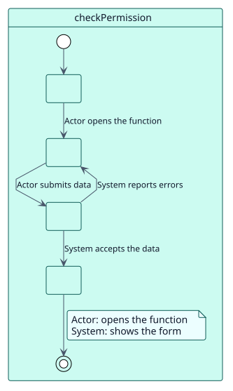

# UC-003 Check a permission, with its explanation

| Overview | Requirements | Analysis | Design | Implementation | Tests |
| --- | --- | --- | --- | --- | --- |
| [Use cases](../../../01-requirements/use-case-overview.svg) | **Requirements** | [Analysis](../../../02-analysis/use-cases/checkPermission/README.md) | [Design](../../../03-design/use-cases/checkPermission/README.md) | [Implementation](../../../04-implementation/use-cases/checkPermission/README.md) | [Tests](../../../04-implementation/use-cases/checkPermission/README.md#tests) |

## Use-case information

| Field | Value |
| --- | --- |
| Actor | System (every service operation), and people with `access.review` who ask for an explanation |
| Package | access |
| Goal | Decide whether an actor may do something in a scope, and explain why |
| Type | Primary, real |
| Level | User goal |
| Requirement | RF-022 |
| Domain entities | Grant, Role permission, Permission override, Scope, Permission decision |

## Context

Every service operation calls the check against the scope of the object it touches (DEC-017). People reviewing access, or wondering why a button is missing, ask the same check for its explanation (RF-023).

## Preconditions

- The permission is declared (RN-021).

## Postconditions

- Success: a decision with its rule, and on request its explanation.
- Failure: none: the check always answers; an unknown permission answers denied and is reported.

## Main flow

| Step | Actor | System |
| --- | --- | --- |
| 1 | An operation needs a permission in a scope | Rejects inactive accounts (RN-010), applies the guest and frozen-scope limits (RN-009, RN-011) |
| 2 | — | Loads the active grants on the scope path from the cache (RN-003) |
| 3 | — | Computes each role's value bottom-up (RN-004) and decides: any forbid denies, otherwise any allow allows (RN-005, RN-006) |
| 4 | A reviewer asks for the explanation | Returns the grants, values and scopes that decided (RN-019) |

## Alternative flows

| ID | Starts at step | Condition | Behaviour | Ends |
| --- | --- | --- | --- | --- |
| A1 | 1 | The permission is not declared | Denied with rule `unknown_permission`, reported in the logs | Failure |
| A2 | 1 | The actor is viewing as another role | Uses that role only, read permissions only (RN-018) | Success |

## Business rules

| ID | Rule |
| --- | --- |
| RN-003 | Active grants on the path |
| RN-004 | First value bottom-up |
| RN-005 | Forbid wins |
| RN-006 | Allow needed |
| RN-007 | No bypass |
| RN-009 | Guest limit |
| RN-010 | Inactive accounts |
| RN-011 | Frozen scopes |
| RN-019 | Explanation |
| RN-021 | Declared permissions |

## Specification

Behaviour source of truth: [specification.puml](./specification.puml)

## Wireframes

## Pending

| Question | Blocks |
| --- | --- |
| None | — |
