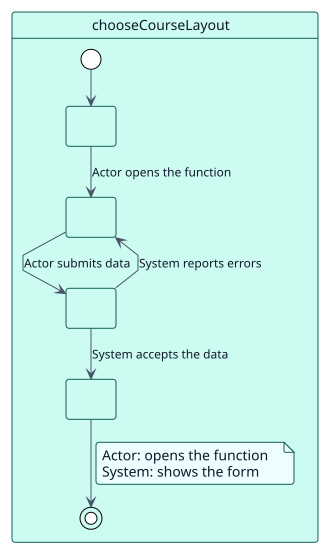
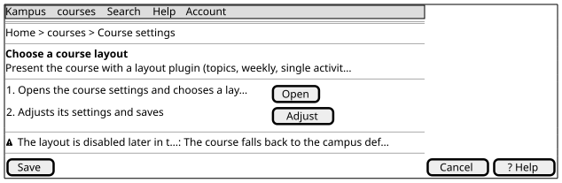

# UC-015 Choose a course layout

| Overview | Requirements | Analysis | Design | Implementation | Tests |
| --- | --- | --- | --- | --- | --- |
| [Use cases](../../../01-requirements/use-case-overview.svg) | **Requirements** | [Analysis](../../../02-analysis/use-cases/chooseCourseLayout/README.md) | [Design](../../../03-design/use-cases/chooseCourseLayout/README.md) | [Implementation](../../../04-implementation/use-cases/chooseCourseLayout/README.md) | [Tests](../../../04-implementation/use-cases/chooseCourseLayout/README.md#tests) |

## Use-case information

| Field | Value |
| --- | --- |
| Actor | Teacher (with `courses.course.update`) |
| Package | courses |
| Goal | Present the course with a layout plugin (topics, weekly, single activity, social…) and its settings |
| Type | Primary, real |
| Level | User goal |
| Requirement | RF-034 |
| Domain entities | Course, Course layout |

## Context

Layouts are plugins (DEC-037). They only present: switching keeps every section and course module, and each layout keeps its own settings for the course.

## Preconditions

- The actor holds `courses.course.update`; the layout is enabled in the campus.

## Postconditions

- Success: the course uses the layout with its settings; `courses.course_updated` is published.
- Failure: no change.

## Main flow

| Step | Actor | System |
| --- | --- | --- |
| 1 | Opens the course settings and chooses a layout | Shows the layout's declared settings, pre-filled if the course used it before |
| 2 | Adjusts its settings and saves | Validates them against the layout's schema and saves with If-Match |

## Alternative flows

| ID | Starts at step | Condition | Behaviour | Ends |
| --- | --- | --- | --- | --- |
| A1 | 2 | The layout is disabled later in the campus | The course falls back to the campus default layout, keeping its sections; the teacher is told | Success |

## Business rules

| ID | Rule |
| --- | --- |
| RN-052 | Switching layouts keeps the content |

## Specification

Behaviour source of truth: [specification.puml](./specification.puml)

## Wireframes

## Pending

| Question | Blocks |
| --- | --- |
| None | — |
