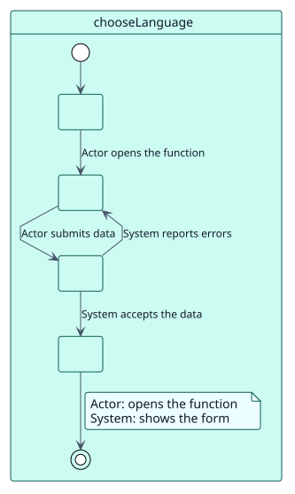

# UC-045 Choose a language

| Overview | Requirements | Analysis | Design | Implementation | Tests |
| --- | --- | --- | --- | --- | --- |
| [Use cases](../../../01-requirements/use-case-overview.svg) | **Requirements** | [Analysis](../../../02-analysis/use-cases/chooseLanguage/README.md) | [Design](../../../03-design/use-cases/chooseLanguage/README.md) | [Implementation](../../../04-implementation/use-cases/chooseLanguage/README.md) | [Tests](../../../04-implementation/use-cases/chooseLanguage/README.md#tests) |

## Use-case information

| Field | Value |
| --- | --- |
| Actor | Any person; visitors through their browser |
| Package | i18n |
| Goal | Use the campus in their language, with dates and numbers formatted for it |
| Type | Primary, real |
| Level | User goal |
| Requirement | RF-091 |
| Domain entities | Language, Language choice |

## Context

The language is resolved per request; a course may force its own; right-to-left languages switch the direction of the client.

## Preconditions

- The language is installed and enabled.

## Postconditions

- Success: later requests resolve to the chosen language, unless a course forces another.
- Failure: no change.

## Main flow

| Step | Actor | System |
| --- | --- | --- |
| 1 | Chooses a language | Stores the choice (RN-189) |
| 2 | — | The client loads the bundles of the language with the scope's customisations (RN-191) and switches direction if needed (RN-192) |

## Alternative flows

| ID | Starts at step | Condition | Behaviour | Ends |
| --- | --- | --- | --- | --- |
| A1 | 2 | A message has no translation | Falls back along the parent chain and counts it as missing (RN-190) | Success |
| A2 | 1 | A course forces another language | The course is shown in its language | Success |

## Business rules

| ID | Rule |
| --- | --- |
| RN-189 | Language resolution |
| RN-190 | Fallbacks and missing strings |
| RN-191 | Message resolution |
| RN-192 | Locale formatting and direction |

## Specification

Behaviour source of truth: [specification.puml](./specification.puml)

## Wireframes

## Pending

| Question | Blocks |
| --- | --- |
| None | — |
