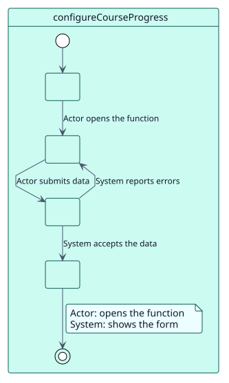
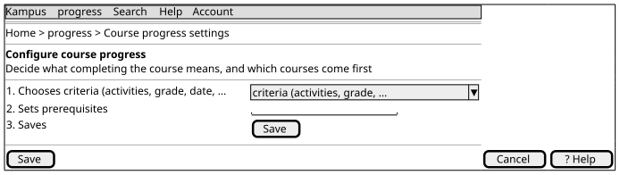

# UC-031 Configure course progress

| Overview | Requirements | Analysis | Design | Implementation | Tests |
| --- | --- | --- | --- | --- | --- |
| [Use cases](../../../01-requirements/use-case-overview.svg) | **Requirements** | [Analysis](../../../02-analysis/use-cases/configureCourseProgress/README.md) | [Design](../../../03-design/use-cases/configureCourseProgress/README.md) | [Implementation](../../../04-implementation/use-cases/configureCourseProgress/README.md) | [Tests](../../../04-implementation/use-cases/configureCourseProgress/README.md#tests) |

## Use-case information

| Field | Value |
| --- | --- |
| Actor | Teacher (with `progress.manage`) |
| Package | progress |
| Goal | Decide what completing the course means, and which courses come first |
| Type | Primary, real |
| Level | User goal |
| Requirement | RF-063 |
| Domain entities | Course criterion, Prerequisite, Course progress |

## Context

Criteria are typed; prerequisites form a graph that must stay acyclic.

## Preconditions

- The actor holds `progress.manage`.

## Postconditions

- Success: criteria and prerequisites are saved; re-evaluation is queued.
- Failure: no change.

## Main flow

| Step | Actor | System |
| --- | --- | --- |
| 1 | Chooses criteria (activities, grade, date, duration, approval, other course) | Validates each typed criterion (RN-120) |
| 2 | Sets prerequisites | Refuses cycles and shows the graph (RN-122) |
| 3 | Saves | Queues the re-evaluation of course progress (RN-121) |

## Alternative flows

| ID | Starts at step | Condition | Behaviour | Ends |
| --- | --- | --- | --- | --- |

## Business rules

| ID | Rule |
| --- | --- |
| RN-120 | Typed criteria |
| RN-121 | Evaluation and revocation |
| RN-122 | Acyclic prerequisites |

## Specification

Behaviour source of truth: [specification.puml](./specification.puml)

## Wireframes

## Pending

| Question | Blocks |
| --- | --- |
| None | — |
