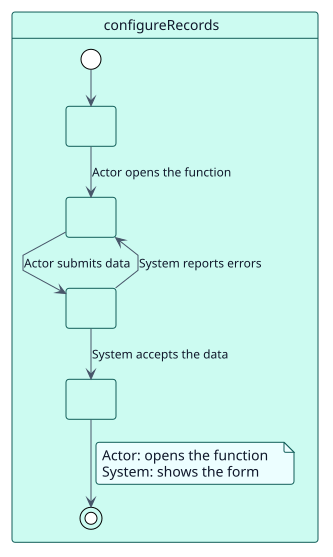

# UC-027 Configure the academic records of a course

| Overview | Requirements | Analysis | Design | Implementation | Tests |
| --- | --- | --- | --- | --- | --- |
| [Use cases](../../../01-requirements/use-case-overview.svg) | **Requirements** | [Analysis](../../../02-analysis/use-cases/configureRecords/README.md) | [Design](../../../03-design/use-cases/configureRecords/README.md) | [Implementation](../../../04-implementation/use-cases/configureRecords/README.md) | [Tests](../../../04-implementation/use-cases/configureRecords/README.md#tests) |

## Use-case information

| Field | Value |
| --- | --- |
| Actor | Teacher (with `records.manage`) |
| Package | records |
| Goal | Organise records in categories, choose aggregation, weights, scales and formulas |
| Type | Primary, real |
| Level | User goal |
| Requirement | RF-060 |
| Domain entities | Grade category, Grade record, Scale, Formula |

## Context

Each aggregation method has a typed definition and worked examples; changing settings recalculates in the background.

## Preconditions

- The actor holds `records.manage`; attributes like maximum or weight may need their own permissions (RN-108).

## Postconditions

- Success: the tree and settings are saved; a recalculation job is queued.
- Failure: no change.

## Main flow

| Step | Actor | System |
| --- | --- | --- |
| 1 | Adds categories and moves records into them | Validates the tree |
| 2 | Chooses methods, weights, drop lowest, scales and formulas | Validates per method (RN-100, RN-101) and formula dependencies (RN-107) |
| 3 | Saves | Saves with If-Match and queues recalculation |

## Alternative flows

| ID | Starts at step | Condition | Behaviour | Ends |
| --- | --- | --- | --- | --- |
| A1 | 2 | A formula would depend on itself | Refused (RN-107) | Failure |

## Business rules

| ID | Rule |
| --- | --- |
| RN-100 | Typed aggregation |
| RN-101 | Drop lowest and keep highest |
| RN-106 | Versioned scales |
| RN-107 | Formula dependencies |
| RN-108 | Permission per attribute |

## Specification

Behaviour source of truth: [specification.puml](./specification.puml)

## Wireframes

## Pending

| Question | Blocks |
| --- | --- |
| None | — |
