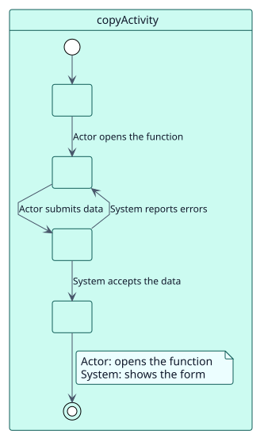

# UC-024 Copy or move an activity

| Overview | Requirements | Analysis | Design | Implementation | Tests |
| --- | --- | --- | --- | --- | --- |
| [Use cases](../../../01-requirements/use-case-overview.svg) | **Requirements** | [Analysis](../../../02-analysis/use-cases/copyActivity/README.md) | [Design](../../../03-design/use-cases/copyActivity/README.md) | [Implementation](../../../04-implementation/use-cases/copyActivity/README.md) | [Tests](../../../04-implementation/use-cases/copyActivity/README.md#tests) |

## Use-case information

| Field | Value |
| --- | --- |
| Actor | Teacher (with `activities.module.add` in the target and `activities.module.update` in the source) |
| Package | activities |
| Goal | Reuse an activity in another place or course, or move it |
| Type | Primary, real |
| Level | User goal |
| Requirement | RF-053 |
| Domain entities | Course module |

## Context

Copy is part of the activity contract: each type copies its own data; permission overrides are copied through the access service.

## Preconditions

- The type supports copying.

## Postconditions

- Success: the copy exists in the target with new identities, or the module is in its new place; events are published.
- Failure: nothing changes.

## Main flow

| Step | Actor | System |
| --- | --- | --- |
| 1 | Chooses copy or move and the target | Validates permissions in source and target |
| 2 | Confirms | Moves (one row) or copies in one transaction, through the type's copy operation (RN-090) |

## Alternative flows

| ID | Starts at step | Condition | Behaviour | Ends |
| --- | --- | --- | --- | --- |

## Business rules

| ID | Rule |
| --- | --- |
| RN-076 | Placement and order |
| RN-077 | One transaction |
| RN-090 | Copy through the contract |

## Specification

Behaviour source of truth: [specification.puml](./specification.puml)

## Wireframes

## Pending

| Question | Blocks |
| --- | --- |
| None | — |
