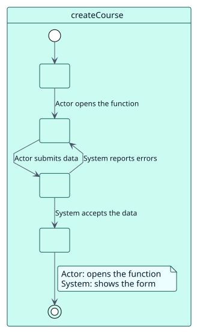

# UC-012 Create and configure a course

| Overview | Requirements | Analysis | Design | Implementation | Tests |
| --- | --- | --- | --- | --- | --- |
| [Use cases](../../../01-requirements/use-case-overview.svg) | **Requirements** | [Analysis](../../../02-analysis/use-cases/createCourse/README.md) | [Design](../../../03-design/use-cases/createCourse/README.md) | [Implementation](../../../04-implementation/use-cases/createCourse/README.md) | [Tests](../../../04-implementation/use-cases/createCourse/README.md#tests) |

## Use-case information

| Field | Value |
| --- | --- |
| Actor | Course creator or manager (with `courses.course.create` in the category) |
| Package | courses |
| Goal | Create a course from a template, and set its names, dates, visibility, layout and owners |
| Type | Primary, real |
| Level | User goal |
| Requirement | RF-031 |
| Domain entities | Course, Course template, Course owner, Section |

## Context

Courses start from templates that bring default sections, a layout, settings and grants. The creator becomes an owner, which carries the right to manage and delete the course.

## Preconditions

- The actor holds `courses.course.create` in the category (RN-051).

## Postconditions

- Success: a draft course with its scope, sections, owners and grants; `courses.course_created` is published.
- Failure: no course.

## Main flow

| Step | Actor | System |
| --- | --- | --- |
| 1 | Chooses a category and a template | Lists the templates available in that category |
| 2 | Gives short name, full name, dates and visibility | Checks uniqueness (RN-041) and dates (RN-042) |
| 3 | Confirms | Creates course, scope, sections, owner and grants in one transaction, with the idempotency key |
| 4 | Publishes the course when ready | Moves it from draft to published (RN-049) |

## Alternative flows

| ID | Starts at step | Condition | Behaviour | Ends |
| --- | --- | --- | --- | --- |
| A1 | 2 | The short name is taken | `conflict` naming the field | Failure |
| A2 | 4 | The owner archives the course at the end of the term | The course scope is frozen (RN-011, RN-049) | Success |

## Business rules

| ID | Rule |
| --- | --- |
| RN-041 | Unique names |
| RN-042 | Dates |
| RN-049 | Lifecycle |
| RN-050 | Deletion by owners and permission |
| RN-051 | Creation from a template |

## Specification

Behaviour source of truth: [specification.puml](./specification.puml)

## Wireframes

## Pending

| Question | Blocks |
| --- | --- |
| None | — |
