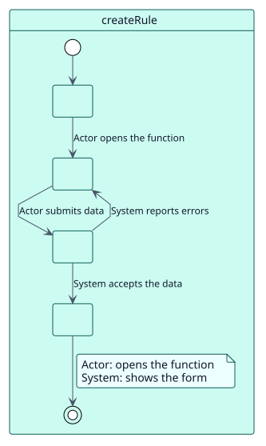

# UC-056 Create a rule

| Overview | Requirements | Analysis | Design | Implementation | Tests |
| --- | --- | --- | --- | --- | --- |
| [Use cases](../../../01-requirements/use-case-overview.svg) | **Requirements** | [Analysis](../../../02-analysis/use-cases/createRule/README.md) | [Design](../../../03-design/use-cases/createRule/README.md) | [Implementation](../../../04-implementation/use-cases/createRule/README.md) | [Tests](../../../04-implementation/use-cases/createRule/README.md#tests) |

## Use-case information

| Field | Value |
| --- | --- |
| Actor | Anyone holding `customise.rules.manage` in the scope |
| Package | customise |
| Goal | Automate a routine (for example enrol in the next course on completion) without code |
| Type | Primary, real |
| Level | User goal |
| Requirement | RF-006 |
| Domain entities | Rule, Rule run |

## Context

Rules combine a declared trigger, conditions and actions; they run as jobs with the owner's permissions.

## Preconditions

- The actor holds `customise.rules.manage` and the permissions the actions need.

## Postconditions

- Success: the rule runs on every matching event, each run recorded.
- Failure: no rule is created.

## Main flow

| Step | Actor | System |
| --- | --- | --- |
| 1 | Chooses a trigger | Offers the declared event types visible in the scope (RN-218) |
| 2 | Adds conditions and actions and saves | Validates them against their schemas and the owner's permissions |
| 3 | — | On each event, evaluates the conditions and enqueues the actions as jobs (RN-219) |

## Alternative flows

| ID | Starts at step | Condition | Behaviour | Ends |
| --- | --- | --- | --- | --- |
| A1 | 3 | An action fails | The run is recorded as failed with its error; the owner is notified | Failure |
| A2 | 3 | The rule would trigger itself or exceed the chain depth | The chain stops and is reported (RN-219) | Failure |

## Business rules

| ID | Rule |
| --- | --- |
| RN-218 | Typed building blocks |
| RN-219 | Jobs, owner permissions and loop protection |
| RN-222 | History |

## Specification

Behaviour source of truth: [specification.puml](./specification.puml)

## Wireframes

## Pending

| Question | Blocks |
| --- | --- |
| None | — |
