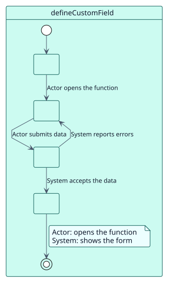

# UC-053 Define a custom field

| Overview | Requirements | Analysis | Design | Implementation | Tests |
| --- | --- | --- | --- | --- | --- |
| [Use cases](../../../01-requirements/use-case-overview.svg) | **Requirements** | [Analysis](../../../02-analysis/use-cases/defineCustomField/README.md) | [Design](../../../03-design/use-cases/defineCustomField/README.md) | [Implementation](../../../04-implementation/use-cases/defineCustomField/README.md) | [Tests](../../../04-implementation/use-cases/defineCustomField/README.md#tests) |

## Use-case information

| Field | Value |
| --- | --- |
| Actor | Anyone holding `customise.fields.manage` in the scope |
| Package | customise |
| Goal | Collect and show extra typed data on people, courses, sections, activities or enrolments |
| Type | Primary, real |
| Level | User goal |
| Requirement | RF-006 |
| Domain entities | Custom field, Custom field value |

## Context

Fields are typed and validated; values are owned through each module's link table; visibility follows permissions.

## Preconditions

- The entity kind accepts custom fields; the actor holds `customise.fields.manage`.

## Postconditions

- Success: the field appears in forms, lists, filters and exports of the scope.
- Failure: no change.

## Main flow

| Step | Actor | System |
| --- | --- | --- |
| 1 | Chooses an entity kind and a type | Shows the validation and visibility options of the type |
| 2 | Saves | Creates the field and its choices (RN-214) |
| 3 | People fill it | Values are validated and stored typed; private fields are visible only with permission (RN-215) |

## Alternative flows

| ID | Starts at step | Condition | Behaviour | Ends |
| --- | --- | --- | --- | --- |
| A1 | 2 | The type of a field with values is changed | `409`: create a new field and migrate | Failure |

## Business rules

| ID | Rule |
| --- | --- |
| RN-213 | Resolution |
| RN-214 | Typed fields without polymorphic owners |
| RN-215 | Visibility by permission |

## Specification

Behaviour source of truth: [specification.puml](./specification.puml)

## Wireframes

## Pending

| Question | Blocks |
| --- | --- |
| None | — |
