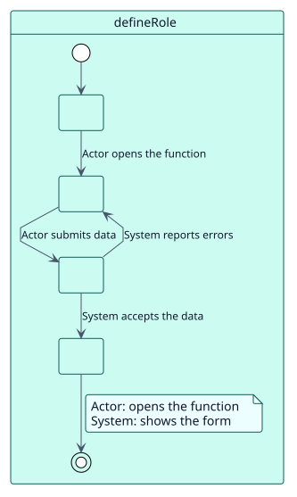
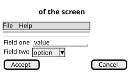

# UC-004 Define a role from a template

| Overview | Requirements | Analysis | Design | Implementation | Tests |
| --- | --- | --- | --- | --- | --- |
| [Use cases](../../../01-requirements/use-case-overview.svg) | **Requirements** | [Analysis](../../../02-analysis/use-cases/defineRole/README.md) | [Design](../../../03-design/use-cases/defineRole/README.md) | [Implementation](../../../04-implementation/use-cases/defineRole/README.md) | [Tests](../../../04-implementation/use-cases/defineRole/README.md#tests) |

## Use-case information

| Field | Value |
| --- | --- |
| Actor | Campus administrator (with `access.role.manage` in the campus) |
| Package | access |
| Goal | Create or adapt the roles of a campus, and bring them back to their template when needed |
| Type | Primary, real |
| Level | User goal |
| Requirement | RF-021 |
| Domain entities | Role, Role template, Role permission, Role allowance |

## Context

Every role comes from a versioned template. New versions of Kampus may bring new template versions; a campus sees the differences and decides.

## Preconditions

- The actor holds `access.role.manage` in the campus.

## Postconditions

- Success: the role exists with its values, allowances and assignable scope kinds; `access.role_created` or `access.role_updated` is published.
- Failure: no change.

## Main flow

| Step | Actor | System |
| --- | --- | --- |
| 1 | Creates a role from a template version | Copies the template values; the short name must be unique in the campus |
| 2 | Adjusts names, values, allowances and assignable kinds | Saves with If-Match and records the changes |
| 3 | Asks to reset to a template version | Shows the differences (RN-017) |
| 4 | Confirms the reset | Applies exactly the previewed differences |

## Alternative flows

| ID | Starts at step | Condition | Behaviour | Ends |
| --- | --- | --- | --- | --- |
| A1 | 4 | The role changed after the preview | `precondition_failed`; preview again | Failure |
| A2 | 1 | The actor deletes a role with grants | `conflict`: grants must be removed first | Failure |

## Business rules

| ID | Rule |
| --- | --- |
| RN-017 | Templates, preview and reset |
| RN-008 | Someone keeps managing access |
| RN-015 | Changes recorded |

## Specification

Behaviour source of truth: [specification.puml](./specification.puml)

## Wireframes

## Pending

| Question | Blocks |
| --- | --- |
| None | — |
