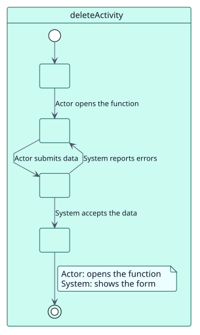
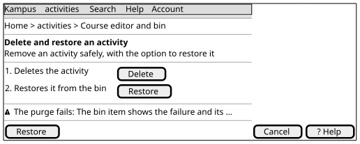

# UC-025 Delete and restore an activity

| Overview | Requirements | Analysis | Design | Implementation | Tests |
| --- | --- | --- | --- | --- | --- |
| [Use cases](../../../01-requirements/use-case-overview.svg) | **Requirements** | [Analysis](../../../02-analysis/use-cases/deleteActivity/README.md) | [Design](../../../03-design/use-cases/deleteActivity/README.md) | [Implementation](../../../04-implementation/use-cases/deleteActivity/README.md) | [Tests](../../../04-implementation/use-cases/deleteActivity/README.md#tests) |

## Use-case information

| Field | Value |
| --- | --- |
| Actor | Teacher (with `activities.module.delete`) |
| Package | activities |
| Goal | Remove an activity safely, with the option to restore it |
| Type | Primary, real |
| Level | User goal |
| Requirement | RF-050 |
| Domain entities | Course module, Recycle bin item |

## Context

Deletion goes through the course recycle bin; the data goes only when the bin item expires, by cascade.

## Preconditions

- The actor holds `activities.module.delete`.

## Postconditions

- Success: the course module is in the bin, hidden from the course; `activities.module_deleted` is published.
- Failure: no change.

## Main flow

| Step | Actor | System |
| --- | --- | --- |
| 1 | Deletes the activity | Moves it to the bin in one transaction (RN-088) |
| 2 | Restores it from the bin | Puts it back in its section and position when they exist |

## Alternative flows

| ID | Starts at step | Condition | Behaviour | Ends |
| --- | --- | --- | --- | --- |
| A1 | — | The purge fails | The bin item shows the failure and its reason; the teacher can retry or restore (RN-089) | Success |

## Business rules

| ID | Rule |
| --- | --- |
| RN-088 | Recycle bin |
| RN-089 | Failed deletions visible |

## Specification

Behaviour source of truth: [specification.puml](./specification.puml)

## Wireframes

## Pending

| Question | Blocks |
| --- | --- |
| None | — |
