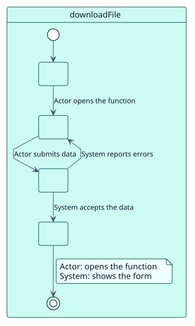

# UC-034 Open or download a file

| Overview | Requirements | Analysis | Design | Implementation | Tests |
| --- | --- | --- | --- | --- | --- |
| [Use cases](../../../01-requirements/use-case-overview.svg) | **Requirements** | [Analysis](../../../02-analysis/use-cases/downloadFile/README.md) | [Design](../../../03-design/use-cases/downloadFile/README.md) | [Implementation](../../../04-implementation/use-cases/downloadFile/README.md) | [Tests](../../../04-implementation/use-cases/downloadFile/README.md#tests) |

## Use-case information

| Field | Value |
| --- | --- |
| Actor | Any person who may read the file's owner |
| Package | files |
| Goal | Open a file attached to something they may read |
| Type | Primary, real |
| Level | User goal |
| Requirement | RF-080 |
| Domain entities | File, Blob |

## Context

The permission is the owner's; the content is served from storage through a signed, expiring URL.

## Preconditions

- The file exists and its scan is clean.

## Postconditions

- Success: the content is served for the requested file only.
- Failure: nothing is served; the answer does not reveal whether the file exists.

## Main flow

| Step | Actor | System |
| --- | --- | --- |
| 1 | Opens a link to a file | Resolves the owner and asks its module whether the actor may read it (RN-128) |
| 2 | — | Issues a signed URL valid for minutes (RN-131) and redirects |
| 3 | Downloads | Serves active content from the files origin with a restrictive policy (RN-132) |

## Alternative flows

| ID | Starts at step | Condition | Behaviour | Ends |
| --- | --- | --- | --- | --- |
| A1 | 1 | The owner is not readable | `404` | Failure |
| A2 | 3 | The signed URL has expired | `403`; the client asks for a new one | Failure |
| A3 | 1 | A conversion is requested | Returns it or queues it (RN-135) | Success |

## Business rules

| ID | Rule |
| --- | --- |
| RN-128 | Readable when the owner is |
| RN-131 | Signed URLs |
| RN-132 | Active content isolated |
| RN-135 | Conversions |

## Specification

Behaviour source of truth: [specification.puml](./specification.puml)

## Wireframes

## Pending

| Question | Blocks |
| --- | --- |
| None | — |
