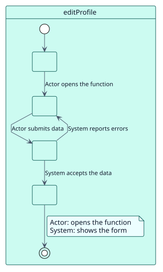

# UC-010 Edit a profile

| Overview | Requirements | Analysis | Design | Implementation | Tests |
| --- | --- | --- | --- | --- | --- |
| [Use cases](../../../01-requirements/use-case-overview.svg) | **Requirements** | [Analysis](../../../02-analysis/use-cases/editProfile/README.md) | [Design](../../../03-design/use-cases/editProfile/README.md) | [Implementation](../../../04-implementation/use-cases/editProfile/README.md) | [Tests](../../../04-implementation/use-cases/editProfile/README.md#tests) |

## Use-case information

| Field | Value |
| --- | --- |
| Actor | The person, or a manager with `users.profile.update_any` |
| Package | users |
| Goal | Keep names, picture, language, time zone and custom fields up to date |
| Type | Primary, real |
| Level | User goal |
| Requirement | RF-014 |
| Domain entities | Profile, Custom field, Preference |

## Context

Profiles hold standard data and custom fields defined per campus or category, each with its own visibility and editing rules.

## Preconditions

- The actor may edit this profile and each field it changes (RN-036).

## Postconditions

- Success: the profile is updated; `users.profile_updated` is published.
- Failure: no change.

## Main flow

| Step | Actor | System |
| --- | --- | --- |
| 1 | Opens a profile | Shows only the fields the actor may see |
| 2 | Changes values | Validates each field by its type and rules |
| 3 | Saves | Updates with If-Match and publishes the event |

## Alternative flows

| ID | Starts at step | Condition | Behaviour | Ends |
| --- | --- | --- | --- | --- |
| A1 | 3 | Changed meanwhile by someone else | `precondition_failed`; reload | Failure |
| A2 | 2 | The person changes the email | Step-up, then a confirmation link to the new address; the old address is notified | Success |

## Business rules

| ID | Rule |
| --- | --- |
| RN-036 | Visibility and editing of custom fields |
| RN-032 | Step-up to change the email |

## Specification

Behaviour source of truth: [specification.puml](./specification.puml)

## Wireframes

## Pending

| Question | Blocks |
| --- | --- |
| None | — |
