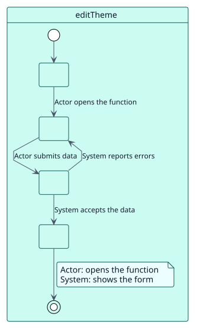

# UC-055 Edit the theme

| Overview | Requirements | Analysis | Design | Implementation | Tests |
| --- | --- | --- | --- | --- | --- |
| [Use cases](../../../01-requirements/use-case-overview.svg) | **Requirements** | [Analysis](../../../02-analysis/use-cases/editTheme/README.md) | [Design](../../../03-design/use-cases/editTheme/README.md) | [Implementation](../../../04-implementation/use-cases/editTheme/README.md) | [Tests](../../../04-implementation/use-cases/editTheme/README.md#tests) |

## Use-case information

| Field | Value |
| --- | --- |
| Actor | Campus administrator, or a manager or teacher where the campus allows theming lower down |
| Package | customise |
| Goal | Brand the campus, a tenant or a course without code |
| Type | Primary, real |
| Level | User goal |
| Requirement | RF-115 |
| Domain entities | Theme |

## Context

Themes are design tokens inheriting from the level above; the client applies them as CSS custom properties.

## Preconditions

- The actor holds `customise.theme.manage` in the scope.

## Postconditions

- Success: the scope uses the new tokens at once.
- Failure: no change.

## Main flow

| Step | Actor | System |
| --- | --- | --- |
| 1 | Changes colours, typography, spacing, radius or motion with a live preview | Previews the pages with the tokens |
| 2 | Saves | Validates the schema and the WCAG 2.2 AA contrast (RN-217); stores the theme |

## Alternative flows

| ID | Starts at step | Condition | Behaviour | Ends |
| --- | --- | --- | --- | --- |
| A1 | 2 | A pair of colours fails contrast | `422` naming the pair and the required ratio | Failure |

## Business rules

| ID | Rule |
| --- | --- |
| RN-213 | Resolution |
| RN-217 | Accessible tokens |

## Specification

Behaviour source of truth: [specification.puml](./specification.puml)

## Wireframes

## Pending

| Question | Blocks |
| --- | --- |
| None | — |
