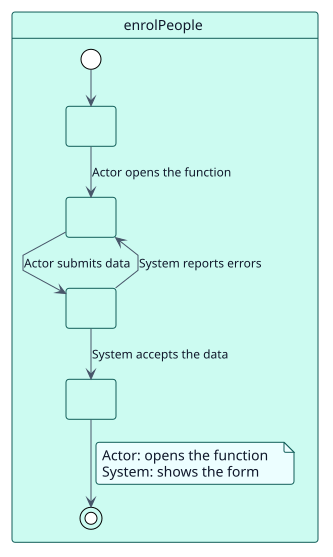
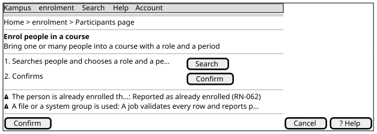

# UC-016 Enrol people in a course

| Overview | Requirements | Analysis | Design | Implementation | Tests |
| --- | --- | --- | --- | --- | --- |
| [Use cases](../../../01-requirements/use-case-overview.svg) | **Requirements** | [Analysis](../../../02-analysis/use-cases/enrolPeople/README.md) | [Design](../../../03-design/use-cases/enrolPeople/README.md) | [Implementation](../../../04-implementation/use-cases/enrolPeople/README.md) | [Tests](../../../04-implementation/use-cases/enrolPeople/README.md#tests) |

## Use-case information

| Field | Value |
| --- | --- |
| Actor | Teacher or manager (with `enrol.enrolment.manage` in the course) |
| Package | enrolment |
| Goal | Bring one or many people into a course with a role and a period |
| Type | Primary, real |
| Level | User goal |
| Requirement | RF-040 |
| Domain entities | Method instance, Enrolment, Enrolment grant |

## Context

Manual enrolment is the basic method: someone with the right picks people, a role and dates. The enrolment owns the grant it creates.

## Preconditions

- The course has an enabled manual instance; the actor holds `enrol.enrolment.manage`.

## Postconditions

- Success: an active enrolment per person with its owned grant; `enrol.enrolment_created` is published per person.
- Failure: no change for the people that failed, reported one by one.

## Main flow

| Step | Actor | System |
| --- | --- | --- |
| 1 | Searches people and chooses a role and a period | Lists only people the actor may see; offers the roles the instance allows |
| 2 | Confirms | For each person, in one transaction: checks capacity with a lock (RN-063), creates the enrolment and its grant (RN-061), publishes the event |

## Alternative flows

| ID | Starts at step | Condition | Behaviour | Ends |
| --- | --- | --- | --- | --- |
| A1 | 2 | The person is already enrolled through this instance | Reported as already enrolled (RN-062) | Success |
| A2 | 1 | A file or a system group is used | A job validates every row and reports per row (RN-073) | Success |

## Business rules

| ID | Rule |
| --- | --- |
| RN-061 | Enrolments own their grants |
| RN-062 | One enrolment per instance and person |
| RN-063 | Capacity in the transaction |
| RN-073 | Bulk enrolment |

## Specification

Behaviour source of truth: [specification.puml](./specification.puml)

## Wireframes

## Pending

| Question | Blocks |
| --- | --- |
| None | — |
