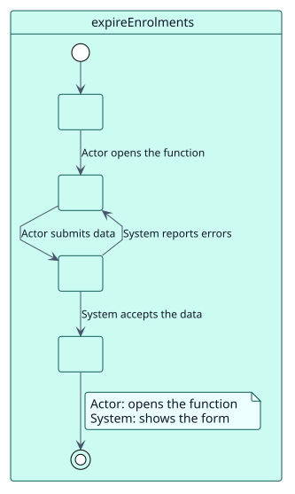
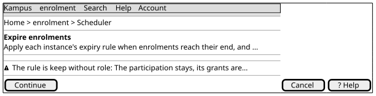

# UC-020 Expire enrolments

| Overview | Requirements | Analysis | Design | Implementation | Tests |
| --- | --- | --- | --- | --- | --- |
| [Use cases](../../../01-requirements/use-case-overview.svg) | **Requirements** | [Analysis](../../../02-analysis/use-cases/expireEnrolments/README.md) | [Design](../../../03-design/use-cases/expireEnrolments/README.md) | [Implementation](../../../04-implementation/use-cases/expireEnrolments/README.md) | [Tests](../../../04-implementation/use-cases/expireEnrolments/README.md#tests) |

## Use-case information

| Field | Value |
| --- | --- |
| Actor | System (scheduled job) |
| Package | enrolment |
| Goal | Apply each instance's expiry rule when enrolments reach their end, and record what was done |
| Type | Primary, real |
| Level | User goal |
| Requirement | RF-041 |
| Domain entities | Enrolment, Expiry rule, Expiry outcome |

## Context

Enrolments with an end date are processed by a scheduled job, never at request time, so the outcome is recorded and visible.

## Preconditions

- Enrolments whose end has passed and that have no outcome yet.

## Postconditions

- Success: each such enrolment is suspended, removed or kept without its role, with its outcome recorded and the event published.
- Failure: failures stay in the job's failed state with their error.

## Main flow

| Step | Actor | System |
| --- | --- | --- |
| 1 | — | Selects due enrolments in batches (`FOR UPDATE SKIP LOCKED`) |
| 2 | — | Applies the instance's expiry rule (RN-068) and records the outcome |
| 3 | — | Optionally notifies people before their enrolment ends, by the campus template |

## Alternative flows

| ID | Starts at step | Condition | Behaviour | Ends |
| --- | --- | --- | --- | --- |
| A1 | 2 | The rule is "keep without role" | The participation stays, its grants are removed | Success |

## Business rules

| ID | Rule |
| --- | --- |
| RN-068 | Expiry rules and outcomes |
| RN-069 | Records kept |

## Specification

Behaviour source of truth: [specification.puml](./specification.puml)

## Wireframes

## Pending

| Question | Blocks |
| --- | --- |
| None | — |
