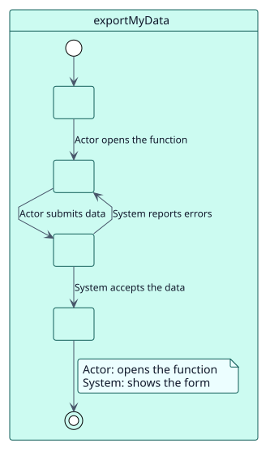

# UC-043 Export my personal data

| Overview | Requirements | Analysis | Design | Implementation | Tests |
| --- | --- | --- | --- | --- | --- |
| [Use cases](../../../01-requirements/use-case-overview.svg) | **Requirements** | [Analysis](../../../02-analysis/use-cases/exportMyData/README.md) | [Design](../../../03-design/use-cases/exportMyData/README.md) | [Implementation](../../../04-implementation/use-cases/exportMyData/README.md) | [Tests](../../../04-implementation/use-cases/exportMyData/README.md#tests) |

## Use-case information

| Field | Value |
| --- | --- |
| Actor | Any signed-in person, or a privacy officer on their behalf (with `privacy.request.manage`) |
| Package | privacy |
| Goal | Receive a copy of all personal data the campus keeps about them |
| Type | Primary, real |
| Level | User goal |
| Requirement | RF-093 |
| Domain entities | Data request, Request item, Export package |

## Context

Each module exports its own data through its privacy handler; the package is a set of files available for a limited time.

## Preconditions

- No open export request exists for the account.

## Postconditions

- Success: the package is ready and the person is notified with signed links.
- Failure: the failed items are visible to the privacy officer and retryable.

## Main flow

| Step | Actor | System |
| --- | --- | --- |
| 1 | Requests an export | Creates the request and one job per module (RN-179) |
| 2 | — | Each handler writes its JSON and files; the package is assembled |
| 3 | Opens the package | Serves signed links until the package expires (RN-183) |

## Alternative flows

| ID | Starts at step | Condition | Behaviour | Ends |
| --- | --- | --- | --- | --- |
| A1 | 2 | A module fails | The item is failed and retried; the request waits (RN-179) | Failure |
| A2 | 3 | The package expired | `410`; a new request is needed | Failure |

## Business rules

| ID | Rule |
| --- | --- |
| RN-178 | Declared handlers |
| RN-179 | One job per module |
| RN-183 | Export packages |
| RN-186 | Due dates |

## Specification

Behaviour source of truth: [specification.puml](./specification.puml)

## Wireframes

## Pending

| Question | Blocks |
| --- | --- |
| None | — |
