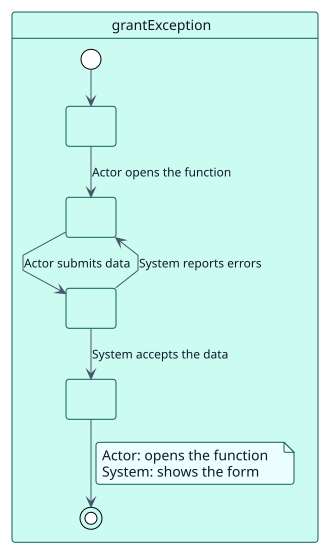
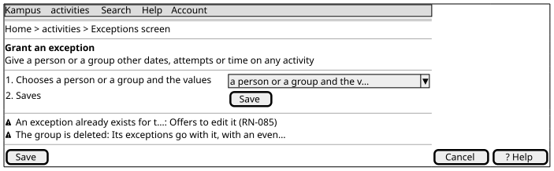

# UC-023 Grant an exception

| Overview | Requirements | Analysis | Design | Implementation | Tests |
| --- | --- | --- | --- | --- | --- |
| [Use cases](../../../01-requirements/use-case-overview.svg) | **Requirements** | [Analysis](../../../02-analysis/use-cases/grantException/README.md) | [Design](../../../03-design/use-cases/grantException/README.md) | [Implementation](../../../04-implementation/use-cases/grantException/README.md) | [Tests](../../../04-implementation/use-cases/grantException/README.md#tests) |

## Use-case information

| Field | Value |
| --- | --- |
| Actor | Teacher (with `activities.exception.manage`) |
| Package | activities |
| Goal | Give a person or a group other dates, attempts or time on any activity |
| Type | Primary, real |
| Level | User goal |
| Requirement | RF-054 |
| Domain entities | Exception |

## Context

Every activity with dates, attempts, time limits or submissions accepts exceptions through one model and one screen.

## Preconditions

- The activity type declares the exception feature; the actor holds `activities.exception.manage`.

## Postconditions

- Success: the exception exists; the effective values change for the person or group; `activities.exception_changed` is published and the calendar follows.
- Failure: no change.

## Main flow

| Step | Actor | System |
| --- | --- | --- |
| 1 | Chooses a person or a group and the values | Previews the effective values with their origin (RN-086) |
| 2 | Saves | Creates or updates the exception (one per person or group) |

## Alternative flows

| ID | Starts at step | Condition | Behaviour | Ends |
| --- | --- | --- | --- | --- |
| A1 | 2 | An exception already exists for that person or group | Offers to edit it (RN-085) | Success |
| A2 | — | The group is deleted | Its exceptions go with it, with an event (RN-087) | Success |

## Business rules

| ID | Rule |
| --- | --- |
| RN-084 | Exceptions for every activity |
| RN-085 | Person xor group, unique |
| RN-086 | Precedence |
| RN-087 | Group deletion |

## Specification

Behaviour source of truth: [specification.puml](./specification.puml)

## Wireframes

## Pending

| Question | Blocks |
| --- | --- |
| None | — |
