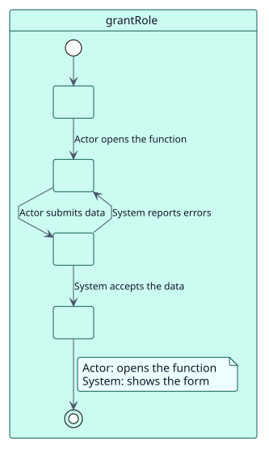
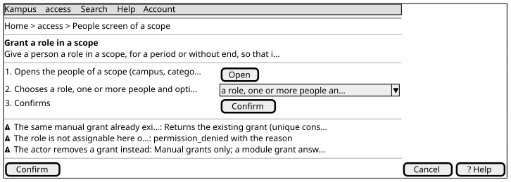

# UC-001 Grant a role in a scope

| Overview | Requirements | Analysis | Design | Implementation | Tests |
| --- | --- | --- | --- | --- | --- |
| [Use cases](../../../01-requirements/use-case-overview.svg) | **Requirements** | [Analysis](../../../02-analysis/use-cases/grantRole/README.md) | [Design](../../../03-design/use-cases/grantRole/README.md) | [Implementation](../../../04-implementation/use-cases/grantRole/README.md) | [Tests](../../../04-implementation/use-cases/grantRole/README.md#tests) |

## Use-case information

| Field | Value |
| --- | --- |
| Actor | Manager, Teacher, Section leader (with `access.grant.create` in the scope and an allowance for the role) |
| Package | access |
| Goal | Give a person a role in a scope, for a period or without end, so that its permissions apply there and below |
| Type | Primary, real |
| Level | User goal |
| Requirement | RF-020 |
| Domain entities | Grant, Role, Scope, Role allowance |

## Context

Roles reach people manually, through this use case, or through modules that own their grants (enrolment, system groups). A grant can be limited in time, which makes temporary assistants and reviewers possible without anyone remembering to remove them.

## Preconditions

- The actor holds `access.grant.create` in the scope (RN-013).
- One of the actor's roles allows granting the target role, and the role is assignable in this scope kind.

## Postconditions

- Success: an active grant exists for the person, role and scope; `access.grant_created` is published after commit and the person's cached permissions are refreshed.
- Failure: no change; the error says which rule failed.

## Main flow

| Step | Actor | System |
| --- | --- | --- |
| 1 | Opens the people of a scope (campus, category, course or section) | Lists the grants of the scope and the roles the actor may grant there |
| 2 | Chooses a role, one or more people and optionally a period | Validates the allowance, the scope kind and the period (RN-013) |
| 3 | Confirms | Creates the grants in one transaction with the idempotency key, records the change (RN-015), publishes the events |

## Alternative flows

| ID | Starts at step | Condition | Behaviour | Ends |
| --- | --- | --- | --- | --- |
| A1 | 3 | The same manual grant already exists | Returns the existing grant (unique constraint, idempotent) | Success |
| A2 | 2 | The role is not assignable here or not allowed for the actor | `permission_denied` with the reason | Failure |
| A3 | 3 | The actor removes a grant instead | Manual grants only; a module grant answers `conflict` (RN-016) | Success or failure |

## Business rules

| ID | Rule |
| --- | --- |
| RN-013 | Permission, allowance and assignable kind |
| RN-003 | Grants apply while active, in the scope and below |
| RN-015 | Every change is recorded |
| RN-016 | Module grants are removed by their module |

## Specification

Behaviour source of truth: [specification.puml](./specification.puml)

## Wireframes

## Pending

| Question | Blocks |
| --- | --- |
| None | — |
