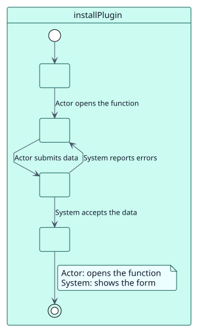
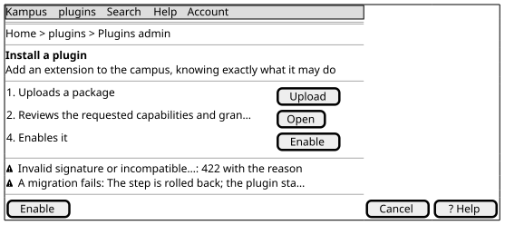

# UC-049 Install a plugin

| Overview | Requirements | Analysis | Design | Implementation | Tests |
| --- | --- | --- | --- | --- | --- |
| [Use cases](../../../01-requirements/use-case-overview.svg) | **Requirements** | [Analysis](../../../02-analysis/use-cases/installPlugin/README.md) | [Design](../../../03-design/use-cases/installPlugin/README.md) | [Implementation](../../../04-implementation/use-cases/installPlugin/README.md) | [Tests](../../../04-implementation/use-cases/installPlugin/README.md#tests) |

## Use-case information

| Field | Value |
| --- | --- |
| Actor | Campus administrator (with `plugins.manage`) |
| Package | plugins |
| Goal | Add an extension to the campus, knowing exactly what it may do |
| Type | Primary, real |
| Level | User goal |
| Requirement | RF-100 |
| Domain entities | Plugin, Plugin version, Capability grant, Installation |

## Context

Plugins are signed WebAssembly packages with a manifest; they run only after their capabilities are granted.

## Preconditions

- The actor holds `plugins.manage`.

## Postconditions

- Success: the plugin is installed and enabled with its contributions live; `plugins.installed` and `plugins.enabled` are published.
- Failure: nothing is installed; the reason is shown.

## Main flow

| Step | Actor | System |
| --- | --- | --- |
| 1 | Uploads a package | Verifies signature, digest and SDK range; validates the manifest (RN-203, RN-204) |
| 2 | Reviews the requested capabilities and grants them | Records the grants (RN-205) |
| 3 | — | Applies the migrations, one transaction per step (RN-207) |
| 4 | Enables it | Registers its contributions; routes, listeners, jobs and UI modules become live |

## Alternative flows

| ID | Starts at step | Condition | Behaviour | Ends |
| --- | --- | --- | --- | --- |
| A1 | 1 | Invalid signature or incompatible SDK | `422` with the reason | Failure |
| A2 | 3 | A migration fails | The step is rolled back; the plugin stays not installed | Failure |

## Business rules

| ID | Rule |
| --- | --- |
| RN-203 | Verified packages |
| RN-204 | Declarative manifest |
| RN-205 | Granted capabilities |
| RN-206 | Own tables only |
| RN-207 | Migrations |

## Specification

Behaviour source of truth: [specification.puml](./specification.puml)

## Wireframes

## Pending

| Question | Blocks |
| --- | --- |
| None | — |
