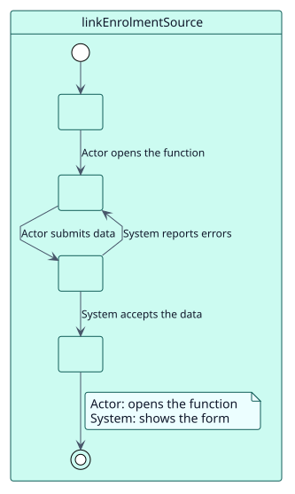
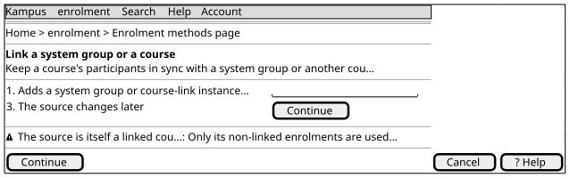

# UC-019 Link a system group or a course

| Overview | Requirements | Analysis | Design | Implementation | Tests |
| --- | --- | --- | --- | --- | --- |
| [Use cases](../../../01-requirements/use-case-overview.svg) | **Requirements** | [Analysis](../../../02-analysis/use-cases/linkEnrolmentSource/README.md) | [Design](../../../03-design/use-cases/linkEnrolmentSource/README.md) | [Implementation](../../../04-implementation/use-cases/linkEnrolmentSource/README.md) | [Tests](../../../04-implementation/use-cases/linkEnrolmentSource/README.md#tests) |

## Use-case information

| Field | Value |
| --- | --- |
| Actor | Manager (with `enrol.instance.manage` in the course) |
| Package | enrolment |
| Goal | Keep a course's participants in sync with a system group or another course |
| Type | Primary, real |
| Level | User goal |
| Requirement | RF-040 |
| Domain entities | Method instance, Linked source, Enrolment |

## Context

Programmes and departments are system groups; companion courses share participants. Linked instances derive their enrolments and keep them in sync, without chains.

## Preconditions

- The actor holds `enrol.instance.manage`; the source exists and the actor may see it.

## Postconditions

- Success: the instance is linked and a sync job aligned its enrolments with the source.
- Failure: no link (for example a cycle).

## Main flow

| Step | Actor | System |
| --- | --- | --- |
| 1 | Adds a system group or course-link instance and chooses the source | Refuses a link that would create a cycle (RN-067) |
| 2 | — | Queues the sync job, which adds and removes exactly the enrolments of this instance |
| 3 | The source changes later | Its events trigger the sync of the linked instances |

## Alternative flows

| ID | Starts at step | Condition | Behaviour | Ends |
| --- | --- | --- | --- | --- |
| A1 | 1 | The source is itself a linked course | Only its non-linked enrolments are used (no chains) | Success |

## Business rules

| ID | Rule |
| --- | --- |
| RN-067 | Derived enrolments, no chains, no cycles |
| RN-073 | Bulk changes as jobs |

## Specification

Behaviour source of truth: [specification.puml](./specification.puml)

## Wireframes

## Pending

| Question | Blocks |
| --- | --- |
| None | — |
