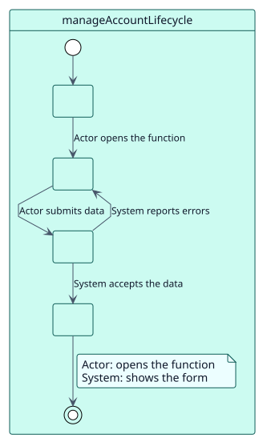

# UC-009 Manage the lifecycle of accounts

| Overview | Requirements | Analysis | Design | Implementation | Tests |
| --- | --- | --- | --- | --- | --- |
| [Use cases](../../../01-requirements/use-case-overview.svg) | **Requirements** | [Analysis](../../../02-analysis/use-cases/manageAccountLifecycle/README.md) | [Design](../../../03-design/use-cases/manageAccountLifecycle/README.md) | [Implementation](../../../04-implementation/use-cases/manageAccountLifecycle/README.md) | [Tests](../../../04-implementation/use-cases/manageAccountLifecycle/README.md#tests) |

## Use-case information

| Field | Value |
| --- | --- |
| Actor | Manager or campus administrator (one permission per transition) |
| Package | identity |
| Goal | Invite, suspend, reactivate and delete accounts, one by one or in bulk |
| Type | Primary, real |
| Level | User goal |
| Requirement | RF-013 |
| Domain entities | Account, Account status, Account transition, Session, API token |

## Context

Accounts move through a small state machine. Suspension and deletion revoke every session and token at once; deletion keeps a tombstone so records stay consistent.

## Preconditions

- The actor holds the permission of the transition in the campus (RN-023).

## Postconditions

- Success: the account is in its new status with the reason recorded; sessions and tokens are revoked when needed; one event is published.
- Failure: no change.

## Main flow

| Step | Actor | System |
| --- | --- | --- |
| 1 | Invites people, or selects accounts and a transition with a reason | Validates the transition from the current status |
| 2 | — | Applies it with If-Match, records it, publishes its event; suspension revokes sessions and tokens (RN-031) |
| 3 | Schedules a deletion | Suspends now and deletes after the grace period, unless cancelled (RN-035) |

## Alternative flows

| ID | Starts at step | Condition | Behaviour | Ends |
| --- | --- | --- | --- | --- |
| A1 | 1 | A file of many rows | A job validates every row, then applies them and reports per row (RN-038) | Success |
| A2 | 3 | The grace period ends | Privacy handlers erase personal data; the row becomes a tombstone (RN-034) | Success |

## Business rules

| ID | Rule |
| --- | --- |
| RN-023 | Lifecycle state machine |
| RN-031 | Central revocation |
| RN-034 | Erasure and tombstone |
| RN-035 | Grace period |
| RN-038 | Bulk operations |

## Specification

Behaviour source of truth: [specification.puml](./specification.puml)

## Wireframes

## Pending

| Question | Blocks |
| --- | --- |
| None | — |
