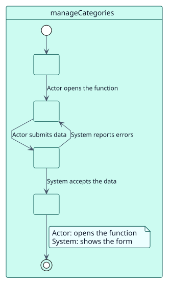

# UC-011 Manage course categories

| Overview | Requirements | Analysis | Design | Implementation | Tests |
| --- | --- | --- | --- | --- | --- |
| [Use cases](../../../01-requirements/use-case-overview.svg) | **Requirements** | [Analysis](../../../02-analysis/use-cases/manageCategories/README.md) | [Design](../../../03-design/use-cases/manageCategories/README.md) | [Implementation](../../../04-implementation/use-cases/manageCategories/README.md) | [Tests](../../../04-implementation/use-cases/manageCategories/README.md#tests) |

## Use-case information

| Field | Value |
| --- | --- |
| Actor | Manager (with `courses.category.manage` in the parent category or the campus) |
| Package | courses |
| Goal | Organise the catalogue: create, rename, move, reorder, hide and delete categories |
| Type | Primary, real |
| Level | User goal |
| Requirement | RF-030 |
| Domain entities | Course category, Visibility, Scope |

## Context

The catalogue is a tree of categories. Hiding one hides everything below for learners without rewriting it, and showing it again restores exactly what each node had.

## Preconditions

- The actor holds `courses.category.manage` where the change happens.

## Postconditions

- Success: the tree reflects the change; one event is published.
- Failure: no change.

## Main flow

| Step | Actor | System |
| --- | --- | --- |
| 1 | Creates a category under a parent | Checks the code is unique in the campus (RN-041); creates its scope |
| 2 | Drags it between two siblings or under another parent | Writes only its sort key and parent; updates the scope closure in one transaction (RN-046) |
| 3 | Hides it, or schedules its visibility | Writes only its own visibility (RN-043) |

## Alternative flows

| ID | Starts at step | Condition | Behaviour | Ends |
| --- | --- | --- | --- | --- |
| A1 | 1 | The actor deletes a category with content | `conflict`: move or delete its courses and subcategories first | Failure |
| A2 | 2 | The move would create a cycle | Refused | Failure |

## Business rules

| ID | Rule |
| --- | --- |
| RN-040 | Tree of categories, courses and sections |
| RN-041 | Unique codes |
| RN-043 | Visibility never copied down |
| RN-046 | Order local to each category |

## Specification

Behaviour source of truth: [specification.puml](./specification.puml)

## Wireframes

## Pending

| Question | Blocks |
| --- | --- |
| None | — |
